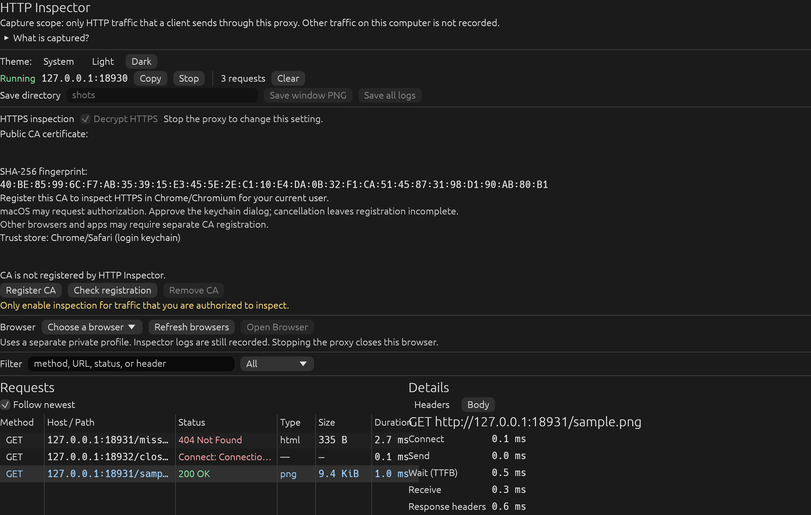

# HTTP Inspector

HTTP Inspector는 로컬 HTTP 프록시를 거치는 요청과 응답을 기록하는 Linux와 macOS 데스크톱 앱이다. HTTPS 복호화를 켜면 URL, 헤더와 본문도 확인할 수 있다.



## 주요 기능

- **요청 검사.** HTTP/1.1 요청을 스트리밍으로 전달하면서 URL, 헤더, 본문과 응답 시간을 기록한다. 목록 검색은 압축을 푼 텍스트 본문의 앞 8KiB까지 찾는다. [요청 검색](docs/guide/search.md) · [본문 보기](docs/guide/body-view.md)
- **HTTPS 복호화.** 기본값은 `CONNECT` 터널이다. 복호화를 켜면 Firefox, Chrome 또는 Chromium 검사 창이나 로컬 CA를 신뢰하는 다른 클라이언트의 HTTP/1.1 요청을 읽는다. 앱은 업스트림 서버 인증서와 호스트 이름을 검증한다. [HTTPS 복호화와 검사 브라우저](docs/guide/https.md)
- **요청 재현.** 기록한 요청을 수정해 다시 보내고 원본과 비교하거나, 셸에서 실행할 `curl` 명령으로 복사한다. [요청 재전송](docs/guide/resend.md) · [cURL 명령으로 복사](docs/guide/copy-as-curl.md)
- **URL 맵.** **Map**에서 호스트와 경로별로 요청을 묶는다. 메서드별 요청·응답 구조와 도메인 간 호출 관계를 확인하고 텍스트, JSON, Mermaid 또는 Graphviz DOT로 저장한다. [URL 맵과 관계 그래프](docs/guide/url-map.md)
- **저장.** 앱 창은 PNG로, 세션 전체 로그는 텍스트로, 목록 기록은 HAR 1.2로 저장한다. 본문은 개별 또는 일괄 저장할 수 있고, 같은 파일의 `206 Partial Content` 응답은 위치 순서로 합칠 수 있다. [로그와 본문 저장](docs/guide/logs.md) · [HAR 내보내기](docs/guide/har.md)

## 설치

### 배포 파일로 실행

공개 버전이 있으면 [GitHub Releases](https://github.com/leedonggyu1848/http_proxy/releases)에서 대상에 맞는 `.tar.gz`와 대응하는 `.tar.gz.sha256` 파일을 받는다. 개발 빌드는 [CI 실행 목록](https://github.com/leedonggyu1848/http_proxy/actions/workflows/ci.yml)의 성공한 실행에서 **Artifacts**를 받는다(GitHub 로그인 필요, 보관 기간 14일). PR 실행에서는 Linux 파일을 받을 수 있다. 세 대상의 파일은 `main` 푸시나 일정·수동 실행의 결과에서 찾는다. CI artifact ZIP을 먼저 풀면 같은 두 파일이 나온다.

| 대상 | 파일 이름의 대상 식별자 | 빌드·실행 검증 환경 |
| --- | --- | --- |
| Linux x86_64 | `x86_64-unknown-linux-gnu` | Ubuntu 24.04, X11 |
| macOS Apple Silicon | `aarch64-apple-darwin` | macOS 15 arm64 |
| macOS Intel | `x86_64-apple-darwin` | macOS 15 x86_64 |

파일 이름은 `http-proxy-v버전-대상.tar.gz`이며 개발 빌드에는 버전 뒤에 전체 커밋 ID가 붙는다. Linux는 glibc 2.39 이상인 Ubuntu 24.04 환경을 기준으로 제공한다. 다른 배포판과 이전 macOS의 실행은 보장하지 않는다. Linux에는 X11 디스플레이와 다음 런타임 라이브러리가 필요하다.

```bash
sudo apt-get install --yes libgl1 libegl1 libx11-6 libxkbcommon0 libxkbcommon-x11-0 libxcursor1 libxi6 libxrandr2 libnss3-tools
```

다운로드한 폴더에서 체크섬을 확인하고 압축을 푼다. 아래 파일 이름은 실제 받은 이름으로 바꾼다.

```bash
# Linux
sha256sum --check http-proxy-v0.1.0-x86_64-unknown-linux-gnu.tar.gz.sha256
tar -xzf http-proxy-v0.1.0-x86_64-unknown-linux-gnu.tar.gz
./http-proxy-v0.1.0-x86_64-unknown-linux-gnu/http-proxy
```

macOS에서는 `sha256sum --check` 대신 `shasum -a 256 --check`를 쓰고 해당 아키텍처 파일을 같은 방법으로 푼다. macOS 바이너리는 서명·공증하지 않는다. 실행이 차단되면 출처와 체크섬을 확인한 파일에 한해 **시스템 설정 → 개인정보 보호 및 보안 → 확인 없이 열기**로 승인한다. 이 항목을 사용할 수 없으면 압축을 푼 실행 파일 하나의 격리 속성만 제거한 뒤 터미널에서 실행한다.

```bash
xattr -d com.apple.quarantine ./http-proxy-v0.1.0-aarch64-apple-darwin/http-proxy
./http-proxy-v0.1.0-aarch64-apple-darwin/http-proxy
```

체크섬은 다운로드 손상을 확인하며 서명이나 배포자의 신원 검증을 대신하지 않는다. 배포 압축에는 실행 파일, README, 코드·폰트 라이선스와 빌드 정보만 포함한다. CA 개인키·설정·트래픽은 포함하지 않는다. CI는 artifact를 다시 내려받아 체크섬과 실행 권한을 확인하고, GUI 프로세스가 실행된 상태에서 로컬 HTTP 요청을 전달한다. Gatekeeper 승인, 실제 사용자 화면 조작과 브라우저 CA 등록은 이 자동 검사 범위에 포함되지 않는다.

### 소스에서 빌드

먼저 [rustup](https://rustup.rs/)을 설치한다. `rustup`은 저장소의 `rust-toolchain.toml`에 지정된 Rust 툴체인(1.100.0)을 설치한다.

| | Linux | macOS |
| --- | --- | --- |
| 지원 환경 | X11 (Wayland 미지원) | Apple Silicon, Intel |
| 필수 패키지 | 아래 `apt-get` 명령 | 없음 |
| HTTPS CA 등록 도구 | `libnss3-tools`(NSS `certutil`, 필수 패키지에 포함) | Firefox 검사 창에만 `brew install nss` |
| 한자·가나 표시 | 선택: `fonts-noto-cjk` | 시스템의 Apple SD Gothic Neo 사용 |

한글은 앱에 내장한 폰트로 표시하므로 폰트 패키지가 필요하지 않다.

**Linux (Ubuntu 계열)**

```bash
sudo apt-get update
sudo apt-get install --yes \
	libgl1-mesa-dev \
	libx11-dev \
	libxkbcommon-dev \
	libxkbcommon-x11-dev \
	libxcursor-dev \
	libxi-dev \
	libxrandr-dev \
	libnss3-tools \
	pkg-config
# 선택: 한자·가나 표시
sudo apt-get install --yes fonts-noto-cjk
```

Fedora에서는 NSS 도구를 `sudo dnf install nss-tools`로 설치한다.

**macOS**

```bash
# 선택: Firefox 검사 창에서 HTTPS를 복호화할 때만 필요
brew install nss
```

## 빠른 시작

1. 배포 파일의 `http-proxy`를 실행한다. 소스에서 빌드하려면 저장소 루트에서 다음 명령을 실행한다.

   ```bash
   cargo run --release
   ```

2. 앱을 실행하면 프록시가 시작된다. 툴바에 `● Running`과 `127.0.0.1:8080`이 표시되면 요청을 받을 수 있다. 멈춰 있으면 **Start**를 누른다.
3. 툴바의 **Open Browser** 메뉴에서 설치된 Firefox, Chrome 또는 Chromium을 선택한다. 프록시가 설정된 검사 전용 비공개 창이 열린다.
4. 열린 창에서 확인할 사이트에 접속한다. 요청이 앱의 목록에 나타나며, 행을 선택하면 **Headers**와 **Body** 탭에서 상세를 본다.

명령줄 프로그램은 프록시 주소를 직접 지정한다. 툴바의 `Copy` 메뉴로 프록시 URL, `curl` 예시, 프록시 환경 변수 설정 예시를 복사할 수 있다.

```bash
curl --proxy http://127.0.0.1:8080 http://example.com/
http_proxy=http://127.0.0.1:8080 https_proxy=http://127.0.0.1:8080 curl http://example.com/
```

HTTPS 복호화를 끈 상태에서는 호스트, 포트, 전송 바이트 수와 연결 시간을 `Tunnel` 행에 기록한다. [프록시 포트와 캡처 범위](docs/guide/proxy-and-capture.md)

## HTTPS 복호화

HTTPS 복호화는 기본으로 꺼져 있으며, 사용 권한이 있는 트래픽에만 사용한다.

1. 실행 중인 프록시에서 **Stop**을 누른다.
2. **Decrypt HTTPS**를 선택한다. 처음 켜면 경고를 한 번 표시하고, 툴바에 CA 상태가 나타난다.
3. **Start**를 누른다.
4. **Open Browser** 메뉴에서 브라우저를 누른다. 앱이 공개 CA를 자동으로 등록한 뒤 검사 창을 연다.

검사 창 대신 기존 Chrome·Chromium을 직접 프록시에 연결하려면 툴바의 **Register CA**를 누른다. Linux는 현재 사용자의 NSS 저장소에, macOS는 로그인 키체인에 공개 CA를 등록한다(macOS는 인증 창에서 승인한다).

- **확인:** CA 상태가 `● Trusted`(초록)로 바뀌는지 본다. **CA details** 메뉴에서 `root-ca.pem` 경로와 SHA-256 지문을 확인하고 **Check registration**으로 다시 검사한다.
- **제거:** 툴바 또는 **CA details** 메뉴의 **Remove CA**를 누른다. Chrome·Chromium 등록은 검사 창을 닫아도 유지되며 개인 브라우저에도 적용되므로, 필요 없으면 제거한다. 등록 상태를 바꾼 뒤에는 브라우저를 다시 시작한다.

> **보안 주의**
>
> - 신뢰 저장소에는 공개 인증서 `root-ca.pem`만 등록한다. 같은 폴더의 `ca-identity.pem`에는 CA 개인키가 있으므로 열거나 복사하거나 공유하지 않는다.
> - 앱을 삭제해도 등록한 CA는 남는다. 삭제 전에 **Remove CA**로 제거한다. 수동으로 등록한 항목은 브라우저 설정에서 직접 제거한다.
> - `Authorization`, `Proxy-Authorization`, `Cookie`, `Set-Cookie` 헤더 값은 기록 전에 `[REDACTED]`로 바뀌어 화면과 로그에 남지 않는다. URL, 다른 헤더와 본문은 가리지 않으므로 저장한 로그를 공유할 때 주의한다.

CA 상태 표시의 의미, OS별 CA 저장 위치, 직접 실행한 Chrome 설정은 [HTTPS 복호화와 검사 브라우저](docs/guide/https.md)를 참고한다.

## 기록과 저장 한도

| 기록 | 범위와 한도 |
| --- | --- |
| 요청 목록 | 최대 2,000건. 일반 본문 미리보기는 요청과 응답 각각 최대 8KiB이며, 지원하는 이미지 응답은 조건에 따라 최대 8MiB를 보관한다. |
| HAR | 목록에 남은 기록 전체 또는 현재 필터에 맞는 기록. 본문을 포함하면 메모리 미리보기를 쓰며, 가린 헤더는 이름과 `[REDACTED]`만 선택해서 넣을 수 있다. |
| 전체 로그 | 앱 세션 전체. 본문 바이트는 세션당 512MiB까지 기록한다. |
| 본문 저장소 | 파일로 저장할 본문을 별도 보관한다. 세션당 기본 2GiB이며 **Settings**의 **Body store limit**에서 바꿀 수 있다. |

필요한 로그와 본문은 앱을 종료하기 전에 저장한다. **Clear**를 누르면 요청 목록과 URL 맵을 비운다. 전체 로그와 본문 저장소는 세션 종료까지 유지한다. [로그와 본문 저장](docs/guide/logs.md)

## 제한 사항

다음 트래픽은 기록되지 않는다. 툴바의 **?** 버튼에서도 같은 안내를 볼 수 있다.

- 프록시 설정을 무시하거나 직접 연결하는 프로그램의 통신
- `NO_PROXY`나 프록시 우회 목록에 포함된 호스트(흔히 `localhost` 포함)
- UDP를 사용하는 HTTP/3(QUIC). **Open Browser**로 연 검사 브라우저는 QUIC을 끈다.
- 이 프록시를 거치지 않고 VPN이나 다른 프록시로 직접 보낸 통신

현재 버전은 다음 기능을 제공하지 않는다.

- 시스템 전체 CA 등록과 기존 Firefox 개인 프로필의 인증서 저장소 변경
- Windows 지원, Wayland 지원
- HTTP/2와 HTTP/3, WebSocket 프레임 분석
- 시스템 프록시 자동 변경
- 종료한 앱의 세션 복원과 SQLite 저장소
- macOS 앱 서명, 공증과 `.dmg` 배포

## 문서

화면 조작과 기능별 사용 절차는 [사용자 가이드](docs/guide/README.md)에 있다. 개발 환경, 검증 명령, CI와 코드 구조는 [개발 문서](docs/development.md)에서 확인할 수 있다.

배포 파일에서 이 README를 열었다면 [GitHub의 문서](https://github.com/leedonggyu1848/http_proxy/tree/main/docs)를 참고한다.

## 라이선스

이 프로젝트의 코드는 [MIT License](LICENSE)를 따른다.

앱에 내장한 한글 폰트 `assets/fonts/NotoSansKR-Regular-subset.otf`는 Noto Sans KR의 서브셋이며 코드와 별개로 [SIL Open Font License 1.1](assets/fonts/OFL.txt)을 따른다. 출처와 재생성 방법은 [assets/fonts/README.md](assets/fonts/README.md)에 있다.
