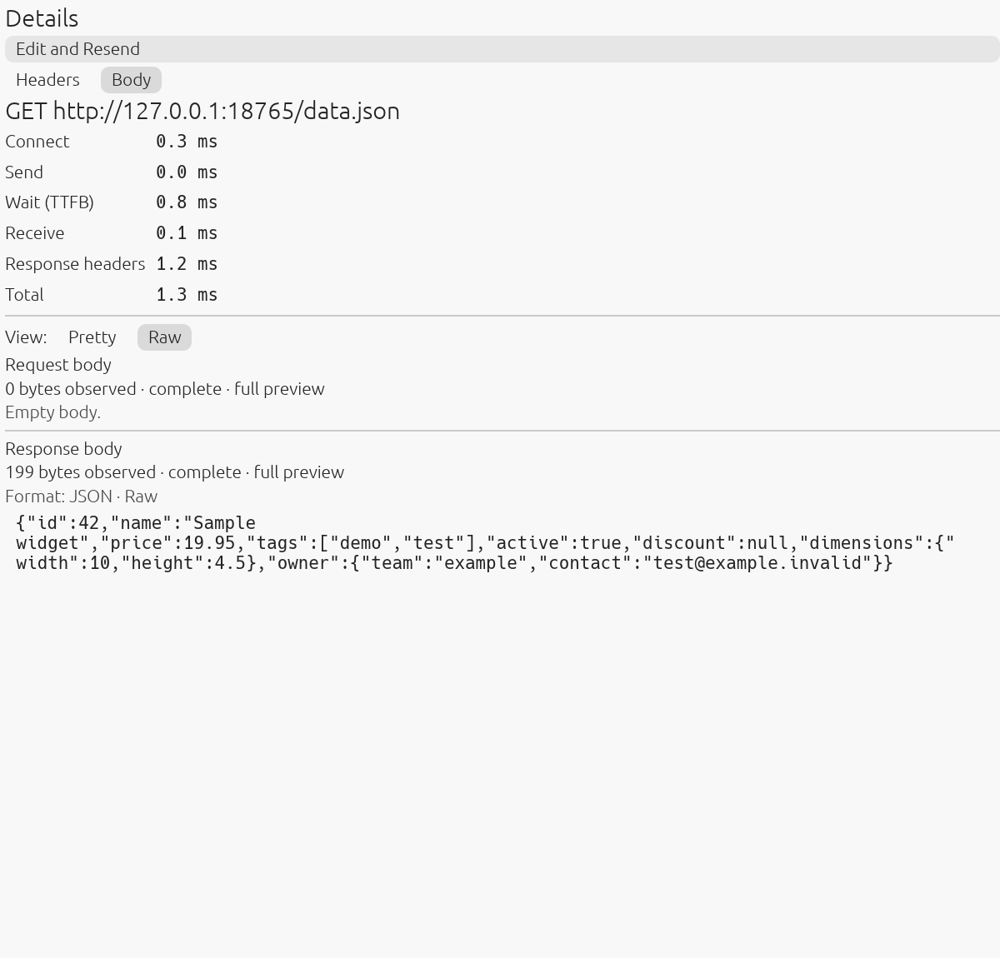
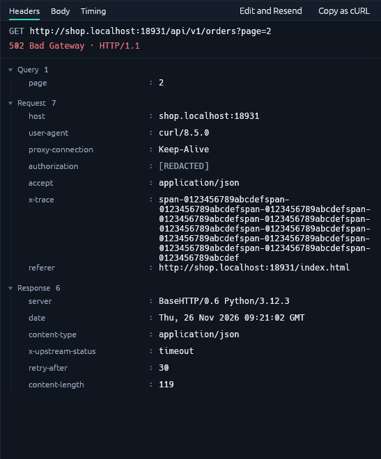
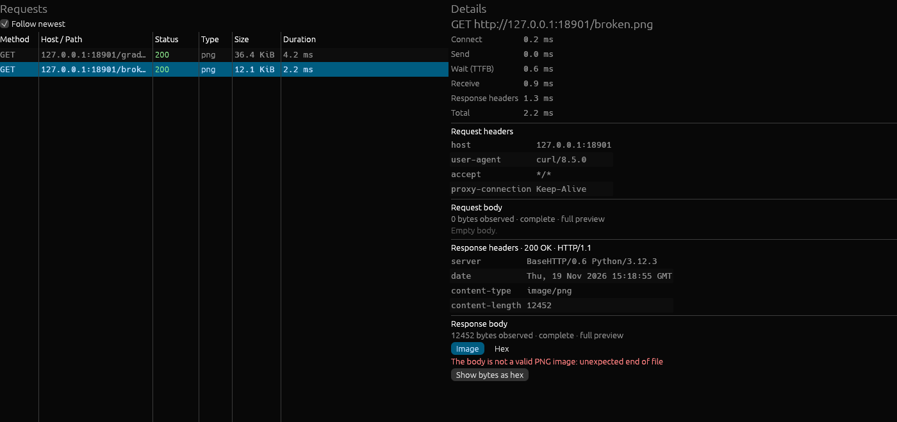

# HTTP Inspector

HTTP Inspector는 로컬 HTTP 프록시를 통해 요청 기록을 보여주는 Linux와 macOS 데스크톱 앱이다. UI와 프록시 엔진은 모두 Rust로 작성했다.

## MVP 기능

현재 버전은 다음 기능을 제공한다.

- 루프백 주소의 HTTP 프록시(기본 포트 `8080`, 변경 가능)
- HTTP/1.1 요청과 응답 스트리밍
- HTTPS `CONNECT` TCP 터널
- 사용자가 켤 수 있는 HTTPS 복호화
- 설치별 로컬 CA 생성과 제한된 개인키 저장
- 버튼으로 현재 사용자의 Chrome·Chromium CA 등록, 상태 확인, 제거
- 설치된 Firefox·Chrome·Chromium 선택과 프록시가 설정된 비공개 검사 창 실행
- 실제 HTTPS 서버 인증서와 호스트 이름 검증
- 메서드, 대상, 결과, 응답 헤더 도착 시간 표시
- 요청과 응답 헤더 상세 보기
- 방향별 최대 8KiB의 실시간 본문 미리보기
- JSON·form·HTML·XML·JavaScript 본문의 Pretty/Raw 보기와 구문 강조, XML 트리 보기, 헤더·쿼리 매개변수 강조
- `Content-Type: image/png` 또는 `image/jpeg` 응답 본문의 이미지 미리보기와 16진수 보기
- 문자열 검색과 응답, 실패, 터널 결과 필터
- 선택한 요청의 Headers와 Body 상세 패널
- 프록시 시작, 중지, 기록 삭제
- 최대 2,000개의 메모리 기록
- 기록 큐 초과 건수 표시
- 프로그램 창 내부 전체를 PNG로 저장
- 화면 필터와 보관 한도에 관계없이 세션 전체 로그와 본문 저장(세션당 본문 512MiB)
- 캡처 범위와 기록되지 않는 트래픽 안내

## 제외 범위

현재 버전은 다음 기능을 제공하지 않는다.

- 시스템 전체 CA 등록과 기존 Firefox 개인 프로필의 인증서 저장소 변경
- Windows 지원
- 종료한 앱의 세션 복원과 SQLite 저장소
- 시스템 프록시 자동 변경
- HTTP/2와 HTTP/3
- WebSocket 프레임 분석
- Wayland 지원

HTTPS 복호화는 기본으로 꺼져 있다. 이 상태에서 앱은 `CONNECT` 터널 안의 URL, 헤더와 본문을 읽지 않는다. 사용자가 복호화를 켜면 앱은 HTTP/1.1 HTTPS 요청을 기존 상세 패널에 표시한다.

본문 미리보기는 메모리에 유지하며 화면 기록을 삭제하거나 앱을 종료하면 사라진다. 전체 로그는 앱이 실행되는 동안 별도의 임시 파일에 기록한다. `Authorization`, `Proxy-Authorization`, `Cookie`, `Set-Cookie` 헤더의 원본 값은 저장 전에 `[REDACTED]`로 바꾸므로 메모리, 임시 로그, 저장한 로그 어디에도 남지 않는다. 큰 본문은 전체를 계속 전달하며 화면 미리보기만 8KiB에서 자른다.

요청·응답 본문의 `Content-Encoding`이 `gzip`, `deflate`, `br`, `zstd`이면 화면 미리보기에서 압축을 푼다. 압축 해제한 출력도 최대 8KiB로 제한하며, 캡처한 압축 데이터가 일부뿐이면 표시 가능한 앞부분과 불완전 상태를 보여 준다. 지원하지 않는 형식이나 손상된 압축 데이터에는 오류를 표시한다. 과도한 중첩 압축과 중간 데이터 확장은 미리보기를 거부한다. 프록시 전달과 전체 로그에는 압축된 원본 바이트를 유지한다.

한글(현대 한글 11,172자)과 ASCII는 앱 바이너리에 내장한 Noto Sans KR 서브셋으로 표시하므로 OS나 폰트 설치 여부와 관계없이 보인다. 내장 폰트에 없는 한자·가나는 시스템에 Nanum 또는 Noto CJK 폰트가 있으면 그 폰트로 보완한다. Ubuntu에서 한자·가나가 네모로 보이면 `sudo apt install fonts-noto-cjk`로 폰트를 설치하고 앱을 다시 실행한다. 시스템 폰트 파일이 손상됐거나 TTF/OTF/TTC 형식이 아니면 등록하지 않고 경고 로그를 남긴 뒤 내장 폰트만 사용한다. `RUST_LOG=http_proxy::ui::fonts=debug cargo run`으로 실행하면 어떤 폰트를 등록했는지 확인할 수 있다.

다음은 Brotli로 압축한 테스트 JSON의 한글 본문을 미리보기에서 표시한 실제 화면이다.


다음은 Chrome으로 접속한 HTTPS 응답의 `Content-Encoding: br` 헤더와 압축을 푼 HTML 본문이다.


### 본문 정리와 구문 강조

**Body** 탭 위쪽의 **View: Pretty / Raw / Tree**로 본문 보기 방식을 고른다. 기본값은 Pretty이며, 고른 방식은 다른 요청을 선택해도 유지된다. `Content-Type`으로 형식을 판별해 본문 위에 `Format: JSON · Pretty`처럼 표시한다.

| 형식 | 판별하는 `Content-Type` | Pretty 보기 |
| --- | --- | --- |
| JSON | `application/json`, `*/*+json` | 2칸 들여쓰기, 키·문자열·숫자·`true`/`false`/`null`·괄호를 다른 색으로 표시 |
| Form | `application/x-www-form-urlencoded` | 키와 값을 퍼센트 디코딩해 한 줄에 `key = value` 하나씩 표시 |
| HTML | `text/html`, `application/xhtml+xml` | 태그마다 줄을 나누고 들여쓰기, 태그·속성 이름·속성 값·주석을 구분. 공백이 의미를 갖는 `pre`·`textarea`와 `script`·`style`의 내용은 원문 그대로 |
| XML | `application/xml`, `text/xml`, `*/*+xml`(Atom·RSS·SOAP·SVG 소스 등) | 요소만 담은 내용을 2칸 들여쓰기. 태그·네임스페이스 접두사·속성 이름·속성 값·주석·`CDATA`·처리 명령·엔티티를 구분. 텍스트·`CDATA`·주석의 내용과 `xml:space="preserve"` 요소는 원문 그대로 |
| JavaScript | `text/javascript`, `application/javascript`, `application/x-javascript`, `application/ecmascript`, `text/ecmascript` | `{`·`;`·`,` 뒤와 `}` 앞에서 줄을 나누고 중괄호 깊이로 들여쓰기, 키워드·문자열·템플릿 리터럴·숫자·정규식·주석·연산자를 구분하고 줄 번호를 표시 |

- 미리보기는 8KiB에서 잘릴 수 있으므로 문법 분석 대신 토큰 단위로 정리한다. 잘린 문자열, 닫히지 않은 괄호·태그도 있는 데까지 정리해 보여 준다.
- 형식에 맞지 않는 글자가 있어 정리할 수 없으면(예: JSON으로 표시된 HTML 오류 페이지) 원문을 그대로 보여 주고 `Showing raw text: …` 안내에 이유와 위치를 적는다. 그 밖의 형식은 Pretty에서도 원문 그대로다.
- **Raw**는 압축만 푼 원문을 정리 없이 보여 준다.
- **Tree**는 XML에서만 쓸 수 있으며, 다른 형식은 Pretty로 보여 주고 그 사실을 안내한다.
- JavaScript는 줄 번호와 함께 보이는 줄만 그린다. Pretty는 정리한 줄, Raw는 원래 줄 기준으로 번호를 매기며 긴 줄은 접지 않고 가로로 스크롤한다. 모듈 스크립트(`.mjs`)와 JSONP 응답도 위 `Content-Type`으로 오면 같은 방식으로 보여 준다.
- JavaScript 정리는 토큰 사이의 공백만 바꾼다. 문자열, 템플릿 리터럴(`${…}` 포함), 정규식, 주석은 한 글자도 바꾸지 않고, 원문에 있던 줄바꿈은 유지하며(자동 세미콜론 삽입 의미 보존) 문법 의미를 바꾸지 않는 곳에만 줄바꿈을 더한다. `/`가 정규식인지 나눗셈인지는 앞 토큰과 괄호 종류(`if (…)` 뒤, 블록 `}` 뒤 등)로 판별하며, 줄바꿈으로 끊긴 문자열·정규식이나 짝이 맞지 않는 괄호처럼 추측이 필요한 입력은 정리하지 않고 원문을 보여 준다.
- 스크립트가 8KiB 미리보기에서 잘리면 읽은 부분까지 정리하고, 끝나지 않은 문자열·주석·블록 등이나 캡처가 일부뿐이라는 경고를 표시한다. `//# sourceMappingURL=` 주석이 있으면 URL을 안내하지만 소스맵 파일은 가져오지 않는다. 스크립트는 실행하지 않는다.
- 색은 글자 자체의 구분(키 뒤의 `:`, 따옴표, 꺾쇠괄호, 주석의 기울임)을 보조할 뿐이며, 밝은·어두운 테마의 모든 배경에서 4.5:1 이상 대비를 테스트로 확인한다.
- **Headers** 탭은 헤더 이름을 `name:` 형태의 다른 색으로, 값은 기본 색으로 표시한다. 요청 URL에 쿼리가 있으면 **Query parameters**에 퍼센트 디코딩한 키와 값을 나눠 보여 준다.
- 정리와 강조는 화면 표시에만 쓰며 프록시 전달 바이트와 전체 로그는 바꾸지 않는다. 강조 결과는 선택한 기록, 본문 길이, 보기 방식, 테마가 바뀔 때만 다시 계산한다.

### XML 보기

XML 본문은 [quick-xml](https://crates.io/crates/quick-xml)로 읽어 Pretty와 Tree가 같은 결과를 쓴다.

- **Pretty:** 요소만 담은 내용은 줄을 나누고 들여쓴다. 텍스트·엔티티·`CDATA`가 섞인 요소는 공백이 의미를 가질 수 있으므로 내용을 원문 그대로 한 덩어리로 둔다. 태그 안 속성 사이 공백만 한 칸으로 정리하고 속성 값은 바꾸지 않는다.
- **Tree:** 요소를 접고 펼칠 수 있다. 처음에는 두 단계까지 펼쳐 두고, 접힌 요소 옆에 `… 3 children`처럼 자식 수를 표시한다. `<title>News</title>`처럼 텍스트 하나만 가진 요소는 한 줄로 보여 준다. 요소를 오른쪽 클릭하면 `/rss/channel/item[2]/title` 같은 XPath를 보고 **Copy XPath**로 복사할 수 있다. 같은 이름의 형제가 여럿이면 1부터 세는 위치를 붙인다. 긴 줄은 200자에서 줄이고, 마우스를 올리면 전체를 보여 준다.
- 미리보기가 8KiB에서 잘렸거나 문법이 틀리면 읽은 데까지 보여 주고 `XML is incomplete (… at byte N); showing the part read so far.`처럼 이유와 위치를 안내한다. 나머지는 **Raw**에서 볼 수 있다.
- **보안:** DTD와 엔티티 정의를 해석하지 않는다. `&xxe;` 같은 외부 엔티티나 엔티티 확장 공격은 원문 표기 그대로 보여 줄 뿐 파일·네트워크를 읽거나 펼치지 않는다. 요소 중첩 256단계, 노드 10,000개를 넘으면 그 앞까지만 보여 주고 안내한다.
- `image/svg+xml`도 텍스트로 보여 줄 때는 같은 XML 보기를 쓴다.

다음은 로컬 테스트 서버의 minified JSON 응답을 Pretty와 Raw로 본 실제 화면이다.




다음은 어두운 테마에서 minified HTML 응답을 Pretty로 본 화면과, 쿼리 매개변수·헤더 강조를 보여 주는 **Headers** 탭이다.




### PNG·JPEG 응답 미리보기

`Content-Type`이 `image/png` 또는 `image/jpeg`인 응답은 **Body** 탭의 **Response body**에서 이미지로 그린다. 이미지를 그리려면 본문 전체가 필요하므로 PNG·JPEG 응답을 응답당 최대 8MiB까지 메모리에 보관한다. 모든 PNG·JPEG 응답이 함께 쓰는 보관 한도는 64MiB이며, 기록을 삭제하거나 오래된 기록이 밀려나면 그만큼 다시 쓸 수 있다. `Content-Length`가 8MiB를 넘는 PNG·JPEG 응답은 공용 한도를 쓰지 않고 다른 본문처럼 앞 8KiB만 보관한다. 한도를 넘은 응답은 이미지 대신 보관한 바이트 수와 한도를 안내한다.

- `Content-Encoding`이 있으면 텍스트 미리보기와 같은 방식으로 압축을 푼 뒤 디코딩한다.
- 이미지 크기(가로×세로)와 이미지 파일 바이트 수를 표시한다. 압축 전송이면 받은 바이트 수도 함께 표시한다.
- 가로·세로 8,192px 또는 16메가픽셀을 넘는 이미지는 헤더만 읽고 픽셀 메모리를 할당하기 전에 거부한다.
- 본문이 잘렸거나 손상되어 디코딩하지 못하면 오류를 표시한다. **Hex** 또는 **Show bytes as hex**로 받은 바이트의 앞 8KiB를 16진수로 확인할 수 있다.

JPEG는 Progressive, 그레이스케일, CMYK를 지원한다. EXIF 방향 정보는 적용하지 않으며 파일에 저장된 픽셀 방향으로 표시한다. PNG와 JPEG 모두 한 변 8,192px 또는 16메가픽셀을 넘으면 디코딩 전에 거부한다.

다음은 gzip으로 전송한 테스트 PNG 응답을 이미지로 표시한 실제 화면이다.


다음은 본문 앞 3분의 1만 보낸 테스트 PNG 응답의 디코딩 오류와 16진수 보기다.




## Linux 요구사항

프로젝트는 Rust 1.100.0과 X11을 사용한다. `rustup`은 `rust-toolchain.toml`에 지정된 툴체인을 설치한다.

Ubuntu 계열 배포판에서 개발에 필요한 패키지를 설치하려면 다음 명령을 사용한다. 한글은 내장 폰트로 표시하므로 폰트 패키지가 필요하지 않다.

```bash
sudo apt-get update
sudo apt-get install --yes \
	libgl1-mesa-dev \
	libx11-dev \
	libxkbcommon-dev \
	libxkbcommon-x11-dev \
	libxcursor-dev \
	libxi-dev \
	libxrandr-dev \
	libnss3-tools \
	pkg-config
```

한자·가나도 표시하려면 선택 항목으로 `fonts-noto-cjk`를 설치한다.

```bash
sudo apt-get install --yes fonts-noto-cjk
```

## 실행

저장소 루트에서 앱을 실행한다.

```bash
cargo run --release
```

UI에 `Running`과 `127.0.0.1:8080`이 표시되면 프록시가 요청을 받을 수 있다. 툴바의 `Copy` 메뉴는 프록시 URL, `curl` 예시, `HTTP_PROXY` 변수를 클립보드에 복사한다.

### 요청 목록 단축키

| 키 | 동작 |
| --- | --- |
| `↑`, `↓` | 이전 요청 또는 다음 요청을 선택합니다. |
| `Home`, `End` | 첫 요청 또는 마지막 요청을 선택합니다. |
| `PageUp`, `PageDown` | 목록에서 한 화면 위 또는 아래의 요청을 선택합니다. |
| `F6`, `Ctrl+PageDown` | 선택한 요청의 다음 상세 탭(**Headers** ↔ **Body**)으로 전환합니다. |
| `Ctrl+PageUp` | 선택한 요청의 이전 상세 탭으로 전환합니다. |
| `Tab`, `Shift+Tab` | 요청 행, 상세 탭과 다른 컨트롤 사이에서 포커스를 옮깁니다. |
| `Enter`, `Space` | 포커스가 있는 요청 행 또는 상세 탭을 선택합니다. |

목록 단축키는 현재 정렬과 필터를 따릅니다. 검색창, 포트 입력란 또는 저장 경로 입력란에 포커스가 있으면 단축키를 처리하지 않습니다. `Esc`로 입력란의 포커스를 해제하면 다시 단축키를 사용할 수 있습니다. 키보드로 다른 요청을 선택하면 **Follow newest**가 꺼지고 선택한 행이 보이도록 목록이 스크롤됩니다.

### 화면 테마

상단의 **Theme: System / Light / Dark**에서 테마를 고른다. 기본값은 **System**이며, 감지 가능한 환경에서는 실행 중 시스템 외관 변경도 반영한다. 감지에 실패하면 Dark를 사용하고 화면에 안내한다. Tab으로 선택 항목에 이동한 뒤 Space로 바꿀 수 있다.

선택은 즉시 적용되며 포트 설정과 같은 디렉터리의 `theme` 파일에 저장된다.

- Linux: `$XDG_CONFIG_HOME/http-inspector/theme`. `XDG_CONFIG_HOME`이 없으면 `~/.config/http-inspector/theme`를 사용한다.
- macOS: `~/Library/Application Support/http-inspector/theme`.

설정 파일이 없거나 값이 잘못되면 System으로 시작한다.

### 화면 읽기 프로그램

AccessKit을 활성화해 요청 행과 기본 egui 컨트롤의 이름, 역할, 선택 상태를 접근성 트리에 제공합니다. Linux에서는 AT-SPI를 사용합니다. 요청 행은 메서드, 전체 URL, 상태와 상태 분류를 함께 읽도록 이름을 제공합니다(예: `GET http://… · 404 Not Found (client error)`). 상세 패널의 **Headers**와 **Body**는 `Request details` 탭 목록 안의 탭 역할과 선택 상태로 제공합니다.

상태는 색에만 의존하지 않습니다. HTTP 응답은 숫자와 이유 문구(예: `200 OK`, `404 Not Found`)를 표시하고, 상태 칸에 마우스를 올리거나 상세 패널의 응답 헤더 제목에서 `success`, `redirect`, `client error`, `server error` 같은 분류를 글자로 확인할 수 있습니다. 실패, 취소, 터널 상태도 글자로 표시합니다.

키보드 탐색은 위의 단축키 표를 따릅니다.

Linux에서 Orca를 실행한 뒤 테스트 요청을 보내고 요청 선택, 상태 읽기, **Headers**와 **Body** 전환을 점검하세요. 목록은 화면에 보이는 행만 접근성 트리에 제공하므로 화면 밖 요청은 목록 단축키로 이동하세요.

### 요청을 수정해 다시 보내기

요청 목록의 우클릭 메뉴나 상세 패널에서 **Edit and Resend**를 누른다.
메서드, URL, 헤더와 본문을 수정하고 **Send**를 누르면 새 요청이 기록된다.
목록의 **Replay of #N**과 상세 패널의 링크로 원본을 찾을 수 있다.
**Compare with original**을 켜면 가장 최근 재전송과 원본의 요청, 응답 상태,
헤더, 본문 미리보기와 시간을 나란히 볼 수 있다. 다른 줄은 노란색으로 표시한다.
편집기는 전송 후에도 유지되며 **Cancel**로 진행 중인 전송을 중단할 수 있다.

쿼리 표에는 URL 인코딩한 키와 값을 입력한다. 쿠키 표는 Cookie 헤더와
동기화되며 쿠키 값은 가려서 표시한다. 쿼리·쿠키·form 표의 행을 끄면 전송에서
빠지지만 표에 남아 다시 켤 수 있다. 표를 열기만 해서는 값이 바뀌지 않으며,
수정하지 않은 행은 원문(예: 값이 없는 `flag`) 그대로 유지한다. **Update Host from URL**은 URL에 맞춰 Host를 바꾼다.
Content-Length는 본문 바이트 수로 계산하며 hop-by-hop 헤더는 전달하지 않는다.
GET, HEAD, OPTIONS 외의 메서드는 서버 상태를 바꿀 수 있다는 확인을 받아 전송한다.

가려진 민감 헤더는 빈 입력칸으로 열린다. 값을 직접 입력하거나 행을 끈다.
입력한 민감 헤더도 화면 기록과 전체 로그에는 [REDACTED]로 남는다.
원래 민감 값을 따로 보관하는 옵션은 제공하지 않는다. 편집기를 닫으면 초안을
해제하고 진행 중인 재전송을 취소한다. 메모리의 물리적 덮어쓰기를 보장하지는 않는다.

잘렸거나 끝나지 않은 본문은 **Load complete body file**로 전체 본문을 불러와야
전송할 수 있다. 바이너리 본문도 파일로 교체한다. 헤더가 생략된 기록은 재전송할 수 없다.
불러올 수 있는 파일은 16MiB까지다. 256KiB를 넘는 본문은 편집기에 넣지 않고 크기와 파일 경로만
표시하며 불러온 그대로 전송한다.
캡처 시 UTF-8이 아닌 바이트가 있어 원래 값을 재현할 수 없는 헤더는 경고와 함께
전송을 막는다. 값을 다시 입력하거나 행을 끈다.
CONNECT 터널은 대상에서 제외한다. HTTPS 재전송에는 HTTPS inspection을 켜야 한다.
본문 비교는 캡처한 미리보기 범위이며 압축 본문의 비교는 원시 바이트를 표시한다.

다음은 로컬 테스트 서버로 보낸 요청의 헤더와 쿠키를 수정해 재전송한 실제 화면이다.
비교 영역은 아래로 스크롤해 응답까지 확인할 수 있다.


### 프록시 포트

프록시는 항상 `127.0.0.1`에서만 연결을 받는다. 포트는 다음 순서로 정한다.

1. `--port <번호>` 또는 `--port=<번호>` 명령줄 인자
2. `HTTP_INSPECTOR_PORT` 환경 변수
3. 툴바에서 마지막으로 입력해 시작에 성공한 포트(`$XDG_CONFIG_HOME/http-inspector/settings`, 없으면 `~/.config/http-inspector/settings`)
4. 기본값 `8080`

```bash
cargo run --release -- --port 18080
HTTP_INSPECTOR_PORT=0 cargo run --release
```

`0`은 운영체제가 비어 있는 포트를 고르게 한다. 실제 포트는 툴바 주소에 표시된다. 다른 프로그램이 포트를 쓰고 있으면 앱은 그 사실을 안내하고, 프록시를 멈춘 상태에서 `Port` 칸에 다른 번호를 입력해 `Start`로 다시 시작할 수 있다. 명령줄 인자와 환경 변수는 그 실행에만 적용되며 저장하지 않는다.

HTTP 요청을 확인하려면 `curl`에 프록시 주소를 지정한다.

```bash
curl --proxy http://127.0.0.1:8080 http://example.com/
```

환경 변수로 명령줄 프로그램에 프록시를 지정할 수도 있다.

```bash
HTTP_PROXY=http://127.0.0.1:8080 your-command
HTTPS_PROXY=http://127.0.0.1:8080 your-command
```

프로그램이 `NO_PROXY`를 설정하면 로컬 주소나 지정된 호스트가 프록시를 우회할 수 있다.

## 캡처 범위

앱은 클라이언트가 이 프록시로 보낸 HTTP 통신만 기록한다. 컴퓨터의 모든 트래픽을 수집하지 않는다. 화면 위쪽의 **What is captured?**를 펼치면 같은 안내를 볼 수 있다.

- HTTP는 메서드, URL, 헤더와 본문을 기록한다.
- **Decrypt HTTPS**를 끄면 HTTPS는 `Tunnel` 행으로 기록한다. 이 행에는 호스트, 포트, 전송 바이트 수와 연결 시간만 있다. URL 경로, 헤더와 본문은 암호화된 채 전달한다.
- **Decrypt HTTPS**를 켜고 클라이언트가 앱 CA를 신뢰하면 연결 안의 HTTP/1.1 요청을 하나씩 기록한다.

다음 트래픽은 기록되지 않는다.

- 프록시 설정을 무시하거나 직접 연결하는 프로그램의 통신
- `NO_PROXY`나 프록시 우회 목록에 포함된 호스트. 이 목록에는 흔히 `localhost`가 들어 있다.
- UDP를 사용하는 HTTP/3(QUIC). 브라우저는 첫 방문 뒤 HTTP/3으로 전환할 수 있다.
- VPN 터널이나 다른 프록시로 보낸 통신

**Open Browser**로 연 검사 브라우저는 QUIC을 끈다. 직접 실행하는 Chrome에는 [HTTPS 복호화](#https-복호화)의 예처럼 `--disable-quic`을 추가한다.

다음은 테스트용 HTTP 요청과 `CONNECT` 터널을 보낸 뒤 **What is captured?**를 펼치고 `Tunnel` 행을 선택한 실제 화면이다.


## 검사 브라우저 열기

1. **Browser** 목록에서 설치된 Firefox 또는 Chrome을 선택한다. Chromium도 선택할 수 있다. 앱은 기본 브라우저를 자동으로 선택하지 않는다.
2. HTTPS의 URL, 헤더와 본문을 확인하려면 프록시를 중지하고 **Decrypt HTTPS**를 선택한 뒤 **Start**를 누른다.
3. **Open Browser**를 누른다. 앱이 프록시를 설정한 검사 전용 프로필로 비공개 창을 연다. HTTPS 복호화를 켰으면 공개 CA도 자동으로 등록한다. Firefox에는 NSS `certutil`이 필요하다. Linux의 Chrome·Chromium도 NSS를 사용한다. macOS의 Chrome·Chromium은 로그인 키체인을 사용한다.
4. 열린 브라우저에서 확인할 사이트에 접속한다. HTTP Inspector의 요청 목록에서 트래픽을 확인한다.
5. 검사를 마치면 브라우저 창을 닫거나 **Close browser**를 누른다. **Stop**을 누르거나 앱을 종료해도 앱에서 연 검사 브라우저를 종료한다.

**Refresh browsers**는 `PATH`에서 Firefox, Firefox ESR, Google Chrome의 Stable·Beta·Dev, Chromium 실행 파일을 다시 찾는다. 같은 실행 파일의 별칭은 하나만 표시한다. Firefox Snap도 지원한다. Flatpak 브라우저와 Chromium Snap은 지원하지 않는다.

매번 새 검사 프로필을 만들며 브라우저 프로세스가 종료되면 삭제한다. 기존 개인 프로필의 쿠키와 로그인 상태는 가져오지 않는다. Firefox Snap의 임시 프로필은 `$HOME/snap/firefox/common` 아래에 만든다. 앱이 강제 종료되면 임시 프로필이 남을 수 있다. 비공개 창을 사용해도 HTTP Inspector의 요청 기록과 전체 로그는 남는다.

Firefox의 CA는 검사 전용 프로필에만 등록한다. Chrome·Chromium의 CA는 Linux에서 현재 사용자의 공용 NSS 저장소에, macOS에서 로그인 키체인에 등록하므로 개인 브라우저에도 신뢰 설정이 적용된다. Chrome·Chromium 등록은 검사 창을 닫아도 유지된다. 필요 없으면 **Decrypt HTTPS** 영역의 **Remove CA**로 제거한다.

다음은 실제 Firefox Snap에서 HTTPS를 복호화한 뒤 브라우저 선택 목록을 연 화면이다.


검사 브라우저는 로컬 사이트도 프록시로 전달하고 HTTP/3을 비활성화한다. 인증서 검증은 유지한다. **Decrypt HTTPS**를 끄면 HTTPS는 `CONNECT` 터널로 전달하며 CA를 새로 등록하지 않는다.

## 창 캡처와 전체 로그 저장

1. **Save directory**에 저장할 기존 폴더의 경로를 입력한다. 기본값은 앱을 실행한 폴더다.
2. 창 이미지를 저장하려면 **Save window PNG**를 누른다. 현재 스크롤 위치를 포함한 앱 내부 전체가 PNG로 저장된다. 운영체제의 제목 표시줄과 테두리는 포함하지 않는다.
3. 전체 로그를 저장하려면 **Save all logs**를 누른다. 수집 시작부터 버튼을 누른 시점까지의 기록을 `.log` 텍스트 파일로 저장한다.
4. 화면에 표시된 **Saved:** 경로에서 파일을 확인한다. 저장할 때마다 새 파일을 만들며 기존 파일을 덮어쓰지 않는다.

다음 이미지는 테스트용 HTTP 트래픽을 보낸 뒤 **Save window PNG**로 저장한 실제 화면이다.


전체 로그에는 필터, 선택한 요청, 화면의 2,000건 보관 한도와 관계없이 모든 요청의 대상과 헤더, 응답 결과, 관찰한 요청·응답 본문, 트레일러를 기록한다. **Clear**는 화면 기록만 지운다. **Stop** 후 **Start**를 눌러도 같은 앱 세션의 전체 로그를 유지한다. 앱을 종료하면 임시 로그를 삭제하므로 필요한 로그는 종료 전에 저장한다.

로그는 발생 순서대로 기록하며 대괄호 안의 요청 번호로 내용을 구분한다. 본문 바이트는 `\n`, `\r`, `\t`, `\\`, `\xNN` 이스케이프를 사용한다. 같은 요청과 방향의 `body bytes:` 줄을 순서대로 합치고 이스케이프를 풀면 본문 바이트를 복원할 수 있다. UTF-8이 아닌 본문도 바이트를 잃지 않는다. 저장 시 수신 중인 본문은 그 시점까지 관찰한 내용이 들어가며, `body: complete` 또는 `body: interrupted`가 없는 방향은 아직 완료되지 않았을 수 있다.

전체 로그는 세션당 본문 바이트를 512MiB까지 기록한다. 한도에 도달하면 해당 본문 뒤에 `body: later bytes omitted ...` 줄을 남기고 이후 본문 바이트를 기록하지 않는다. 대상, 헤더와 결과는 계속 기록하며 툴바에 노란색 안내를 표시한다. 프록시는 본문 전체를 계속 전달한다.

복호화하지 않은 HTTPS는 CONNECT 연결 기록만 저장한다. 프록시가 본문을 읽기 전에 실패한 요청의 본문은 저장할 수 없다. 전체 로그에는 URL과 본문의 민감한 내용이 포함될 수 있으며, 위에 나열한 네 가지 헤더 외의 내용은 가리지 않는다. 임시 로그와 내보낸 파일은 소유자만 읽고 쓸 수 있는 권한으로 만든다.

디스크 쓰기 실패나 기록 대기열 초과가 발생하면 로그가 불완전하다는 오류를 표시하고 이후 로그 내보내기를 거부한다. 프록시의 트래픽 전달은 계속한다. 저장 위치 오류는 경로를 수정한 뒤 다시 저장할 수 있다.

## HTTPS 복호화

HTTPS 복호화는 사용 권한이 있는 트래픽에만 사용한다.

1. 실행 중인 프록시에서 **Stop**을 누른다.
2. **Decrypt HTTPS**를 선택한다.
3. UI에 표시된 `root-ca.pem` 경로와 SHA-256 지문을 확인한다. CA는 프록시를 시작하기 전에도 생성된다.
4. **Start**를 누른다.
5. **Browser**에서 브라우저를 선택한다.
6. **Open Browser**를 누른다. CA를 자동으로 등록한 뒤 검사 전용 비공개 창이 열린다.

기존 Chrome·Chromium을 직접 프록시에 연결하려면 **Register CA**로 CA를 등록한다. **CA is registered and trusted for HTTPS.**가 표시되는지 확인한다.

Linux에서 **Register CA**는 NSS의 `certutil` 명령으로 현재 사용자의 Chrome·Chromium 인증서 저장소에 공개 CA만 등록한다. 관리자 권한은 필요하지 않다. Ubuntu·Debian에서는 `sudo apt install libnss3-tools`, Fedora에서는 `sudo dnf install nss-tools`로 도구를 설치한다. 도구가 없거나 등록에 실패하면 화면에 오류를 표시한다. 수동으로 등록하려면 Chrome의 `chrome://settings/certificates`에서 공개 CA를 가져온다.

Linux의 등록 대상은 [Chromium의 NSS 저장소 선택 규칙](https://chromium.googlesource.com/chromium/src/+/HEAD/crypto/nss_util.cc)을 따른다. `$HOME/.pki/nssdb` 디렉터리가 있으면 그 경로를 사용한다. 없으면 `$XDG_DATA_HOME/pki/nssdb`를 사용하고, `XDG_DATA_HOME`이 없으면 `$HOME/.local/share/pki/nssdb`를 사용한다. 화면에 실제 대상 경로를 표시한다. 별도 저장소를 사용하는 Snap·Flatpak 브라우저와 Firefox, 시스템 전체 저장소에는 등록하지 않는다.

**Check registration**은 이 앱이 관리하는 항목의 인증서와 HTTPS 신뢰 설정을 확인한다. **Remove CA**는 현재 CA와 일치하는 앱 관리 항목만 제거한다. 다른 설치의 CA와 수동으로 등록한 다른 이름의 항목은 제거하지 않는다. 등록 상태를 바꾼 후에는 브라우저를 다시 시작한다.

기본 CA 경로는 다음과 같다.

```text
$XDG_DATA_HOME/http-inspector/ca/root-ca.pem
```

`XDG_DATA_HOME`이 없으면 다음 경로를 사용한다.

```text
$HOME/.local/share/http-inspector/ca/root-ca.pem
```

Chrome의 HTTP/3 우회를 막으려면 테스트 프로필을 다음과 같이 실행한다.

```bash
google-chrome \
	--user-data-dir=/tmp/http-inspector-chrome \
	--proxy-server=http://127.0.0.1:8080 \
	--disable-quic
```

Chrome에는 `root-ca.pem`만 등록한다. `ca-identity.pem`에는 개인키가 있으므로 열거나 복사하거나 신뢰 저장소에 등록하지 않는다. 앱을 삭제해도 등록한 CA는 남으므로, 삭제 전에 **Remove CA**로 제거한다. 수동으로 등록한 항목은 Chrome 설정에서 직접 제거한다.

## 검증

전체 로컬 검사를 실행한다.

```bash
cargo fmt --all --check
cargo clippy --workspace --all-targets --all-features -- -D warnings
cargo test --workspace --all-features
RUSTDOCFLAGS="-D warnings" cargo doc --workspace --all-features --no-deps
cargo deny check
cargo build --release
```

통합 테스트는 실제 TCP 연결을 사용한다. 테스트는 HTTP 전달과 `CONNECT` 터널의 양방향 전송을 검증한다.

## 문서

- [네트워크 인스펙터 설계](docs/http-network-inspector-design.md)
- [Rust 개발 도구 및 의존성](docs/rust-development-tooling.md)
- [코드 품질 기준](docs/code-quality.md)
- [Git 작업 흐름](docs/git-workflow.md)
- [Network 상세 보기 설계](docs/f12-network-increment-design.md)
- [HTTPS 복호화 구현 설계](docs/https-inspection-implementation.md)
- [HTTPS 후속 작업](docs/https-future-work.md)

## macOS에서 실행하기

Apple Silicon과 Intel Mac에서 Rust 툴체인을 설치하고 다음 명령을 실행한다. X11은 필요하지 않다. 한글은 내장 폰트로 표시하고, 한자는 시스템의 Apple SD Gothic Neo 폰트로 보완한다.

```bash
cargo run --release
```

Firefox 검사 창에서 HTTPS를 복호화하려면 Homebrew NSS를 설치한다. Chrome 검사 창에는 NSS가 필요하지 않다.

```bash
brew install nss
```

**Open Browser**는 `/Applications`와 `~/Applications`에서 Firefox, Google Chrome, Chromium 앱 번들을 찾는다. 번들 안 실행 파일을 새 검사 프로필로 직접 실행한다. 기존 브라우저 창은 그대로 유지한다.

macOS에서는 CA를 `~/Library/Application Support/http-inspector/ca/`에, 포트 설정을 `~/Library/Application Support/http-inspector/settings`에 저장한다. `XDG_DATA_HOME`과 `XDG_CONFIG_HOME`은 사용하지 않는다. CA 디렉터리는 `0700`, 개인키 파일은 `0600` 권한으로 생성한다.

HTTPS를 복호화하려면 **Decrypt HTTPS**를 켜고 **Register CA**를 누른다. 앱은 `security add-trusted-cert`로 공개 CA를 로그인 키체인에 SSL 신뢰 대상으로 등록한다. macOS 인증 창이 나타나면 승인한다. 취소하면 화면에 오류가 표시되며 다시 시도할 수 있다. **Check registration**은 저장된 인증서 바이트와 SSL 신뢰 상태를 확인한다. **Remove CA**는 현재 CA의 SHA-256 지문과 일치하는 인증서 및 사용자 신뢰 설정을 제거한다. 변경 후 브라우저를 다시 실행한다. Safari도 로그인 키체인의 신뢰 설정을 사용하지만 검사 창 실행 목록에는 포함되지 않는다.

서명, 공증과 `.dmg` 배포는 지원하지 않는다. 시스템 키체인과 시스템 프록시 설정은 변경하지 않는다.

다음 화면은 Apple Silicon Mac에서 실행한 앱이 로컬 테스트 서버의 HTTP 응답을 기록한 모습이다. 앱의 **Save window PNG** 경로로 렌더링을 저장했다.


macOS 실환경에서 키체인 등록·상태 확인·제거와 Chrome 검사 창 실행을 확인하려면 다음 검사를 실행한다. 첫 검사는 임시 CA를 로그인 키체인에 등록한 뒤 제거하며, macOS 인증 창이 나타날 수 있다.

```bash
cargo test --test macos_integration -- --ignored
```

## 라이선스

이 프로젝트의 코드는 [MIT License](LICENSE)를 따른다.

앱에 내장한 한글 폰트 `assets/fonts/NotoSansKR-Regular-subset.otf`는 Noto Sans KR의 서브셋이며 코드와 별개로 [SIL Open Font License 1.1](assets/fonts/OFL.txt)을 따른다. 출처와 재생성 방법은 [assets/fonts/README.md](assets/fonts/README.md)에 있다.
