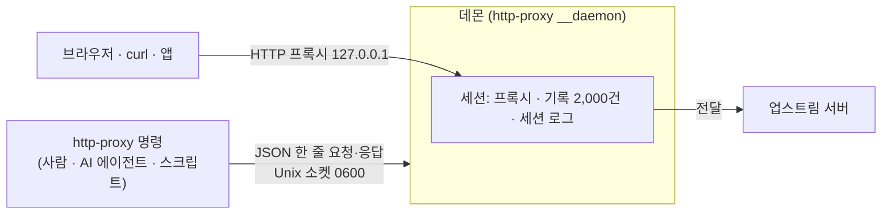

# 명령줄 인터페이스

[README](../README.md)로 돌아가기

화면 없이 프록시를 띄우고 캡처한 요청·응답을 셸에서 읽는다. 사람은 표 형태의 텍스트를, 스크립트와 AI 에이전트는 `--json`으로 버전 필드가 있는 JSON을 받는다. X11 디스플레이가 필요하지 않다.

## 실행 파일 이름

명령은 앱과 같은 실행 파일 `http-proxy`로 실행한다. 이슈 #126의 `http-inspector`는 이 실행 파일을 가리킨다. 실행 파일 이름 변경은 설치 경로·데스크톱 항목과 함께 바뀌는 별도의 호환성 변경으로 다룬다.

- 인자 없이 실행하거나 `--port N`만 주면 지금처럼 데스크톱 앱이 열린다.
- 첫 인자가 `proxy`, `records`, `log`, `ca`, `schema`, `help`, `--help`, `--version`, `--json`이면 명령줄로 동작한다.

## 에이전트용 안내

AI 에이전트에게는 [`http-inspector-cli` 스킬](../.agents/skills/http-inspector-cli/SKILL.md)을 준다. 명령 요약과 자주 쓰는 흐름(캡처 확인, 재전송, HAR·엔드포인트 구조)을 한 문서에 담았다.

## 범위

명령줄은 캡처한 요청을 **확인하고 → 이해하고 → 고쳐서 재현하는** 흐름에 직접 필요한 기능만 제공한다(#126의 범위 조정). 명령이 많을수록 에이전트가 사용법을 익히는 비용이 커지므로 효과가 작은 기능은 앱에만 둔다. 앱 전용 기능과 이유는 아래 "화면 기능 대응"에 있다.

## 구조

명령은 짧게 실행되고 끝나지만 프록시와 기록은 계속 살아 있어야 한다. 그래서 `proxy start`가 백그라운드 데몬을 띄우고, 이후 명령은 현재 사용자만 열 수 있는 Unix 도메인 소켓으로 데몬에 요청한다.



- 데몬은 `proxy stop`까지 실행된다. `proxy stop`은 프록시와 데몬을 함께 끝내며 보관한 기록도 사라진다. 필요한 기록은 먼저 `log save`로 저장한다.
- 데몬은 데스크톱 앱과 별도의 세션을 가진다. 둘이 같은 포트를 쓰려 하면 나중에 시작한 쪽이 `proxy_start_failed`로 실패한다.
- 기록 보관 한도(2,000건), 본문 미리보기 한도, 헤더 마스킹, 세션 로그는 데스크톱 앱과 같은 코드를 쓴다.
- 본문 Pretty·Raw·Tree 결과와 필터 결과도 앱과 같은 코드로 만든다. 같은 캡처면 앱과 같은 텍스트와 같은 기록이 나온다.

## 빠른 시작

```bash
http-proxy proxy start --port 0 --json
# {"schema":1,"running":true,"address":"127.0.0.1:43127","port":43127,"https_inspection":false,...}

eval "$(http-proxy proxy env)"          # 이 셸의 프로그램을 프록시로 보낸다
curl http://127.0.0.1:18190/api/users

http-proxy records wait --filter 'method:GET url:/api/users' --timeout 10s --json
http-proxy records body 42 --side response --view pretty --max-bytes 4096
http-proxy records replay 42 --header 'X-Debug: 1' --dry-run   # 보낼 요청 확인
http-proxy records replay 42 --header 'X-Debug: 1'             # 보내고 새 기록 출력
http-proxy records curl 42
http-proxy log save ./session.log
http-proxy proxy stop
```

## 공통 규칙

- **`--json`**: 모든 명령이 지원한다. 결과는 한 줄짜리 JSON 문서이며 최상위에 `"schema": 1`이 있다. 필드 순서는 정해져 있지 않으므로 이름으로 읽는다. 오류도 JSON 모드에서는 stdout에 `{"schema":1,"error":{"code":…,"message":…,"hint":…}}`로 나온다.
- **스트림**: `records watch`는 이벤트마다 한 줄(NDJSON)을 쓴다.
- **텍스트 모드**: 결과는 stdout, 오류와 본문 안내(`note: …`)는 stderr로 나온다.
- **비대화식**: 어떤 명령도 입력을 기다리지 않는다.
- **기록 ID**: 목록·감시·대기·상세·본문이 같은 정수 ID를 쓴다. ID는 데몬이 실행되는 동안 늘어나기만 한다.
- **자체 설명**: `http-proxy --help`, 각 명령의 `--help`, `http-proxy schema`로 전체 명령·인자·출력 필드·오류 코드를 읽는다.

## 명령

### `http-proxy proxy start`

데몬과 프록시를 시작한다. 데몬은 있지만 프록시가 멈춰 있으면 주어진 옵션으로 다시 시작한다.

이미 프록시가 실행 중이면 요청한 설정과 비교한다.

- 같으면 상태를 출력하고 `already_running`이 `true`가 된다. `--port`를 생략하거나 `--port 0`이면 어떤 포트든 같다고 본다.
- HTTPS 복호화 여부가 다르거나 `--port`로 다른 포트를 지정하면 설정을 바꾸지 않고 `proxy_conflict`로 실패한다. HTTPS 복호화는 `proxy set --https-inspection on|off`로 바꾸고, 포트는 `proxy stop` 뒤 다시 시작한다.
- 여러 `proxy start`를 동시에 실행해도 데몬은 하나만 뜬다. 제어 디렉터리의 잠금 파일(`control.lock`)이 소켓 확인·정리·생성을 한 번에 하나씩 처리하고, 나머지는 먼저 뜬 데몬에 다시 연결해 `already_running: true`를 출력한다.

| 옵션 | 설명 |
| --- | --- |
| `--port N` | 루프백 포트. `0`이면 빈 포트를 고르고 실제 주소를 출력한다. 생략하면 `HTTP_INSPECTOR_PORT`, 앱에 저장한 포트, `8080` 순서로 정한다. |
| `--https-inspection` | 로컬 CA로 HTTPS를 복호화한다. 기본값은 앱과 같이 꺼짐이다. |
| `--foreground` | 백그라운드 데몬을 띄우지 않고 이 프로세스에서 실행한다. 상태를 출력한 뒤 `proxy stop`까지 반환하지 않는다. |

출력은 `proxy status`와 같다.

### `http-proxy proxy status`

| 필드 | 설명 |
| --- | --- |
| `running` | 프록시가 연결을 받는지 |
| `address`, `port` | 프록시 주소. 멈췄으면 `null` |
| `https_inspection` | HTTPS 복호화 여부 |
| `proxy_error` | 프록시가 스스로 멈춘 이유 |
| `pid` | 데몬 프로세스 ID |
| `records`, `record_limit` | 보관 중인 기록 수와 한도(2,000) |
| `records_dropped` | 프록시 이벤트 큐가 가득 차 기록하지 못한 수 |
| `records_evicted` | 보관 한도 때문에 밀려난 수 |
| `session_log` | 세션 로그 사용 가능 여부, 오류, 본문 한도(`body_limit_bytes`)와 도달 여부(`body_limit_reached`) |
| `control_socket` | 제어 소켓 경로 |

### `http-proxy proxy set`

`--https-inspection on|off`로 실행 중인 프록시를 같은 포트에서 다시 시작한다. 보관한 기록은 유지된다. 출력은 `proxy status`와 같다.

### `http-proxy proxy stop`

프록시와 데몬을 끝낸다. 출력: `stopped`, `records`(버린 기록 수).

### `http-proxy records list`

보관한 기록을 오래된 순서로 출력한다.

| 옵션 | 설명 |
| --- | --- |
| `--filter TEXT` | 앱 필터 입력란과 같은 문법(아래 "필터"). |
| `--scope all\|url\|headers\|request-body\|response-body` | 자유 텍스트를 찾을 범위 |
| `--case-sensitive`, `--regex` | 앱의 **Aa**, **.\*** 옵션 |
| `--kind all\|responses\|failures\|tunnels` | 앱의 결과 종류 탭 |
| `--since ID` | 이 ID보다 큰 기록만 |
| `--limit N` | 조건에 맞는 기록 중 최신 N건만 |
| `--full` | 요약 대신 기록의 모든 필드 |

출력: `records`(기록 배열), `matched`, `retained`. 기본 출력은 다음 단계를 고르는 데 필요한 요약 필드만 담는다.

| 요약 필드 | 설명 |
| --- | --- |
| `id` | 기록 ID |
| `method`, `url` | 요청 메서드와 대상 |
| `outcome` | `pending`, `response`, `tunnel`, `https_inspection`, `failed`, `cancelled`, `incomplete` |
| `status` | 응답 상태 코드 또는 `null` |
| `duration_ms` | 걸린 시간 |
| `request_bytes`, `response_bytes` | 요청 본문과 받은 응답 본문(터널은 받은 바이트)의 크기, 없으면 `null` |

`--full`을 주면 기록마다 아래 필드를 모두 출력한다. `records wait`와 `records replay`의 `record`도 이 형식이다.

| 필드 | 설명 |
| --- | --- |
| `id` | 기록 ID |
| `method`, `url`, `host`, `path` | 요청 메서드와 대상 |
| `outcome` | `pending`, `response`, `tunnel`, `https_inspection`, `failed`, `cancelled`, `incomplete` |
| `status` | 응답 상태 코드 또는 `null` |
| `summary` | 앱 목록의 상태 문구(`404 Not Found`, `Pending`, `Connect: connection refused`) |
| `type` | 짧은 응답 미디어 형식(`json`) |
| `received_bytes`, `duration_ms` | 받은 바이트, 걸린 시간 |
| `settled` | 더 바뀔 내용이 없는지 |
| `source` | `http_proxy`, `connect`, `inspected_https` |
| `replay_of` | 재전송한 원본 기록 ID |
| `started_at_ms` | 시작 시각(Unix 밀리초) |

### `http-proxy records show`

`records show ID [--part all|request|response]`. 목록 필드에 더해 요청 줄, 헤더(`name`, `value`, `redacted`), 쿼리 매개변수, 인증 방식, 응답 줄(`line`, 예: `200 OK · HTTP/1.1`), 실패(`failure.stage`, `failure.message`), 터널(`tunnel.state`, 양방향 바이트, 시간), 단계별 시간(`timing`), 본문 요약(`observed_bytes`, `retained_bytes`, `lifecycle`, `capture`, `media_type`, `content_encoding`)을 출력한다.

`capture`는 보관한 바이트가 본문의 어디까지인지 나타낸다: `whole`(전체), `truncated`(미리보기 한도에서 잘림), `streaming`(아직 받는 중), `ended`(중간에 끊김).

### `http-proxy records body`

`records body ID [--side request|response] [--view pretty|raw|tree|hex] [--max-bytes N]`. 앱 **Body** 탭과 같은 코드로 `Content-Encoding`을 풀고 정리한다.

| 보기 | 출력 |
| --- | --- |
| `pretty`(기본) | 정리한 텍스트(`text`). 형식이 정리를 지원하지 않으면 원문과 안내 |
| `raw` | 압축만 푼 텍스트 |
| `tree` | JSON·XML 트리 행(`nodes`: `depth`, `label`, `path`) |
| `hex` | 받은 그대로의 바이트(압축 해제 전) 16진수 덤프. 기본 8 KiB, `--max-bytes`로 조정 |

- `--json-path '$.data.items[3].id'`, `--xpath '/rss/channel/item[2]/title'`은 Tree 보기의 경로와 같은 형식으로 행 하나를 골라 그 값의 원문을 `text`로 출력한다. JSON 문자열은 따옴표가 붙은 JSON 원문(`"\"pro\""`)이다. 경로는 `--view tree`로 확인한다. 식별자가 아닌 키는 Tree 보기처럼 `$.echo["x-client"]`로 쓰며, `$.echo.x-client`처럼 점으로 써도 같은 행을 고른다.
- `notices`는 앱이 본문 위에 보여 주는 안내(압축 방식, 잘림, 수신 중, 정리 실패)다.
- `--max-bytes N`은 출력 텍스트를 N바이트에서 자른다. `truncated`와 자르기 전 길이 `text_bytes`를 함께 출력한다.
- 이진 본문(이미지, `application/octet-stream` 같은 형식, 앞부분에 NUL이 있는 본문)을 텍스트 보기로 요청하면 `binary_body`로 실패한다. `--view hex`를 쓰거나 `log save`로 전체 로그를 저장한다.

### `http-proxy records watch`

새 기록과 상태 변화를 NDJSON으로 계속 출력한다. 필터 옵션과 `--full`은 `records list`와 같다. 기본값은 실행 이후의 새 기록이며 `--since ID`로 그 뒤의 보관 기록부터 받을 수 있다.

| `event` | 내용 |
| --- | --- |
| `started` | 감시 시작. `since` |
| `added` | 조건에 맞는 기록이 처음 보임. `record` |
| `updated` | 결과·상태 코드·완료 여부가 바뀜. `record` |
| `cleared` | `records clear`가 실행됨 |
| `daemon_stopped` | 데몬이 멈춰 스트림이 끝남 |

### `http-proxy records wait`

조건에 맞는 **완료된** 기록이 나타나면 그 기록(`record`)을 출력하고 끝낸다. 기본값은 보관한 모든 기록을 대상으로 하므로 요청을 보낸 뒤 실행해도 된다. `--since ID`로 그 뒤의 기록만 기다린다. `--timeout`은 `500ms`, `10s`, `2m`, `1h` 형식이며 기본 `30s`, 최대 `1h`다. 시간 안에 맞는 기록이 없으면 아무 기록도 출력하지 않고 `timeout`(종료 코드 6)으로 실패한다.

### `http-proxy records clear`

앱의 **Clear**처럼 보관한 기록을 모두 지운다. 출력: `removed`.

### `http-proxy records replay`

`records replay ID [--method M] [--url URL] [--header 'Name: value']… [--remove-header Name]… [--body-file PATH] [--yes] [--dry-run] [--timeout 60s]`. 앱의 **Edit and Resend**와 같은 코드(`ReplayDraft`)로 캡처한 요청을 고쳐 다시 보낸다. 보낸 요청은 새 기록이 되며 원본 ID가 `replay_of`에 남는다.

| 옵션 | 설명 |
| --- | --- |
| `--method`, `--url` | 메서드와 절대 `http://`·`https://` URL을 바꾼다 |
| `--header 'Name: value'` | 같은 이름의 캡처 헤더를 모두 끄고 이 값을 보낸다. 여러 번 쓸 수 있다 |
| `--remove-header Name` | 같은 이름의 캡처 헤더를 모두 뺀다 |
| `--body-file PATH` | 파일 전체를 본문으로 보낸다(최대 16 MiB). 상대 경로는 명령을 실행한 디렉터리 기준 |
| `--yes` | 서버 상태를 바꿀 수 있는 요청을 보낸다는 확인 |
| `--dry-run` | 보내지 않고 보낼 요청(메서드, URL, 헤더, 본문)을 출력한다 |
| `--timeout` | 새 기록이 끝나기를 기다리는 시간(기본 `60s`). 시간 안에 새 기록이 나타났으면 끝나지 않았어도 그 기록을 출력하고(`settled: false`), 나타나지 않았으면 `timeout`(종료 코드 6)으로 실패한다 |

확인 규칙은 앱과 같다.

- `GET`, `HEAD`, `OPTIONS`가 아닌 메서드는 `--yes`가 없으면 보내지 않고 `confirmation_required`(종료 코드 5)로 실패한다. `--dry-run`은 보내지 않으므로 `--yes`가 필요 없고, 필요 여부를 `needs_confirmation`으로 알려 준다.
- 캡처할 때 가려진 헤더(`Authorization`, `Cookie` 등)는 값이 없으므로 그대로 보낼 수 없다. `--header`로 값을 주거나 `--remove-header`로 빼지 않으면 `not_reproducible`로 실패하고 해당 헤더 이름을 알려 준다.
- 본문이나 헤더 일부만 캡처한 요청은 `--body-file`로 완전한 본문을 주어야 한다.
- HTTPS 요청은 HTTPS 복호화가 켜져 있어야 보낸다(`https_unavailable`). 프록시가 멈췄으면 `proxy_not_running`이다.

요청은 앱과 같이 `Host`와 `Content-Length`를 다시 계산해 보낸다. 본문 없는 `GET`에도 `content-length: 0`이 붙고, hop-by-hop 헤더와 `Expect`는 빠진다.

출력: `replay_of`, `dry_run`, `needs_confirmation`, `request`(보낸 또는 보낼 요청: `method`, `url`, `headers`, `body_bytes`, `body`(UTF-8이 아니면 `null`, 64 KiB까지), `body_truncated`), `record`(보낸 경우 새 기록). `request.headers`의 자격 증명 헤더 값은 직접 입력한 값이라도 `[REDACTED]`로 출력한다.

### `http-proxy records curl`

`records curl ID [--placeholders]`. 앱의 **Copy as cURL**과 같은 코드로 캡처한 요청을 POSIX 셸 `curl` 명령으로 출력한다.

- 가려진 헤더는 원래 값이 저장되지 않으므로 기본값은 명령에서 빼고, `--placeholders`면 `<REDACTED>` 자리표시자로 넣는다. 어느 쪽이든 `redacted_headers`에 이름이 남고 텍스트 모드는 stderr에 안내를 쓴다. 실행 전에 실제 값을 채워야 한다.
- URL이나 본문이 잘렸거나 헤더 일부를 캡처하지 못한 요청, `CONNECT` 터널은 다른 요청을 만들지 않도록 `not_reproducible`로 실패한다.

출력: `id`, `command`, `redacted_headers`, `placeholders`.

### `http-proxy records export`

`records export [필터 옵션] [--format har] [--output PATH] [--include-bodies] [--include-redacted-headers]`. 앱의 **Save → Export HAR**와 같은 코드로 조건에 맞는 보관 기록을 HAR 1.2로 만든다. 필터 옵션은 `records list`와 같다.

- `--output PATH`면 새 파일에 쓰고 `entries`, `path`를 출력한다. 파일은 소유자만 읽을 수 있고, 기존 파일은 덮어쓰지 않는다(`file_exists`).
- `--output`이 없으면 HAR 문서 자체를 stdout에 쓴다. 다른 도구가 바로 읽도록 `--json`이어도 `schema` 필드로 감싸지 않는다.
- 기본값은 앱과 같이 본문과 자격 증명 헤더를 넣지 않는다. `--include-bodies`는 잘렸을 수 있는 본문 미리보기를, `--include-redacted-headers`는 자격 증명 헤더를 `[REDACTED]` 표시와 함께 넣는다. 원래 값은 어느 경우에도 들어가지 않는다.

### `http-proxy records endpoints`

`records endpoints [필터 옵션] [--format summary|openapi]`. 앱의 **Map** 상세 패널과 같은 코드(URL 맵, ID 접기, 엔드포인트 구조 집계)로 조건에 맞는 기록의 엔드포인트별 요청·응답 구조를 보여 준다. 최상위 `http-proxy schema`는 이 명령줄의 출력 형식을 설명하는 명령이고, 이 명령은 캡처한 API의 구조를 보여 준다.

- `summary`(기본): 엔드포인트마다 경로 패턴(`/users/{id}`), 메서드, 요청 수, 경로 ID 종류, 쿼리 이름과 값 형식, 사용자 정의 헤더 이름, 인증 방식, 요청 본문(Content-Type별)과 응답 본문(상태 코드·Content-Type별)의 필드 이름·형식·등장 횟수를 출력한다.
- `openapi`: 같은 집계로 OpenAPI 3.1 문서를 만들어 stdout에 쓴다(`schema` 필드로 감싸지 않음). 서버 하나만 표현하므로 기록이 여러 호스트에 걸치면 `usage`로 실패한다. `--filter host:<host>`로 좁힌다. 캡처만으로 서버가 필드를 요구하는지 알 수 없으므로 `required`를 표시하지 않고 관찰 횟수를 `x-observed-requests`, `x-observed-in`으로 남긴다. YAML이 필요하면 JSON을 변환한다(OpenAPI JSON은 그대로 YAML로도 읽힌다).
- 쿼리 값, 헤더 값, 본문 필드 값은 집계하지 않고 이름·형식·횟수만 남긴다.
- 앱의 Map은 **Clear** 이후 누적 집계(목록에서 밀려난 요청 포함)를 쓰지만, 이 명령은 지금 보관 중인 기록(최대 2,000건) 중 조건에 맞고 끝난 기록만 쓴다. 본문은 메모리 미리보기에서 읽으므로 미리보기 한도를 넘은 본문은 잘린 것으로 제외한다.

### `http-proxy records hls`

`records hls ID [--variant N] [--output PATH]`. 앱의 HLS 창과 같은 코드로 캡처한 `.m3u8` 재생목록을 확인하고 선택한 화질을 하나의 `.ts` 파일로 받는다.

- `--output`이 없으면 화질 목록(`variants`: `index`, `quality`, `bandwidth`, `resolution`, `state`, 세그먼트 수, `can_download`, `blocked`)과 기본 화질(`default_variant`)을 출력한다.
- `--output PATH`면 `--variant`(기본은 앱이 고르는 화질)를 받아 PATH에 저장한다. 진행은 NDJSON `progress` 이벤트(단계, 전체·완료·재사용·받은 세그먼트 수, 받은 바이트)로, 끝은 `completed`(경로, 전체 바이트, 세그먼트 수)로 알린다. 실패하면 오류 줄로 끝난다.
- 파일은 정확히 PATH에만 저장한다. PATH에 파일이나 심볼릭 링크(가리키는 대상이 없는 링크 포함)가 있으면 시작하지 않고 `file_exists`로 실패한다. 받는 동안 PATH에 파일이 생기면 그 파일을 덮어쓰거나 다른 이름으로 저장하지 않고 `file_exists`로 끝낸다. 덮어쓰는 옵션은 없다.
- 받는 동안에는 같은 디렉터리의 숨은 임시 파일(`.이름.partial`)에 쓰고, 성공·실패·취소 어느 경우에도 지운다.
- 앱과 같은 조건이 필요하다. 현재 데몬 세션에 해당 화질의 미디어 재생목록과 Chrome `.ts` 세그먼트 요청이 캡처되어 있어야 하며, 없으면 `hls_unavailable`로 이유(예: `No Chrome .ts segment request captured for this quality`)를 알려 준다. 이미 보관한 세그먼트는 재사용하고 나머지는 프록시를 거쳐 받는다.
- 진행 중에 명령을 끝내면(Ctrl+C) 다운로드를 취소한다.

### `http-proxy proxy env`

실행 중인 프록시로 프로그램을 보내는 셸 `export` 줄을 출력한다. `eval "$(http-proxy proxy env)"`로 현재 셸에 적용한다.

| 변수 | 내보내는 조건 | 효과 |
| --- | --- | --- |
| `HTTP_PROXY`, `HTTPS_PROXY`, `http_proxy`, `https_proxy` | 항상 | 프록시 주소. curl은 소문자 `http_proxy`만 읽으므로 대소문자를 모두 쓴다 |
| `NODE_EXTRA_CA_CERTS` | HTTPS 복호화가 켜졌을 때 | Node.js 기본 루트에 로컬 CA를 **더한다** |
| `SSL_CERT_FILE`, `CURL_CA_BUNDLE`, `REQUESTS_CA_BUNDLE` | HTTPS 복호화가 켜지고 `--ca-bundle`을 줬을 때 | OpenSSL, curl, Python requests의 CA 묶음을 로컬 CA 하나로 **바꾼다** |

`--ca-bundle`의 세 변수는 시스템 CA 묶음을 대체한다. 프록시를 거치는 HTTPS는 모두 로컬 CA로 서명되므로 동작하지만, 프록시를 거치지 않는 HTTPS(`NO_PROXY` 대상, 프록시를 무시하는 프로그램)는 인증서 검사에 실패한다. 그래서 기본값에서 빼고 명시할 때만 내보낸다. 한 번만 쓸 때는 `curl --cacert "$(http-proxy ca info --json | jq -r .certificate_path)"`처럼 해당 명령에만 CA를 준다. `NO_PROXY`는 바꾸지 않는다.

출력: `proxy_url`, `https_inspection`, `variables`(`name`, `value`, `replaces_system_roots`), `notes`. 텍스트 모드의 안내는 `#` 주석 줄이라 `eval`해도 안전하다.

### `http-proxy ca info`

로컬 검사 CA 인증서의 경로(`certificate_path`), SHA-256 지문(`fingerprint_sha256`), 유효 기간(`valid_from`, `valid_until`, RFC 3339 UTC)을 출력한다. CA가 없으면 앱이 HTTPS 복호화를 켤 때처럼 만든다. 데몬이 없어도 동작한다. **개인키와 그 파일 경로는 출력하지 않는다.** CA를 브라우저·시스템에 등록하거나 제거하는 일은 앱에서 한다.

### `http-proxy log save`

`log save PATH`. 데몬 세션의 전체 로그를 새 파일로 저장한다. 상대 경로는 명령을 실행한 디렉터리를 기준으로 한다. 기존 파일은 덮어쓰지 않고 `file_exists`로 실패한다. 세션 로그가 바쁘면 `busy`(종료 코드 75)로 실패하므로 잠시 뒤 다시 실행한다. 출력: `path`.

### `http-proxy schema`

모든 명령, 인자, 출력 필드, 오류 코드, 종료 코드를 JSON 하나로 출력한다. 명령과 인자는 실제 인자 파서에서 읽으므로 구현과 어긋나지 않는다.

## 필터

`--filter`는 앱 필터 입력란과 같은 파서와 매처를 쓴다. 문법은 [요청 검색](guide/search.md)에 있다. 예: `method:POST url:/api/users status:4xx -path:/static/ token`.

앱은 입력 중에 쓸 수 없는 조건을 건너뛰고 나머지로 거르지만, 명령줄은 스크립트가 의도보다 넓은 조건으로 실행되지 않도록 쓸 수 없는 조건이 하나라도 있으면 `invalid_filter`로 실패한다.

## 종료 코드

| 코드 | 의미 |
| --- | --- |
| `0` | 성공 |
| `1` | 실패. `error.code`로 이유를 구분한다 |
| `2` | 잘못된 명령줄 또는 필터 |
| `3` | 데몬이 실행 중이 아님 |
| `4` | 기록, 본문, 트리 경로가 없음 |
| `5` | 서버 상태를 바꿀 수 있는 요청이라 `--yes`가 필요함 |
| `6` | `records wait` 시간 초과 |
| `75` | 일시적으로 바쁨. 잠시 뒤 다시 실행 |

## 오류 코드

| `error.code` | 종료 코드 | 의미와 다음 행동 |
| --- | --- | --- |
| `usage` | 2 | 잘못된 인자. `--help` 확인 |
| `invalid_filter` | 2 | 쓸 수 없는 필터 조건 |
| `daemon_not_running` | 3 | `http-proxy proxy start` 실행 |
| `insecure_control_path` | 1 | 제어 디렉터리·소켓이 다른 사용자 소유이거나 다른 사용자에게 열려 있음 |
| `daemon_unavailable` | 1 | 데몬이 준비되지 않았거나 연결이 끊김. `proxy start --foreground`로 원인 확인 |
| `daemon_already_running` | 1 | 다른 데몬이 이미 소켓에서 응답함. `proxy start`는 이 경우 그 데몬에 다시 연결하므로 보통 보이지 않는다 |
| `record_not_found` | 4 | 그 ID의 기록이 보관 목록에 없음 |
| `body_unavailable` | 4 | 요청 본문·응답이 없거나 본문을 보관하지 않음 |
| `path_not_found` | 4 | `--json-path`·`--xpath`에 맞는 트리 행이 없음 |
| `binary_body` | 1 | 이진 본문. `--view hex` |
| `view_unavailable` | 1 | 이 본문에 쓸 수 없는 보기(트리 없음, 압축 해제 실패) |
| `confirmation_required` | 5 | `records replay`가 `GET`·`HEAD`·`OPTIONS`가 아닌 요청을 보내려 함. `--dry-run`으로 확인한 뒤 `--yes` |
| `hls_unavailable` | 1 | HLS 재생목록이 아니거나 선택한 화질을 아직 받을 수 없음. 메시지가 이유를 알려 준다 |
| `not_reproducible` | 1 | 가려진 헤더 값이 없거나 캡처가 불완전해 그대로 재현할 수 없음. 메시지가 줄 값을 알려 준다 |
| `proxy_not_running` | 1 | 프록시가 멈춰 있음. `proxy start` |
| `proxy_start_failed` | 1 | 포트 사용 중 등. `--port 0` 시도 |
| `proxy_conflict` | 1 | 실행 중인 프록시와 다른 포트·HTTPS 설정으로 `proxy start`. `proxy set` 또는 `proxy stop` 뒤 다시 시작 |
| `https_unavailable` | 1 | CA를 준비할 수 없음, 또는 HTTPS 복호화가 꺼진 채 HTTPS 재전송 |
| `timeout` | 6 | `records wait` 시간 초과 |
| `busy` | 75 | 세션 로그가 바쁨 등. 다시 실행 |
| `file_exists` | 1 | 저장 경로에 파일이 이미 있음 |
| `io` | 1 | 파일·소켓 오류 |

## 보안

- **제어 채널**: `$XDG_RUNTIME_DIR/http-inspector/control.sock`, 이 변수가 없거나 절대 경로가 아니면 시스템 임시 디렉터리의 `http-inspector-<uid>/control.sock`을 쓴다. 디렉터리는 `0700`, 소켓은 `0600`으로 만든다. 디렉터리나 소켓이 다른 사용자 소유이거나 그룹·다른 사용자 권한이 있으면 고치지 않고 `insecure_control_path`로 거부한다. TCP 제어 포트는 없다.
- **프록시**: 앱과 같이 `127.0.0.1`에만 바인딩한다.
- **가려진 헤더**: `Authorization`, `Proxy-Authorization`, `Cookie`, `Set-Cookie` 값은 캡처할 때 `[REDACTED]`로 바뀌므로 명령 출력, 소켓 메시지, 세션 로그 어디에도 원래 값이 없다. 원래 값을 복원하는 옵션은 없다.
- **CA 개인키**: 어떤 명령·출력·소켓 메시지에도 포함하지 않는다. `ca info`는 공개 인증서의 경로와 지문만 출력한다.
- **재전송·cURL**: 가려진 헤더를 되살리지 않는다. 재전송에 직접 준 자격 증명 값도 출력에서는 `[REDACTED]`로 보인다.
- **세션 로그**: 데몬의 전체 로그는 만들자마자 이름을 지운 임시 파일에 기록한다. `proxy stop`, `SIGTERM`·`SIGINT`, 강제 종료 어느 경우에도 본문이 담긴 파일이 임시 디렉터리에 남지 않는다. 신호로 끝난 데몬의 소켓 파일은 다음 `proxy start`가 응답이 없음을 확인한 뒤 지운다.
- **소켓 정리**: 데몬은 종료할 때 리스너를 닫기 전에 잠금 파일을 잡고 소켓 파일을 지운다. 그 사이 다른 `proxy start`는 살아 있는 데몬을 보고 물러나므로, 종료하는 데몬이 새로 뜬 데몬의 소켓을 지우는 일이 없다.

## 화면 기능 대응

| 앱 기능 | 명령 |
| --- | --- |
| 프록시 시작·포트 변경, 중지, 상태 | `proxy start --port N`, `proxy stop`, `proxy status` |
| HTTPS 복호화 켜기·끄기 | `proxy start --https-inspection`, `proxy set --https-inspection on\|off` |
| 프록시 URL·환경 변수 복사 | `proxy env` |
| CA 상세(경로·지문) | `ca info` |
| 요청 목록·결과 종류 탭·필터 | `records list --filter … --kind …` |
| 새 요청 따라가기 | `records watch`, `records wait` |
| 상세 Headers·Timing | `records show` |
| 상세 Body (Pretty·Raw·Tree·Hex) | `records body --view …` |
| JSON Tree 경로·XML XPath 복사 | `records body --json-path`, `--xpath` |
| **Edit and Resend** | `records replay` |
| **Copy as cURL** | `records curl` |
| **Save → Export HAR** | `records export --format har` |
| Map 상세의 엔드포인트 요청·응답 구조 | `records endpoints` (OpenAPI 3.1: `--format openapi`) |
| HLS 화질 확인·미디어 다운로드 | `records hls` |
| **Clear** | `records clear` |
| 전체 로그 저장 | `log save PATH` |

### 앱 전용

다음 기능은 명령으로 제공하지 않는다.

| 기능 | 이유 |
| --- | --- |
| 검사 브라우저 열기 | 디스플레이가 필요하고, 에이전트는 curl이나 자체 브라우저 도구를 쓴다 |
| CA 신뢰 등록·상태·제거 | 시스템·브라우저 신뢰 저장소를 바꾸는 일회성 작업이라 사람이 앱에서 하는 편이 안전하다 |
| URL 맵 | 시각적 트리 기능이다. 목록 필터와 엔드포인트 구조로 대신한다 |
| 본문 바이트 범위 병합 | 쓰임이 드물다 |
| 이미지 정보 보기 | 에이전트에게 쓸모가 적다. 원래 바이트는 `--view hex`로 본다 |
| 본문 안 검색(일치 위치 이동) | `--filter`와 `records body … \| grep`으로 대신한다 |
| 프로그램 창 PNG 저장 | 화면 전용 기능이다 |
| 테마, 언어, 목록·상세 너비, **Follow newest**, 상세 탭 선택 | 화면 배치와 표시 설정이다 |
| 클립보드 복사 자체 | 복사할 값은 각 명령이 stdout으로 출력한다 |
