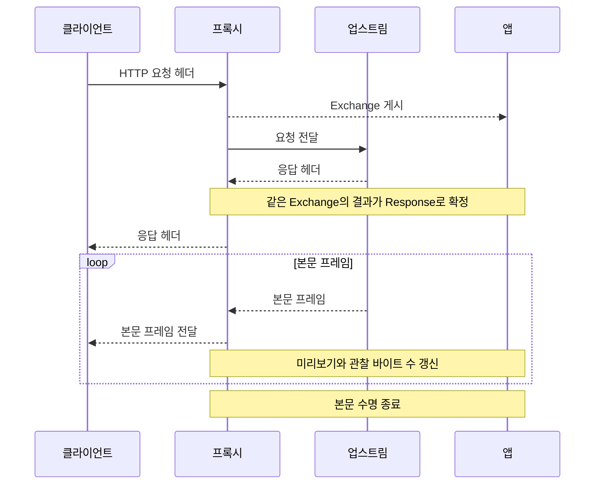

# 요청의 수명

[개발자 가이드](README.md)

로컬 서버가 응답을 늦추면 Requests 화면에는 먼저 대기 중인 요청이 나타난다. 응답 헤더가 오면 상태 코드가 표시되고, 서버가 본문을 나눠 보내면 받은 바이트 수가 계속 늘어난다. 이 세 시점은 각각 레코드 게시, 응답 결과 확정, 본문 진행에 해당한다.

## 앱에서 프록시까지

1. `src/main.rs`는 UI 진입점으로 넘긴다. `InspectorApp::new`는 화면 상태와 `SessionState`를 준비하고, 본문 분석에 쓸 `AnalysisPipeline`을 시작한다. [실행 진입점](../../src/main.rs) · [앱 초기화](../../src/ui/app/mod.rs)
2. `SessionState::start_proxy`는 포트를 검증하고 `ProxyConfig`를 만든다. 복호화가 켜져 있거나 본문 저장소를 사용할 수 있으면 각각의 설정을 추가한다. 프록시가 새 레코드를 게시할 때 UI가 다시 그리도록 알림 콜백을 등록한다. [세션 상태](../../src/ui/app/state.rs)
3. `ProxyHandle`은 연결을 받는 런타임과 캡처 이벤트 수신을 앱에 연결한다. 수락한 클라이언트 연결에서 Hyper HTTP/1.1 서버를 띄우고 요청을 `proxy_request`에 넘긴다. [프록시 핸들](../../crates/http-inspector-core/src/interception/handle.rs)

## 평문 HTTP 요청 한 건

- `proxy_request`가 `CaptureContext::start`를 호출한다. 캡처 컨텍스트가 기록 ID를 만들고 `InFlight` 상태의 `Exchange`를 제한된 큐에 게시한다. 큐가 가득 차면 화면용 이벤트의 누락 수를 센다. [캡처 컨텍스트](../../crates/http-inspector-core/src/interception/capture_context.rs)
- `forward_http`는 요청 대상을 검사하고 업스트림에 연결한다. `forward_over_stream`은 업스트림에 보낼 요청 대상을 경로로 바꾸고 연결 단위 헤더를 제거한다. 응답 헤더를 받으면 같은 `Exchange`의 결과를 `Outcome::Response`로 확정한다. 연결이나 헤더 수신이 실패하면 단계와 함께 실패를 기록한다. [HTTP 전달](../../crates/http-inspector-core/src/interception/forward.rs)
- `ObservedBody`는 요청·응답 본문을 감싼다. Hyper가 프레임을 읽을 때 캡처에 필요한 데이터를 관찰하고 원래 프레임을 반환한다. 스트림 종료, 스트림 오류, 읽는 쪽의 중단은 각각 본문 완료, 끊김, 취소로 기록한다. [본문 관찰 코드](../../crates/http-inspector-core/src/interception/capture.rs)
- `InspectorApp::receive_records`는 프레임을 그리기 전에 큐의 레코드를 읽어 Requests와 `AnalysisPipeline`에 넘긴다. 이들이 보관하는 `Exchange`는 엔진과 상태를 공유한다. 응답 헤더 도착이나 본문 진행 때마다 새 행을 게시할 필요가 없다. [앱의 레코드 수신](../../src/ui/app/mod.rs)

## CONNECT와 재전송에서 달라지는 지점

- 기본 `CONNECT`는 `connect_tunnel`에서 TCP 양방향 전달을 시작한다. 기록에는 터널의 바이트 수와 연결 상태가 남는다. [CONNECT 분기](../../crates/http-inspector-core/src/interception/inspect.rs) · [터널 전달](../../crates/http-inspector-core/src/interception/tunnel.rs)
- 복호화 모드는 `CONNECT` 안쪽에 클라이언트 TLS를 수락하고, 내부 HTTP 요청마다 별도 `Exchange`를 만든다. 목적지는 `CONNECT`가 지정한 호스트와 포트로 유지한다. 업스트림 TLS 연결을 검증한 뒤 `forward_over_stream`을 재사용한다. [HTTPS 복호화 설계](../https-inspection-implementation.md)
- **Edit and Resend**는 편집한 요청의 검증을 거쳐 엔진에서 실행한다. 캡처는 새 기록 ID를 만들고 원본의 ID를 `replay_of`에 기록한다. [재전송 진입점](../../crates/http-inspector-core/src/replay.rs) · [엔진의 재전송 실행](../../crates/http-inspector-core/src/interception/execute.rs)

응답을 지연시켜 레코드가 먼저 게시되는 과정은 [`exchange_lifecycle`](../../tests/exchange_lifecycle.rs), 본문이 끝나기 전에 청크가 전달되는 과정은 [`body_completion`](../../tests/body_completion.rs)에서 확인할 수 있다.
