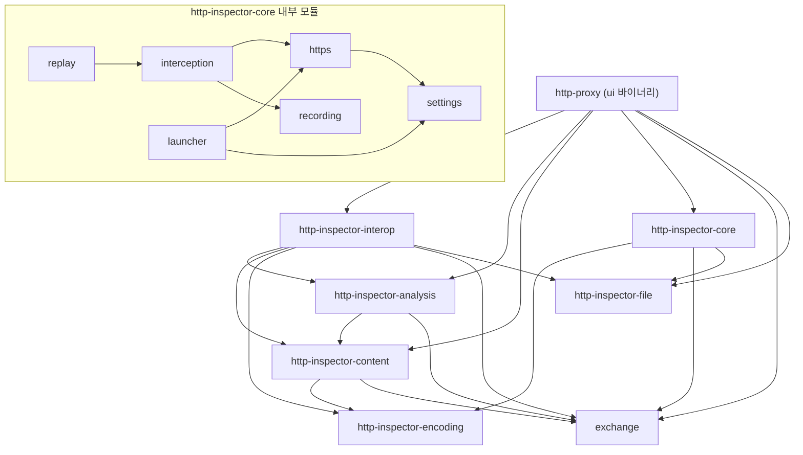

# 개발 문서

[README](../README.md)로 돌아가기

이 문서는 HTTP Inspector를 개발하고 검증할 때 필요한 환경, 명령과 설계 문서를 모은다. 작업 흐름, 커밋과 PR 규칙은 [AGENTS.md](../AGENTS.md)를 따른다.

프록시 요청이 어떻게 캡처되어 화면과 저장소에 반영되는지는 [코드베이스 가이드](developer-guide/README.md)에서 따라갈 수 있다.

## 개발 환경

프로젝트는 Rust 1.100.0을 사용한다. `rustup`은 `rust-toolchain.toml`에 지정된 툴체인을 설치한다. Linux에서는 X11을 사용하며, macOS에서는 X11이 필요하지 않다.

Linux 시스템 패키지와 macOS의 선택 도구(Homebrew NSS)는 [README의 설치](../README.md#설치)를 따른다. CI의 Linux 품질 검사에는 빌드용 시스템 패키지가, 패키지 실행 검사에는 런타임 패키지와 Xvfb가 필요하다.

글꼴 등록을 확인하려면 다음처럼 실행한다. 어떤 폰트를 등록했는지 로그로 확인할 수 있다.

```bash
RUST_LOG=http_proxy::ui::style::fonts=debug cargo run
```

## 검증

문서만 바꿨다면 `git diff --check`로 변경을 검사한다. PR을 열기 전에는 저장소 루트에서 아래 전체 검사를 실행한다. `cargo-deny`가 없으면 `cargo install --locked cargo-deny`로 설치한다.

```bash
cargo fmt --all --check
python3 scripts/check-boundaries.py
cargo clippy --workspace --all-targets --all-features -- -D warnings
cargo test --workspace --all-features
RUSTDOCFLAGS="-D warnings" cargo doc --workspace --all-features --no-deps
cargo deny check
cargo build --release
```

요청 검색은 `cargo bench --bench search`로 측정한다. URL 맵 삽입, 트리 구성과 관계 그래프 배치는 `cargo bench --bench url_map`으로 측정한다. 결과는 `target/criterion/`에 남는다.

통합 테스트는 실제 TCP 연결을 사용한다. 테스트는 HTTP 전달과 `CONNECT` 터널의 양방향 전송을 검증한다.

라이브러리 크레이트 단독 테스트는 `cargo test -p <crate>`로 실행한다. 크레이트 이름은 아래 구성 표에서 확인한다.

프록시를 띄우지 않고 캡처 레코드(`Exchange`)가 필요한 테스트는 `http-inspector-exchange` 크레이트의 `test-support` feature가 제공하는 `http_inspector_exchange::ExchangeBuilder`로 레코드를 만든다. 빌더는 캡처 경로(`http_inspector_exchange::capture`)와 같은 쓰기 핸들과 헤더 마스킹·길이 제한 규칙을 쓴다. 본문을 읽는 분석 코드(엔드포인트 스키마)는 `BodySource` 포트로 본문을 받으므로, 테스트에서는 본문 저장소 대신 디코딩된 본문을 메모리에 둔 `http_inspector_exchange::MemoryBodySource`를 넘긴다. 각 크레이트의 `dev-dependencies`에서만 `http-inspector-exchange`의 `test-support` feature를 켜므로 테스트·벤치마크·문서 테스트 빌드에서만 빌더가 컴파일되고, `cargo build --release` 결과물에는 들어가지 않는다.

macOS 실환경에서 키체인 등록·상태 확인·제거와 Chrome 검사 창 실행을 확인하려면 다음 검사를 실행한다. 첫 검사는 임시 CA를 로그인 키체인에 등록한 뒤 제거하며, macOS 인증 창이 나타날 수 있다.

```bash
cargo test --test macos_integration -- --ignored
```

## CI

CI(`.github/workflows/ci.yml`)는 이벤트에 따라 실행 범위가 다르다. PR 대기 시간을 줄이려고 PR에서는 느린 러너와 단계를 생략하고, 생략한 범위는 `main` 푸시와 매일 한 번의 일정 실행에서 검증한다.

| 작업 | PR | `main` 푸시, `v*` 태그 푸시, 일정 실행(매일 03:00 KST), 수동 실행 |
| --- | --- | --- |
| `quality (ubuntu-24.04, x86_64-unknown-linux-gnu)` | 전체 단계 | 전체 단계 |
| `quality (macos-15, aarch64-apple-darwin)` | 포맷, 모듈 경계, Clippy, 테스트, 문서 | 전체 단계 |
| `quality (macos-15-intel, x86_64-apple-darwin)` | 실행하지 않음 | 전체 단계 |
| `package-smoke (ubuntu-24.04, x86_64-unknown-linux-gnu)` | artifact 다운로드·실행 검사, `.deb` 설치·실행 검사 | 같음 |
| `package-smoke (macos-15, aarch64-apple-darwin)` | 실행하지 않음 | artifact 다운로드·실행 검사 |
| `package-smoke (macos-15-intel, x86_64-apple-darwin)` | 실행하지 않음 | artifact 다운로드·실행 검사 |
| `dependencies` | `cargo deny check` | 같음 |
| `release` | 실행하지 않음 | 태그 푸시에서만 |

`quality`의 전체 단계는 포맷, 모듈 경계 검사, Clippy, 테스트, 문서, Release 빌드, 패키지, artifact 업로드다. Linux 작업은 같은 Release 바이너리로 `.deb`도 만들어 함께 업로드한다. PR의 macOS 작업은 Release 빌드부터 업로드까지를 모두 건너뛰므로 macOS artifact를 만들지 않는다. `package-smoke`는 `quality`가 모두 끝난 뒤 같은 OS의 새 러너에서 업로드된 artifact를 이름으로 받아 실행 파일을 검사한다. 업로드한 작업 안에서 바로 받으면 artifact 목록 반영이 늦어 `Artifact not found`로 실패할 수 있어서, 업로드 작업이 끝난 뒤 받도록 작업을 나눴다. Linux 러너에는 README의 런타임 라이브러리와 Xvfb만 설치한다. 태그 푸시는 PR이 아니므로 세 대상의 압축을 모두 만들고, `release` 작업은 `package-smoke`까지 성공한 세 압축과 `.deb`를 확인한 뒤 공개한다.

- **Cargo 캐시:** `Swatinem/rust-cache`가 운영체제, rustc 버전, `Cargo.lock`을 키로 의존성 빌드 결과를 캐시한다. 캐시는 `main` 브랜치의 푸시·일정·수동 실행에서만 저장한다. PR과 태그 푸시는 `main` 캐시를 읽기만 한다. PR 캐시가 저장소 캐시 한도(10GB)를 채워 `main` 캐시를 밀어내지 않게 하기 위해서다.
- **중복 실행 취소:** 같은 PR에 다시 푸시하면 이전 실행을 취소한다. `main` 푸시, 태그 푸시, 일정·수동 실행은 실행마다 별도 그룹이라 취소되거나 대체되지 않는다.
- **디버그 정보:** CI는 `CARGO_PROFILE_DEV_DEBUG=line-tables-only`로 test 빌드의 디버그 정보를 줄인다. 테스트가 실패해도 백트레이스에는 파일과 줄 번호가 남는다.
- **cargo-deny:** `taiki-e/install-action`으로 미리 빌드된 바이너리를 설치한다.

Intel macOS에서만 생기는 문제와 macOS 패키지 문제는 PR이 아니라 병합 후 `main` 푸시나 일정 실행에서 드러날 수 있다. 플랫폼 코드, 의존성, 빌드·패키지 설정을 바꾸는 PR은 **Actions** 탭의 **Run workflow**로 해당 브랜치를 수동 실행해 세 대상 전체를 확인할 수 있다.

## 배포 검증

CI는 Ubuntu 24.04 x86_64, macOS 15 arm64, macOS 15 Intel에서 각각 네이티브 빌드한다. PR에서는 이 중 Linux 대상만 빌드·패키지·실행 검사하고, 세 대상 전체는 `main` 푸시, 태그 푸시, 일정·수동 실행에서 검사한다([CI](#ci) 참고). `scripts/package.py`는 실행 파일과 공개 문서·라이선스만 복사해 tar.gz와 SHA-256 파일을 만든다. Linux 작업은 [`cargo-deb`](https://github.com/kornelski/cargo-deb)로 같은 실행 파일을 `.deb`로 묶는다(`cargo deb --no-build`). 패키지 구성은 `Cargo.toml`의 `[package.metadata.deb]`에 있다. `scripts/smoke-package.py`는 Actions에서 다시 다운로드한 압축의 체크섬과 실행 권한을 확인하고, 임시 데이터 디렉터리에서 GUI를 실행해 로컬 HTTP 요청을 전달한다. Linux는 Xvfb를 사용한다. Linux `package-smoke`는 이어서 `.deb`의 체크섬을 확인하고 `apt-get install`로 설치해 `Depends`가 해석되는지, 데스크톱 항목이 `desktop-file-validate`를 통과하는지, 아이콘이 설치됐는지 확인한 뒤 설치된 `/usr/bin/http-proxy`로 같은 전달 검사(`--installed`)를 한다. 성공 로그에 실제 OS와 CPU 아키텍처가 남는다. 서명·공증, Gatekeeper 승인과 사용자 화면 조작은 검사하지 않는다.

릴리스를 만들 때는 `Cargo.toml`의 버전과 정확히 일치하는 `v<버전>` 태그를 push한다. 태그 검증, 세 대상의 품질 검사·빌드·실행 검사와 의존성 검사가 모두 성공해야 릴리스 job이 실행된다. 이 job은 세 압축, `.deb`와 체크섬을 확인하고 `CHANGELOG.md`의 해당 버전 절을 릴리스 노트로 써서 draft에 모두 첨부한 다음 공개한다. 실패한 draft는 정상 릴리스로 공개하지 않는다. 같은 태그의 릴리스가 이미 있으면 자동으로 덮어쓰지 않는다. 재실행 전에 해당 draft의 첨부 상태를 확인하고 필요하면 draft를 삭제한다. 이미 공개된 릴리스는 새 버전으로 수정한다.

Actions의 [파일 권한 제한](https://github.com/actions/upload-artifact/tree/v4#permission-loss) 때문에 실행 파일을 tar.gz로 감싼다. 대상은 GitHub의 [호스팅 runner 목록](https://docs.github.com/en/actions/reference/runners/github-hosted-runners)에 따라 고정하고, 공개에는 GitHub CLI의 [draft와 verify-tag 옵션](https://cli.github.com/manual/gh_release_create)을 사용한다.

## 릴리스와 버전

### 배포 형식

| 형식 | 대상 | 내용 |
| --- | --- | --- |
| `http-proxy-v<버전>-<대상>.tar.gz` | Linux x86_64, macOS arm64, macOS x86_64 | 실행 파일, README, 코드·폰트 라이선스, `BUILD.txt` |
| `http-inspector_<버전>-1_amd64.deb` | Ubuntu 24.04 계열 x86_64 | `/usr/bin/http-proxy`, 데스크톱 항목, hicolor 아이콘(SVG, 256px PNG), 문서·라이선스 |

모든 파일에는 같은 이름의 `.sha256` 파일이 붙는다. Linux 형식은 `.deb`와 tar.gz를 쓰고 AppImage는 만들지 않는다. 앱은 X11·OpenGL 라이브러리를 실행 중에 `dlopen`으로 불러오므로 AppImage로 묶어도 호스트 라이브러리에 의존하고, 이미 검증하는 tar.gz가 배포판에 묶이지 않는 실행 방법을 제공하기 때문이다. `.deb`는 apt가 런타임 라이브러리를 함께 설치하고 메뉴 항목을 등록하므로 Ubuntu 사용자의 설치 절차를 줄인다.

- 데스크톱 항목은 `packaging/linux/http-inspector.desktop`, 아이콘은 `assets/icons/`에 있다. 창의 X11 `WM_CLASS`가 실행 파일 이름(`http-proxy`)이므로 `StartupWMClass=http-proxy`로 메뉴 항목과 창을 연결한다.
- 실행 중 `dlopen`으로 불러오는 X11·OpenGL 라이브러리는 `cargo-deb`의 `$auto`가 찾지 못하므로 `depends`에 직접 적는다. README의 Linux 런타임 패키지를 바꾸면 이 목록도 같이 바꾼다. `libnss3-tools`는 HTTPS CA 등록에만 필요해 `recommends`로 둔다.
- 로컬에서 `.deb`를 만들려면 `cargo install --locked cargo-deb`로 설치한 뒤 `cargo build --release --locked --target x86_64-unknown-linux-gnu`와 `cargo deb --no-build --no-strip --target x86_64-unknown-linux-gnu --output dist/`를 실행한다.

### 버전 정책

- 버전은 [SemVer 2.0.0](https://semver.org/lang/ko/)을 따르며, 루트 `Cargo.toml`의 `[workspace.package] version` 하나를 모든 크레이트가 공유한다. 크레이트는 crates.io에 공개하지 않으므로 버전은 앱 단위로 매긴다.
- 기준은 사용자가 체감하는 동작이다. 명령줄 옵션, 설정·CA 저장 위치와 형식, 내보내기 형식(HAR, URL 맵)을 호환되지 않게 바꾸거나 기능을 제거하면 호환성 변경이다.
- `1.0.0` 전에는 호환성 변경에 MINOR(`0.2.0`), 호환되는 기능 추가와 수정에 PATCH(`0.1.1`)를 올린다. `1.0.0`부터는 MAJOR·MINOR·PATCH를 SemVer대로 올린다.
- 사전 배포는 `v0.2.0-rc.1`처럼 SemVer 꼬리표를 붙인 태그로 만들며, GitHub Release에 사전 배포로 표시된다. `.deb` 버전에서는 `cargo-deb`가 꼬리표 앞의 `-`를 `~`로 바꿔(`0.2.0~rc.1-1`) 정식 버전 `0.2.0-1`보다 낮게 정렬한다.

### CHANGELOG 작성

`CHANGELOG.md`는 [Keep a Changelog 1.1.0](https://keepachangelog.com/ko/1.1.0/) 형식을 따른다.

- 사용자가 체감하는 동작을 바꾸는 PR은 `## [Unreleased]` 아래 `### 추가`, `### 변경`, `### 사용 중단`, `### 제거`, `### 수정`, `### 보안` 중 맞는 절에 한 줄 이상 적는다. 사용자 관점으로 쓰고 내부 구현은 적지 않는다.
- 리팩터링, 테스트, CI처럼 사용자 동작이 바뀌지 않는 변경은 적지 않는다. 배포 형식이나 지원 환경이 바뀌는 CI 변경은 적는다.

### 릴리스 절차

1. 릴리스 PR에서 `Cargo.toml`의 `[workspace.package] version`을 올리고 `Cargo.lock`을 갱신한다(`cargo update --workspace`).
2. 같은 PR에서 `CHANGELOG.md`의 `## [Unreleased]` 내용을 `## [<버전>] - YYYY-MM-DD` 절로 옮기고 빈 `## [Unreleased]`를 남긴다. 날짜는 태그를 만들 날이다.
3. PR이 병합되면 최신 `main`에서 `git tag v<버전>`을 만들고 `git push origin v<버전>`으로 push한다.
4. CI의 태그 검증 단계는 태그가 `Cargo.toml` 버전과 같은지, `scripts/release-notes.py`가 해당 CHANGELOG 절을 찾는지 확인한다. 어느 하나라도 실패하면 빌드 전에 멈춘다.
5. 모든 작업이 성공하면 `release` 작업이 CHANGELOG 절과 자동 생성된 PR 목록을 릴리스 노트로 써서 공개한다.

## 워크스페이스 구조와 의존 규칙

저장소는 Cargo workspace로 구성된다. 루트 패키지 `http-proxy`는 앱 바이너리(`src/main.rs`, `src/ui/`), 통합 테스트(`tests/`), 벤치마크(`benches/`)를 두고, 라이브러리 크레이트는 `crates/` 아래에 둔다. 루트 `Cargo.toml`은 `[workspace.package]`, `[workspace.dependencies]`, `[workspace.lints]`를 모든 크레이트에 공통 적용한다. `cargo run`, `cargo build --release`, `cargo test --test ...`, `cargo bench --bench ...`는 저장소 루트에서 실행한다.

### 크레이트 분리 기준

1. **런타임·UI 의존 여부**: 비동기 프록시 런타임(`tokio`, `hyper`, `rustls`)이나 데스크톱 UI(`eframe`, `egui`)가 필요 없는 순수 도메인 크레이트(`encoding`, `exchange`, `content`, `analysis`, `interop`)를 런타임 크레이트(`core`)와 UI 바이너리(`http-proxy`)에서 분리해 Cargo가 컴파일 타임에 의존 방향을 강제하게 한다.
2. **함께 바뀌는 모듈 묶음**:
   - `http-inspector-exchange`는 공유 캡처 모델(`exchange`), HTTP 헤더 규칙(`http_semantics`), 순수 HTTP 캡처 규칙(`capture`), `test-support` 픽스처(`ExchangeBuilder`, `MemoryBodySource`)를 함께 둔다. 순수 캡처 규칙과 `ExchangeBuilder`를 `interception`에서 `exchange`로 옮김으로써 프록시 캡처 경로와 단일 진실 공급원을 유지하면서도 `exchange`·`content`·`analysis`·`interop`가 `core`(`tokio`·`hyper`) 없이 단독 빌드·테스트할 수 있다.
   - `http-inspector-core`는 비동기 런타임·OS 연동·파일시스템 상태를 다루며 함께 변하는 6개 모듈(`interception`, `https`, `recording`, `replay`, `launcher`, `settings`)을 묶는다.
   - `http-inspector-file`은 `core`·`interop`·UI가 공유하는 파일 발행 절차를 갖는다. 기존 파일을 보존할지 교체할지는 호출부에서 지정한다.

### 크레이트 구성

| 크레이트 | 위치 | 포함 모듈·책임 | `tokio`/`hyper` | `eframe`/`egui` |
| --- | --- | --- | --- | --- |
| `http-inspector-encoding` | `crates/http-inspector-encoding/` | `Content-Encoding` 목록 파싱, 역순 스트리밍 디코더, 계층 수와 zstd 윈도 제한 | 없음 | 없음 |
| `http-inspector-exchange` | `crates/http-inspector-exchange/` | `exchange` 공유 캡처 모델(`RecordId`, `Exchange`, `Outcome`, `MediaType`, `BodySource` 포트), `http_semantics`(hop-by-hop 제거·민감 헤더 마스킹), `capture`(순수 캡처 규칙), `APP_NAME`, `test-support` 픽스처(`ExchangeBuilder`, `MemoryBodySource`) | 없음 | 없음 |
| `http-inspector-content` | `crates/http-inspector-content/` | `decode`, `detect`, `format`, `image` (`Content-Encoding` 해제, 본문 형식 감지·포맷 토큰화, 이미지 디코딩) | 없음 | 없음 |
| `http-inspector-analysis` | `crates/http-inspector-analysis/` | `pipeline`, `url`, `url_map`, `endpoint_schema`, `endpoint_analysis`, `search`, `filter` | 없음 | 없음 |
| `http-inspector-interop` | `crates/http-inspector-interop/` | `har`, `curl`, `map_export` (HAR 1.2, cURL, URL 맵 Text/JSON/Mermaid/DOT) | 없음 | 없음 |
| `http-inspector-file` | `crates/http-inspector-file/` | 내보내기·설정의 임시 파일 작성과 발행 | 없음 | 없음 |
| `http-inspector-core` | `crates/http-inspector-core/` | `interception`, `https`, `recording`, `replay`, `launcher`, `settings`, `DEFAULT_PORT` | 사용 | 없음 |
| `http-proxy` (바이너리) | `src/main.rs`, `src/ui/` (`app`, `requests`, `detail`, `map`, `dialogs`, `style`) | eframe/egui 데스크톱 화면, 통합 테스트(`tests/`), 벤치마크(`benches/`) | 사용 | 사용 |

아래 그림은 Cargo가 강제하는 크레이트 간 의존 방향과 `http-inspector-core` 내부 모듈 의존 방향을 보여 준다. 화살표 반대 방향 참조는 허용하지 않는다.



### 경계 검사

`scripts/check-boundaries.py`는 Cargo의 비순환 의존 그래프만으로는 막히지 않는 크레이트 간 의존 방향·전이 유입·내부 모듈 경계·쓰기 핸들 소유권을 로컬과 CI(`quality` 작업)에서 함께 검사한다.

- **워크스페이스 크레이트 의존 방향 (`ALLOWED_WORKSPACE_DEPS`)**: 각 라이브러리 크레이트의 `[dependencies]`(`target.*.dependencies`와 `build-dependencies` 포함)에 허용 목록 밖의 워크스페이스 크레이트가 들어오는 것을 차단한다(`http-inspector-encoding`·`http-inspector-exchange`·`http-inspector-file`: 없음, `http-inspector-content`: `encoding`·`exchange`, `http-inspector-analysis`: `exchange`·`content`, `http-inspector-interop`: `encoding`·`exchange`·`content`·`analysis`·`file`, `http-inspector-core`: `encoding`·`exchange`·`file`). 이를 통해 역방향 의존과 `http-inspector-core`를 통한 런타임 전이 유입을 함께 막는다.
- **런타임·UI 격리와 `dev-dependencies` 검사**: `http-inspector-encoding`·`http-inspector-exchange`·`http-inspector-content`·`http-inspector-analysis`·`http-inspector-interop`·`http-inspector-file`은 normal 의존성과 `[dev-dependencies]`(`target.*.dev-dependencies` 포함) 모두에서 `tokio`·`hyper`·`hyper-util`·`eframe`·`egui`·`egui_extras` 및 `http-inspector-core` 의존을 금지한다(`http-inspector-exchange`가 `test-support` 활성화를 위해 자기 자신을 `dev-dependencies`에 두는 경우 등 자기 자신 및 허용된 하위 워크스페이스 크레이트만 허용). `http-inspector-core`는 normal 의존성과 `dev-dependencies` 모두에서 `eframe`·`egui`·`egui_extras` 의존을 금지한다. `dep = { package = "..." }` 형태(직접 선언 및 `[workspace.dependencies]` 상속 포함)의 별칭도 실제 패키지 이름으로 해석해 검사한다.
- **크레이트 내부 모듈 방향** (`crate::`, `self::`, `super::` 상대 경로 정규화 및 크레이트 루트 별칭 금지):
  - `http-inspector-exchange`: `exchange`와 `http_semantics`는 서로 참조하지 않으며, `capture`는 `exchange`·`http_semantics`만, `exchange_builder`는 `exchange`·`capture`만 참조한다.
  - `http-inspector-core`: `settings`·`recording`은 다른 내부 모듈을 참조하지 않고, `https -> settings`, `launcher -> https, settings`, `interception -> https, recording`, `replay -> interception`만 허용한다.
- **쓰기 핸들 소유권**: `Exchange` 쓰기 핸들(`ExchangeWriter`, `BodyPreviewWriter`, `TunnelWriter`)은 프로덕션 코드에서 `http-inspector-exchange`와 `http-inspector-core`의 `interception`·`replay`에서만 사용한다.

## 설계 문서

- [Rust 개발 도구 및 의존성](rust-development-tooling.md)과 [코드 품질 기준](code-quality.md)
- [초기 네트워크 인스펙터 설계 기록](http-network-inspector-design.md)
- [요청 상세와 스트리밍 캡처 설계](f12-network-increment-design.md)
- [HTTPS 복호화 구현 설계](https-inspection-implementation.md)와 [HTTPS 후속 작업](https-future-work.md)
- UI 변경의 [디자인 정책과 캡처 점검 절차](../.agents/skills/ui-design/SKILL.md)

Git 작업 흐름은 별도 문서 없이 [AGENTS.md](../AGENTS.md)의 Git·커밋·PR 지침에 정리되어 있다.
