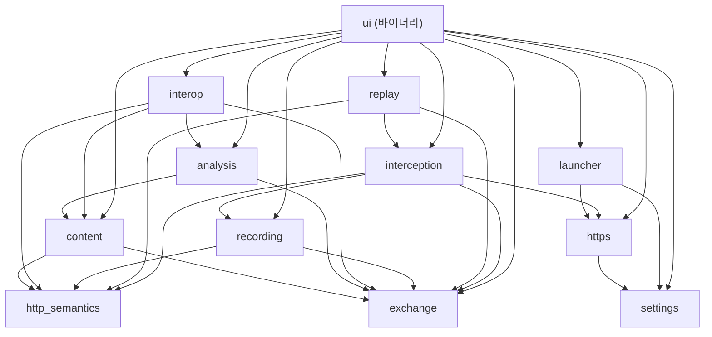

# 개발 문서

[README](../README.md)로 돌아가기

이 문서는 HTTP Inspector를 개발하고 검증할 때 필요한 환경, 명령과 설계 문서를 모은다. 작업 흐름, 커밋과 PR 규칙은 [AGENTS.md](../AGENTS.md)를 따른다.

## 개발 환경

프로젝트는 Rust 1.100.0을 사용한다. `rustup`은 `rust-toolchain.toml`에 지정된 툴체인을 설치한다. Linux에서는 X11을 사용하며, macOS에서는 X11이 필요하지 않다.

Linux 시스템 패키지와 macOS의 선택 도구(Homebrew NSS)는 [README의 설치](../README.md#설치)를 따른다. CI도 같은 패키지를 설치한다.

글꼴 등록을 확인하려면 다음처럼 실행한다. 어떤 폰트를 등록했는지 로그로 확인할 수 있다.

```bash
RUST_LOG=http_proxy::ui::style::fonts=debug cargo run
```

## 검증

전체 로컬 검사를 실행한다.

```bash
cargo fmt --all --check
python3 scripts/check-boundaries.py
cargo clippy --workspace --all-targets --all-features -- -D warnings
cargo test --workspace --all-features
RUSTDOCFLAGS="-D warnings" cargo doc --workspace --all-features --no-deps
cargo deny check
cargo build --release
```

요청 검색 알고리즘 후보(미리보기 2,000건 × 8KiB, 전체 로그 256MiB, gzip 64MiB)의 검색 시간은 `cargo bench --bench search`로 측정한다. 결과는 `target/criterion`에 남는다.

통합 테스트는 실제 TCP 연결을 사용한다. 테스트는 HTTP 전달과 `CONNECT` 터널의 양방향 전송을 검증한다.

프록시를 띄우지 않고 캡처 레코드(`Exchange`)가 필요한 테스트는 `test-support` feature의 `http_proxy::interception::ExchangeBuilder`로 레코드를 만든다. 빌더는 캡처 경로와 같은 쓰기 핸들과 헤더 마스킹·길이 제한 규칙을 쓴다. 본문을 읽는 분석 코드(엔드포인트 스키마)는 `BodySource` 포트로 본문을 받으므로, 테스트에서는 본문 저장소 대신 디코딩된 본문을 메모리에 둔 `http_proxy::exchange::MemoryBodySource`를 넘긴다. `Cargo.toml`의 `dev-dependencies`가 이 패키지 자신을 `test-support`와 함께 참조하므로 테스트·벤치마크·문서 테스트 빌드에서만 feature가 켜지고, `cargo build --release` 결과물에는 빌더가 들어가지 않는다.

macOS 실환경에서 키체인 등록·상태 확인·제거와 Chrome 검사 창 실행을 확인하려면 다음 검사를 실행한다. 첫 검사는 임시 CA를 로그인 키체인에 등록한 뒤 제거하며, macOS 인증 창이 나타날 수 있다.

```bash
cargo test --test macos_integration -- --ignored
```

## CI

CI(`.github/workflows/ci.yml`)는 이벤트에 따라 실행 범위가 다르다. PR 대기 시간을 줄이려고 PR에서는 느린 러너와 단계를 생략하고, 생략한 범위는 `main` 푸시와 매일 한 번의 일정 실행에서 검증한다.

| 작업 | PR | `main` 푸시, `v*` 태그 푸시, 일정 실행(매일 03:00 KST), 수동 실행 |
| --- | --- | --- |
| `quality (ubuntu-24.04, x86_64-unknown-linux-gnu)` | 전체 단계 | 전체 단계 |
| `quality (macos-15, aarch64-apple-darwin)` | 포맷, 모듈 경계, Clippy, 테스트, 문서 | 전체 단계 |
| `quality (macos-15-intel, x86_64-apple-darwin)` | 실행하지 않음 | 전체 단계 |
| `package-smoke (ubuntu-24.04, x86_64-unknown-linux-gnu)` | artifact 다운로드·실행 검사 | 같음 |
| `package-smoke (macos-15, aarch64-apple-darwin)` | 실행하지 않음 | artifact 다운로드·실행 검사 |
| `package-smoke (macos-15-intel, x86_64-apple-darwin)` | 실행하지 않음 | artifact 다운로드·실행 검사 |
| `dependencies` | `cargo deny check` | 같음 |
| `release` | 실행하지 않음 | 태그 푸시에서만 |

`quality`의 전체 단계는 포맷, 모듈 경계 검사, Clippy, 테스트, 문서, Release 빌드, 패키지, artifact 업로드다. PR의 macOS 작업은 Release 빌드부터 업로드까지를 모두 건너뛰므로 macOS artifact를 만들지 않는다. `package-smoke`는 `quality`가 모두 끝난 뒤 같은 OS의 새 러너에서 업로드된 artifact를 이름으로 받아 실행 파일을 검사한다. 업로드한 작업 안에서 바로 받으면 artifact 목록 반영이 늦어 `Artifact not found`로 실패할 수 있어서, 업로드 작업이 끝난 뒤 받도록 작업을 나눴다. Linux 러너에는 README의 런타임 라이브러리와 Xvfb만 설치한다. 태그 푸시는 PR이 아니므로 세 대상의 압축을 모두 만들고, `release` 작업은 `package-smoke`까지 성공한 세 압축을 확인한 뒤 공개한다.

- **Cargo 캐시:** `Swatinem/rust-cache`가 운영체제, rustc 버전, `Cargo.lock`을 키로 의존성 빌드 결과를 캐시한다. 캐시는 `main` 브랜치의 푸시·일정·수동 실행에서만 저장한다. PR과 태그 푸시는 `main` 캐시를 읽기만 한다. PR 캐시가 저장소 캐시 한도(10GB)를 채워 `main` 캐시를 밀어내지 않게 하기 위해서다.
- **중복 실행 취소:** 같은 PR에 다시 푸시하면 이전 실행을 취소한다. `main` 푸시, 태그 푸시, 일정·수동 실행은 실행마다 별도 그룹이라 취소되거나 대체되지 않는다.
- **디버그 정보:** CI는 `CARGO_PROFILE_DEV_DEBUG=line-tables-only`로 test 빌드의 디버그 정보를 줄인다. 테스트가 실패해도 백트레이스에는 파일과 줄 번호가 남는다.
- **cargo-deny:** `taiki-e/install-action`으로 미리 빌드된 바이너리를 설치한다.

Intel macOS에서만 생기는 문제와 macOS 패키지 문제는 PR이 아니라 병합 후 `main` 푸시나 일정 실행에서 드러날 수 있다. 플랫폼 코드, 의존성, 빌드·패키지 설정을 바꾸는 PR은 **Actions** 탭의 **Run workflow**로 해당 브랜치를 수동 실행해 세 대상 전체를 확인할 수 있다.

## 배포 검증

CI는 Ubuntu 24.04 x86_64, macOS 15 arm64, macOS 15 Intel에서 각각 네이티브 빌드한다. PR에서는 이 중 Linux 대상만 빌드·패키지·실행 검사하고, 세 대상 전체는 `main` 푸시, 태그 푸시, 일정·수동 실행에서 검사한다([CI](#ci) 참고). `scripts/package.py`는 실행 파일과 공개 문서·라이선스만 복사해 tar.gz와 SHA-256 파일을 만든다. `scripts/smoke-package.py`는 Actions에서 다시 다운로드한 압축의 체크섬과 실행 권한을 확인하고, 임시 데이터 디렉터리에서 GUI를 실행해 로컬 HTTP 요청을 전달한다. Linux는 Xvfb를 사용한다. 성공 로그에 실제 OS와 CPU 아키텍처가 남는다. 서명·공증, Gatekeeper 승인과 사용자 화면 조작은 검사하지 않는다.

릴리스를 만들 때는 `Cargo.toml`의 버전과 정확히 일치하는 `v<버전>` 태그를 push한다. 태그 검증, 세 대상의 품질 검사·빌드·실행 검사와 의존성 검사가 모두 성공해야 릴리스 job이 실행된다. 이 job은 세 압축과 체크섬을 확인하고 draft에 모두 첨부한 다음 공개한다. 실패한 draft는 정상 릴리스로 공개하지 않는다. 같은 태그의 릴리스가 이미 있으면 자동으로 덮어쓰지 않는다. 재실행 전에 해당 draft의 첨부 상태를 확인하고 필요하면 draft를 삭제한다. 이미 공개된 릴리스는 새 버전으로 수정한다.

Actions의 [파일 권한 제한](https://github.com/actions/upload-artifact/tree/v4#permission-loss) 때문에 실행 파일을 tar.gz로 감싼다. 대상은 GitHub의 [호스팅 runner 목록](https://docs.github.com/en/actions/reference/runners/github-hosted-runners)에 따라 고정하고, 공개에는 GitHub CLI의 [draft와 verify-tag 옵션](https://cli.github.com/manual/gh_release_create)을 사용한다.

## 모듈 구조와 의존 규칙

라이브러리 크레이트(`src/lib.rs`)는 도메인 모듈 선언과 앱 상수(`APP_NAME`, `DEFAULT_PORT`)만 두고, 타입을 최상위에 평평하게 다시 내보내지 않는다. 바이너리(`src/ui/`), 통합 테스트(`tests/`), 벤치마크(`benches/`)는 `http_proxy::exchange::Exchange`, `http_proxy::recording::FullLog`처럼 도메인 경로로 API를 사용한다.

| 모듈 | 위치 | 책임 |
| --- | --- | --- |
| `exchange` | `src/exchange.rs`, `src/exchange/` | 공유 캡처 모델(`RecordId`, `Exchange`, 헤더·본문 미리보기, `Outcome`, 터널, `MediaType`, `BodySide`, `BodySource` 포트) |
| `http_semantics` | `src/http_semantics.rs`, `src/http_semantics/` | 내부 HTTP 규칙(hop-by-hop 헤더 제거, 민감 헤더 마스킹) |
| `settings` | `src/settings.rs`, `src/settings/` | 저장 위치 규칙과 프록시 포트 검증 |
| `content` | `src/content/` | `Content-Encoding` 해제, 본문 형식 감지·포맷 토큰화, 이미지 디코딩 |
| `analysis` | `src/analysis/` | 캡처 이벤트 파이프라인, URL 정규화·맵, 엔드포인트 스키마, 검색, 레코드 필터 |
| `interop` | `src/interop/` | 외부 형식 변환(HAR 1.2, cURL, URL 맵 Text/JSON/Mermaid/DOT) |
| `https` | `src/https.rs`, `src/https/` | 로컬 CA 생성·발급과 OS trust store 등록 |
| `launcher` | `src/launcher.rs`, `src/launcher/` | 프록시가 설정된 브라우저 탐색·실행 |
| `recording` | `src/recording.rs`, `src/recording/` | 전체 세션 로그(`FullLog`)와 본문 저장소(`BodyStore`, `BodySource` 구현) |
| `interception` | `src/interception.rs`, `src/interception/` | 로컬 프록시 리스너, 업스트림 전달, `CONNECT` 터널, 캡처, `test-support` 픽스처 빌더 |
| `replay` | `src/replay.rs`, `src/replay/` | 재전송 초안 검증과 실행 요청 |
| `ui` (바이너리) | `src/main.rs`, `src/ui/` (`app`, `requests`, `detail`, `map`, `dialogs`, `style`) | eframe/egui 데스크톱 화면 |

아래 그림은 허용하는 모듈 의존 방향을 보여 준다. 화살표 반대 방향 참조는 허용하지 않는다.



`scripts/check-boundaries.py`가 로컬과 CI(`quality` 작업)에서 다음 규칙을 검사한다(`crate::`뿐 아니라 `super::`·`self::` 상대 경로도 파일의 모듈 경로 기준으로 정규화해 검사하며, `use crate;`·`use crate as ...;` 등 크레이트 루트 별칭을 금지한다).

- `src/lib.rs`에 최상위 `pub use` 재노출을 두지 않는다.
- `src/ui/`와 `src/main.rs`를 제외한 `src/`의 모든 코드는 `eframe`·`egui`·`egui_extras`를 참조하지 않는다.
- `exchange`·`http_semantics`·`settings`는 다른 도메인 모듈을 참조하지 않는다.
- `content`·`analysis`·`interop`는 `interception`·`recording`·`https`·`replay`를 참조하지 않는다. 본문은 `exchange::BodySource` 포트로 읽는다. 단, `test-support`의 `ExchangeBuilder` 등이 `interception::capture` 규칙을 재사용하므로 `analysis`·`interop`·`recording`의 `#[cfg(test)]` 단위 테스트에서만 해당 픽스처 항목(`ExchangeBuilder`, `ConnectExchangeBuilder`, `ResponseFixture`, `FixtureError`, `BODY_PREVIEW_BYTES`) 참조를 허용한다.
- `Exchange` 쓰기 핸들(`ExchangeWriter`, `BodyPreviewWriter`, `TunnelWriter`)은 프로덕션 코드에서 `exchange`·`interception`·`replay`에서만 사용한다.

## 설계 문서

- [네트워크 인스펙터 설계](http-network-inspector-design.md)
- [Rust 개발 도구 및 의존성](rust-development-tooling.md)
- [코드 품질 기준](code-quality.md)
- [Network 상세 보기 설계](f12-network-increment-design.md)
- [HTTPS 복호화 구현 설계](https-inspection-implementation.md)
- [HTTPS 후속 작업](https-future-work.md)

Git 작업 흐름은 별도 문서 없이 [AGENTS.md](../AGENTS.md)의 Git·커밋·PR 지침에 정리되어 있다.
