# 본문 보기

[사용자 가이드 목록](README.md) · [README](../../README.md)

선택한 요청의 **Body** 탭에서 요청·응답 본문을 확인한다. 이 문서는 미리보기 한도, 압축 해제, 형식별 정리와 구문 강조, JSON·XML 트리, 이미지 미리보기를 설명한다.

## 미리보기 한도

본문 미리보기는 방향별 최대 8KiB이며 메모리에 유지한다. 화면 기록을 삭제하거나 앱을 종료하면 사라진다. 큰 본문은 전체를 계속 전달하며 화면 미리보기만 8KiB에서 자른다. 본문 전체는 [전체 로그](logs.md)에 기록된다.

## 압축 해제

요청·응답 본문의 `Content-Encoding`이 `gzip`, `deflate`, `br`, `zstd`이면 화면 미리보기에서 압축을 푼다. 압축 해제한 출력도 최대 8KiB로 제한하며, 캡처한 압축 데이터가 일부뿐이면 표시 가능한 앞부분과 불완전 상태를 보여 준다. 지원하지 않는 형식이나 손상된 압축 데이터에는 오류를 표시한다. 과도한 중첩 압축과 중간 데이터 확장은 미리보기를 거부한다. 프록시 전달과 전체 로그에는 압축된 원본 바이트를 유지한다.

한글(현대 한글 11,172자)과 ASCII는 앱 바이너리에 내장한 Noto Sans KR 서브셋으로 표시하므로 OS나 폰트 설치 여부와 관계없이 보인다. 내장 폰트에 없는 한자·가나는 시스템에 Nanum 또는 Noto CJK 폰트가 있으면 그 폰트로 보완한다. Ubuntu에서 한자·가나가 네모로 보이면 `sudo apt install fonts-noto-cjk`로 폰트를 설치하고 앱을 다시 실행한다. 시스템 폰트 파일이 손상됐거나 TTF/OTF/TTC 형식이 아니면 등록하지 않고 경고 로그를 남긴 뒤 내장 폰트만 사용한다. `RUST_LOG=http_proxy::ui::fonts=debug cargo run`으로 실행하면 어떤 폰트를 등록했는지 확인할 수 있다.

다음은 Brotli로 압축한 테스트 JSON의 한글 본문을 미리보기에서 표시한 실제 화면이다.

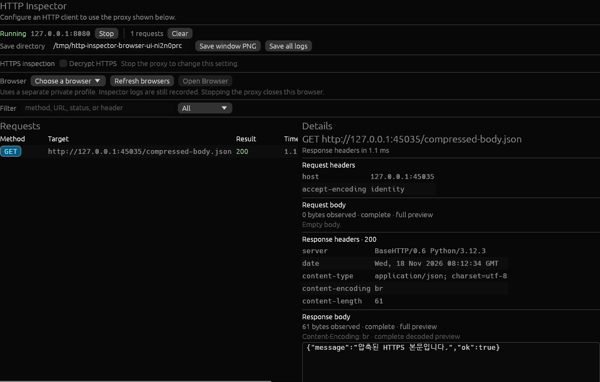

다음은 Chrome으로 접속한 HTTPS 응답의 `Content-Encoding: br` 헤더와 압축을 푼 HTML 본문이다.

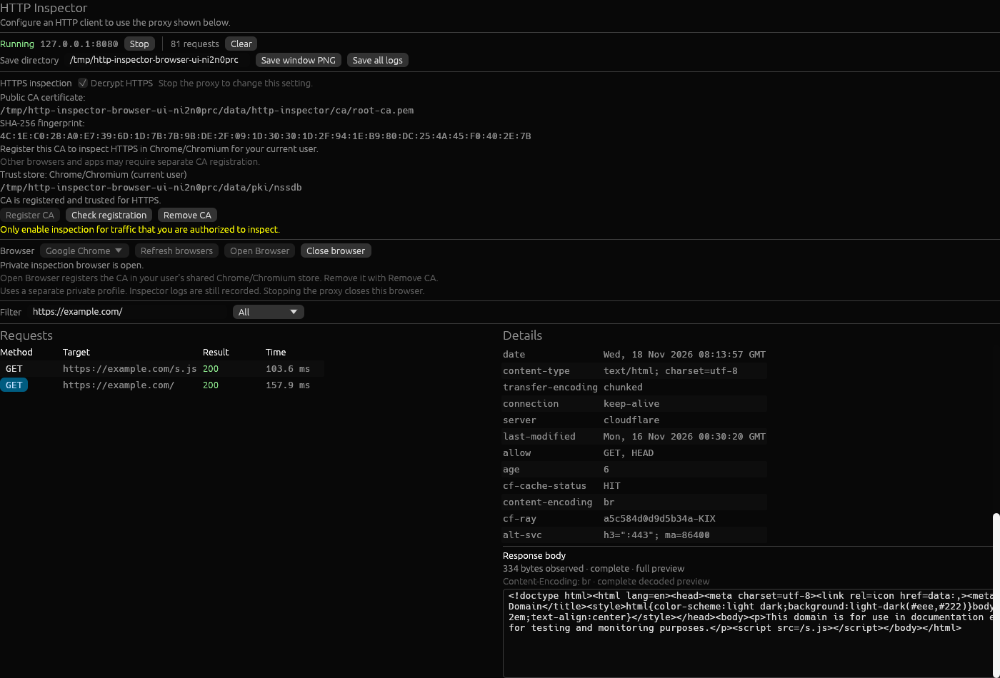

## 본문 정리와 구문 강조

**Body** 탭 위쪽의 **View: Pretty / Raw / Tree**로 본문 보기 방식을 고른다. 기본값은 Pretty이며, 고른 방식은 다른 요청을 선택해도 유지된다. `Content-Type`으로 형식을 판별해 본문 위에 `Format: JSON · Pretty`처럼 표시한다.

| 형식 | 판별하는 `Content-Type` | Pretty 보기 |
| --- | --- | --- |
| JSON | `application/json`, `*/*+json` | 2칸 들여쓰기, 키·문자열·숫자·`true`/`false`/`null`·괄호를 다른 색으로 표시 |
| CSS | `text/css` | 규칙·선언마다 줄바꿈, 중첩 블록 들여쓰기, 줄 번호와 선택자·at-rule·속성·값·단위·색상·`!important`·주석 강조 |
| Form | `application/x-www-form-urlencoded` | 키와 값을 퍼센트 디코딩해 한 줄에 `key = value` 하나씩 표시 |
| HTML | `text/html`, `application/xhtml+xml` | 태그마다 줄을 나누고 들여쓰기, 태그·속성 이름·속성 값·주석을 구분. 공백이 의미를 갖는 `pre`·`textarea`와 `script`·`style`의 내용은 원문 그대로 |
| XML | `application/xml`, `text/xml`, `*/*+xml`(Atom·RSS·SOAP·SVG 소스 등) | 요소만 담은 내용을 2칸 들여쓰기. 태그·네임스페이스 접두사·속성 이름·속성 값·주석·`CDATA`·처리 명령·엔티티를 구분. 텍스트·`CDATA`·주석의 내용과 `xml:space="preserve"` 요소는 원문 그대로 |
| JavaScript | `text/javascript`, `application/javascript`, `application/x-javascript`, `application/ecmascript`, `text/ecmascript` | `{`·`;`·`,` 뒤와 `}` 앞에서 줄을 나누고 중괄호 깊이로 들여쓰기, 키워드·문자열·템플릿 리터럴·숫자·정규식·주석·연산자를 구분하고 줄 번호를 표시 |

- 미리보기는 8KiB에서 잘릴 수 있으므로 문법 분석 대신 토큰 단위로 정리한다. 잘린 문자열, 닫히지 않은 괄호·태그도 있는 데까지 정리해 보여 준다.
- 형식에 맞지 않는 글자가 있어 정리할 수 없으면(예: JSON으로 표시된 HTML 오류 페이지) 원문을 그대로 보여 주고 `Showing raw text: …` 안내에 이유와 위치를 적는다. 그 밖의 형식은 Pretty에서도 원문 그대로다.
- CSS는 문자열, `url(...)`, 주석의 원문을 보존한다. 잘린 미리보기나 닫히지 않은 블록·문자열에는 불완전 안내를 표시하고 읽은 부분까지 정리한다. 속성 값의 유효성은 검사하지 않는다. URL과 `sourceMappingURL` 주석은 표시만 하며 외부 파일은 가져오지 않는다. 색 견본은 `var()`·`currentColor`처럼 문맥에 따라 달라지는 색을 오해하지 않도록 제공하지 않는다.
- **Raw**는 압축만 푼 원문을 정리 없이 보여 준다.
- **Tree**는 JSON과 XML에서 쓸 수 있다. 요청·응답 모두 지원하지 않는 형식이면 버튼이 비활성화된다. 한쪽만 지원하면 다른 본문은 Pretty로 표시하고 안내한다.
- JavaScript는 줄 번호와 함께 보이는 줄만 그린다. Pretty는 정리한 줄, Raw는 원래 줄 기준으로 번호를 매기며 긴 줄은 접지 않고 가로로 스크롤한다. 모듈 스크립트(`.mjs`)와 JSONP 응답도 위 `Content-Type`으로 오면 같은 방식으로 보여 준다.
- JavaScript 정리는 토큰 사이의 공백만 바꾼다. 문자열, 템플릿 리터럴(`${…}` 포함), 정규식, 주석은 한 글자도 바꾸지 않고, 원문에 있던 줄바꿈은 유지하며(자동 세미콜론 삽입 의미 보존) 문법 의미를 바꾸지 않는 곳에만 줄바꿈을 더한다. `/`가 정규식인지 나눗셈인지는 앞 토큰과 괄호 종류(`if (…)` 뒤, 블록 `}` 뒤 등)로 판별하며, 줄바꿈으로 끊긴 문자열·정규식이나 짝이 맞지 않는 괄호처럼 추측이 필요한 입력은 정리하지 않고 원문을 보여 준다.
- 스크립트가 8KiB 미리보기에서 잘리면 읽은 부분까지 정리하고, 끝나지 않은 문자열·주석·블록 등이나 캡처가 일부뿐이라는 경고를 표시한다. `//# sourceMappingURL=` 주석이 있으면 URL을 안내하지만 소스맵 파일은 가져오지 않는다. 스크립트는 실행하지 않는다.
- 색은 글자 자체의 구분(키 뒤의 `:`, 따옴표, 꺾쇠괄호, 주석의 기울임)을 보조할 뿐이며, 밝은·어두운 테마의 모든 배경에서 4.5:1 이상 대비를 테스트로 확인한다.
- **Headers** 탭은 헤더 이름을 `name:` 형태의 다른 색으로, 값은 기본 색으로 표시한다. 요청 URL에 쿼리가 있으면 **Query parameters**에 퍼센트 디코딩한 키와 값을 나눠 보여 준다.
- 정리와 강조는 화면 표시에만 쓰며 프록시 전달 바이트와 전체 로그는 바꾸지 않는다. 강조 결과는 선택한 기록, 본문 길이, 보기 방식, 테마가 바뀔 때만 다시 계산한다.

## XML 보기

XML 본문은 [quick-xml](https://crates.io/crates/quick-xml)로 읽어 Pretty와 Tree가 같은 결과를 쓴다.

- **Pretty:** 요소만 담은 내용은 줄을 나누고 들여쓴다. 텍스트·엔티티·`CDATA`가 섞인 요소는 공백이 의미를 가질 수 있으므로 내용을 원문 그대로 한 덩어리로 둔다. 태그 안 속성 사이 공백만 한 칸으로 정리하고 속성 값은 바꾸지 않는다.
- **Tree:** 요소를 접고 펼칠 수 있다. 처음에는 두 단계까지 펼쳐 두고, 접힌 요소 옆에 `… 3 children`처럼 자식 수를 표시한다. `<title>News</title>`처럼 텍스트 하나만 가진 요소는 한 줄로 보여 준다. 요소를 오른쪽 클릭하면 `/rss/channel/item[2]/title` 같은 XPath를 보고 **Copy XPath**로 복사할 수 있다. 같은 이름의 형제가 여럿이면 1부터 세는 위치를 붙인다. 긴 줄은 200자에서 줄이고, 마우스를 올리면 전체를 보여 준다.
- 미리보기가 8KiB에서 잘렸거나 문법이 틀리면 읽은 데까지 보여 주고 `XML is incomplete (… at byte N); showing the part read so far.`처럼 이유와 위치를 안내한다. 나머지는 **Raw**에서 볼 수 있다.
- **보안:** DTD와 엔티티 정의를 해석하지 않는다. `&xxe;` 같은 외부 엔티티나 엔티티 확장 공격은 원문 표기 그대로 보여 줄 뿐 파일·네트워크를 읽거나 펼치지 않는다. 요소 중첩 256단계, 노드 10,000개를 넘으면 그 앞까지만 보여 주고 안내한다.
- `image/svg+xml`도 텍스트로 보여 줄 때는 같은 XML 보기를 쓴다.

## JSON Tree

JSON Tree는 객체·배열을 처음 두 단계까지 펼친다. 화살표나 **Expand all**, **Collapse all**로 접기 상태를 바꾼다. 접힌 객체에는 중복을 포함한 키 수, 배열에는 항목 수가 표시된다. 원문의 키 순서·중복 키·숫자 표기를 보존한다.

**Search**에 키나 값을 입력하면 일치한 노드까지 펼치고 강조한다. 생략된 문자열은 툴팁으로 전체 값을 확인한다. 값을 우클릭하고 **Copy path** 또는 **Copy value (JSON)**를 고르면 경로나 원문 값을 복사한다. 경로는 `$.data.items[3].id` 형식이며 특수문자가 있는 키는 `$["a.b"]`처럼 표시한다. 중복 키의 경로는 같지만 각 노드의 값은 그대로 복사된다.

JSON Tree는 깊이 64단계·4,096개 노드로 제한하며, 보이는 행만 그린다. 잘린 JSON·문법 오류·상한 초과는 안내와 함께 Pretty로 대체한다. JSON Pretty도 64단계를 넘으면 Raw로 대체한다. 트리는 화면 표시에만 쓰며 전달 바이트와 전체 로그를 바꾸지 않는다.

## 화면 예시

CSS 실제 화면 캡처는 macOS 접근성 권한이 없는 환경에서 추가하지 못했다. 아래 캡처는 기존 JSON·HTML 보기이며 CSS 화면을 나타내지 않는다.

다음은 로컬 테스트 서버의 minified JSON 응답을 Pretty와 Raw로 본 실제 화면이다.

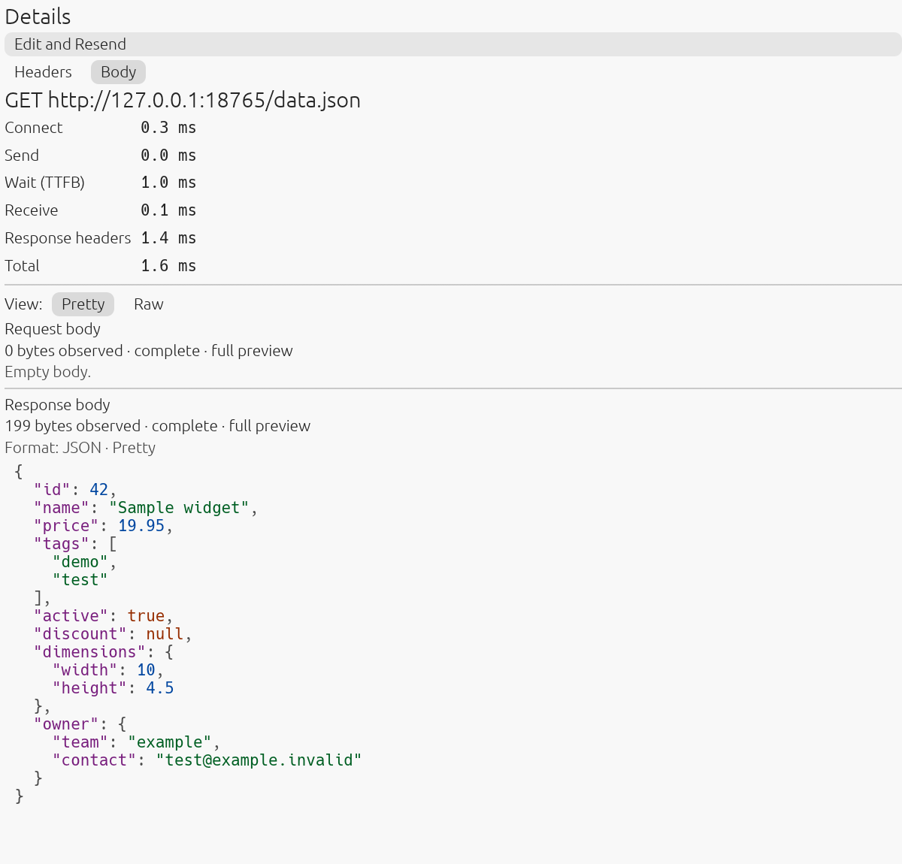

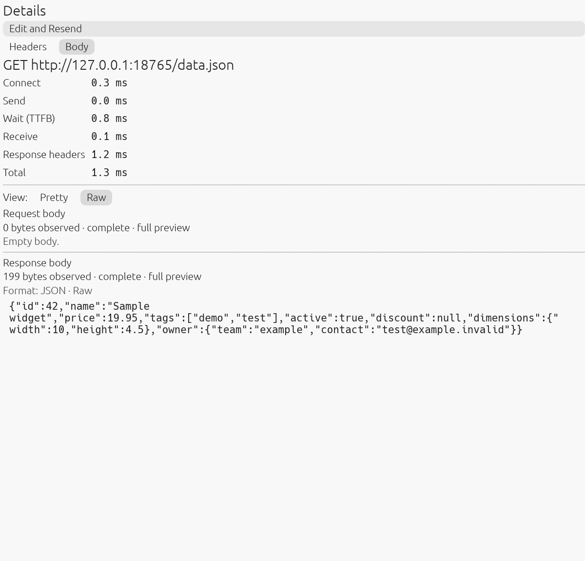

다음은 어두운 테마에서 minified HTML 응답을 Pretty로 본 화면과, 쿼리 매개변수·헤더 강조를 보여 주는 **Headers** 탭이다.

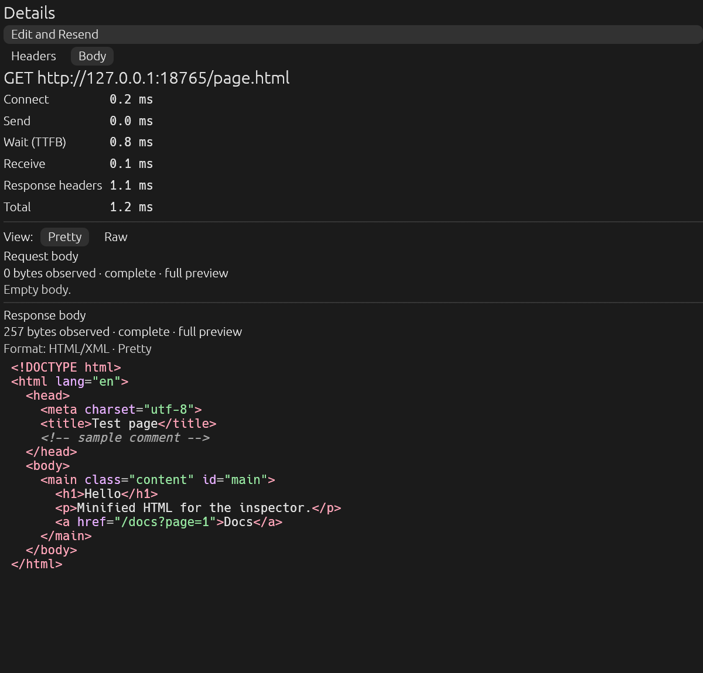

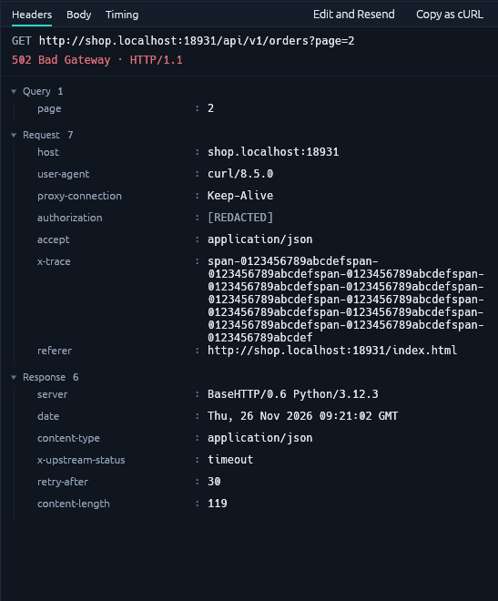

## 이미지 응답 미리보기

`Content-Type`이 다음 형식인 응답은 **Body** 탭의 **Response body**에서 이미지로 그린다. 이미지를 그리려면 본문 전체가 필요하므로 이미지 응답을 응답당 최대 8MiB까지 메모리에 보관한다. 모든 이미지 응답이 함께 쓰는 보관 한도는 64MiB이며, 기록을 삭제하거나 오래된 기록이 밀려나면 그만큼 다시 쓸 수 있다. `Content-Length`가 8MiB를 넘는 이미지 응답은 공용 한도를 쓰지 않고 다른 본문처럼 앞 8KiB만 보관한다. 한도를 넘은 응답은 이미지 대신 보관한 바이트 수와 한도를 안내한다.

| 형식 | `Content-Type` | 표시 방식 |
| --- | --- | --- |
| PNG | `image/png` | 첫 프레임 |
| JPEG | `image/jpeg` | Progressive, 그레이스케일, CMYK 지원. EXIF 방향은 적용하지 않는다 |
| GIF | `image/gif` | 애니메이션은 첫 프레임만 그리고 프레임 수를 표시한다(1,000개까지 센다) |
| WebP | `image/webp` | 손실·무손실·애니메이션. 애니메이션은 첫 프레임과 프레임 수를 표시한다 |
| SVG | `image/svg+xml` | 래스터화해 그린다. **Source**로 소스를 텍스트로 볼 수 있다 |
| BMP | `image/bmp` | |
| ICO | `image/x-icon`, `image/vnd.microsoft.icon` | 여러 크기 중 가장 큰 이미지 |

AVIF(`image/avif`)는 지원하지 않는다. Rust만으로 된 AV1 디코더(`rav1d`)는 `unsafe` C ABI만 공개하고, 그 밖의 디코더는 C 라이브러리 `dav1d`나 `libaom`이 필요하다. AVIF 응답은 일반 본문처럼 텍스트 미리보기로 표시한다.

- `Content-Encoding`이 있으면 텍스트 미리보기와 같은 방식으로 압축을 푼 뒤 디코딩한다.
- 본문 앞부분의 시그니처가 `Content-Type`과 다른 형식이면 시그니처 기준으로 그리고, 그 사실을 경고로 표시한다. 시그니처를 알 수 없으면 `Content-Type`의 형식으로 디코딩한다.
- 형식, 이미지 크기(가로×세로), 이미지 파일 바이트 수와 애니메이션 프레임 수를 표시한다. 압축 전송이면 받은 바이트 수도 함께 표시한다.
- 가로·세로 8,192px 또는 16메가픽셀을 넘는 이미지는 헤더만 읽고 픽셀 메모리를 할당하기 전에 거부한다. 애니메이션은 첫 프레임만 디코딩하므로 디코딩 메모리는 한 프레임 크기를 넘지 않는다.
- 본문이 잘렸거나 손상되어 디코딩하지 못하면 오류를 표시한다. **Hex** 또는 **Show bytes as hex**로 받은 바이트의 앞 8KiB를 16진수로 확인할 수 있다.

SVG는 다음 제한으로 그린다.

- 스크립트를 실행하지 않는다. 외부 CSS·글꼴·이미지를 포함해 SVG 밖의 리소스를 네트워크나 파일에서 읽지 않는다. `<image>`는 data URL도 그리지 않는다.
- 글꼴을 읽지 않으므로 `<text>`는 그리지 않고 안내를 표시한다. 내용은 **Source**에서 확인한다.
- `<use>`가 가리키는 대상을 복사본으로 셀 때 요소가 50,000개, 중첩이 256단계를 넘거나 `<use>` 참조가 순환하면 그리지 않는다.
- 한 변이 2,048px를 넘으면 비율을 유지해 줄여 그린다.
- **Source**는 압축을 푼 SVG의 앞 256KiB를 텍스트로만 보여 준다.

다음은 로컬 테스트 서버의 응답을 프록시로 받아 표시한 실제 화면이다. 왼쪽 표의 일부와 툴바는 잘라냈다.

애니메이션 GIF는 첫 프레임과 프레임 수를 표시한다.

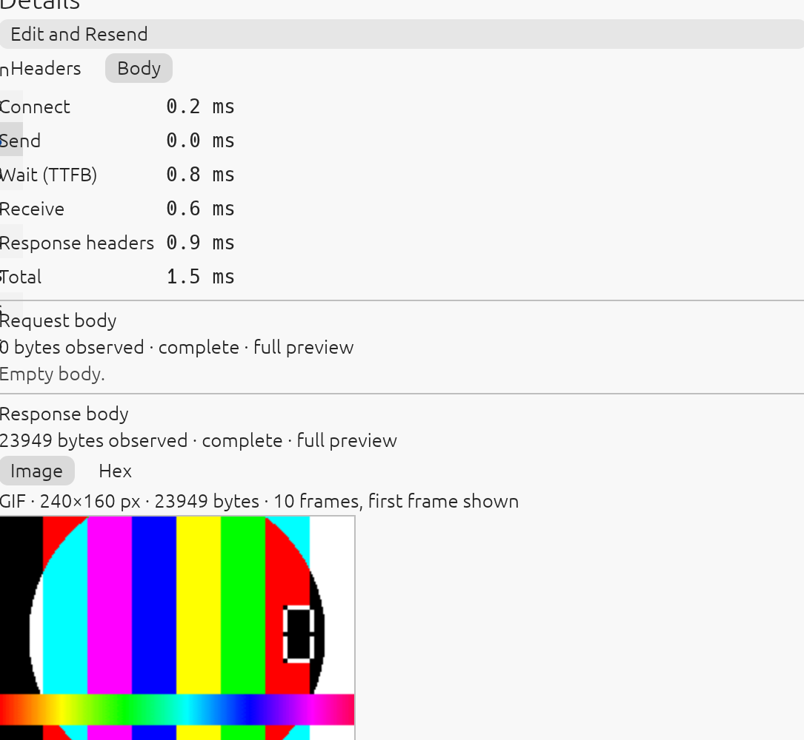

`Content-Type: image/png`로 보낸 GIF는 시그니처 기준으로 GIF로 그리고 경고를 표시한다.

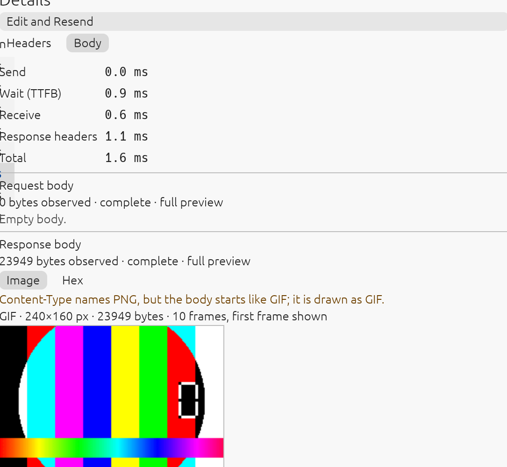

손실 압축 WebP, BMP, ICO 응답이다.

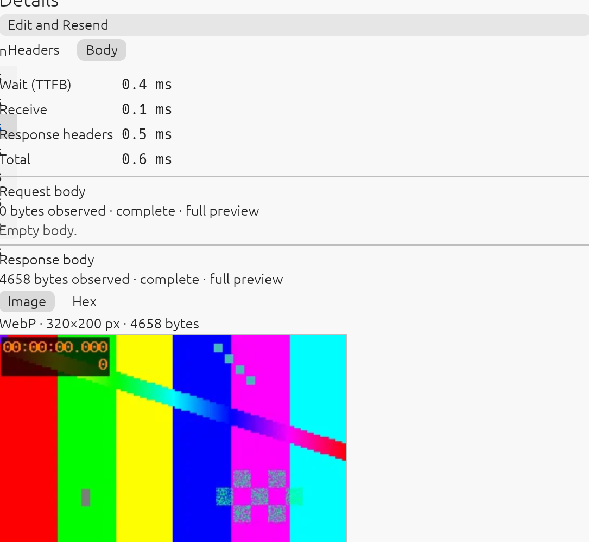

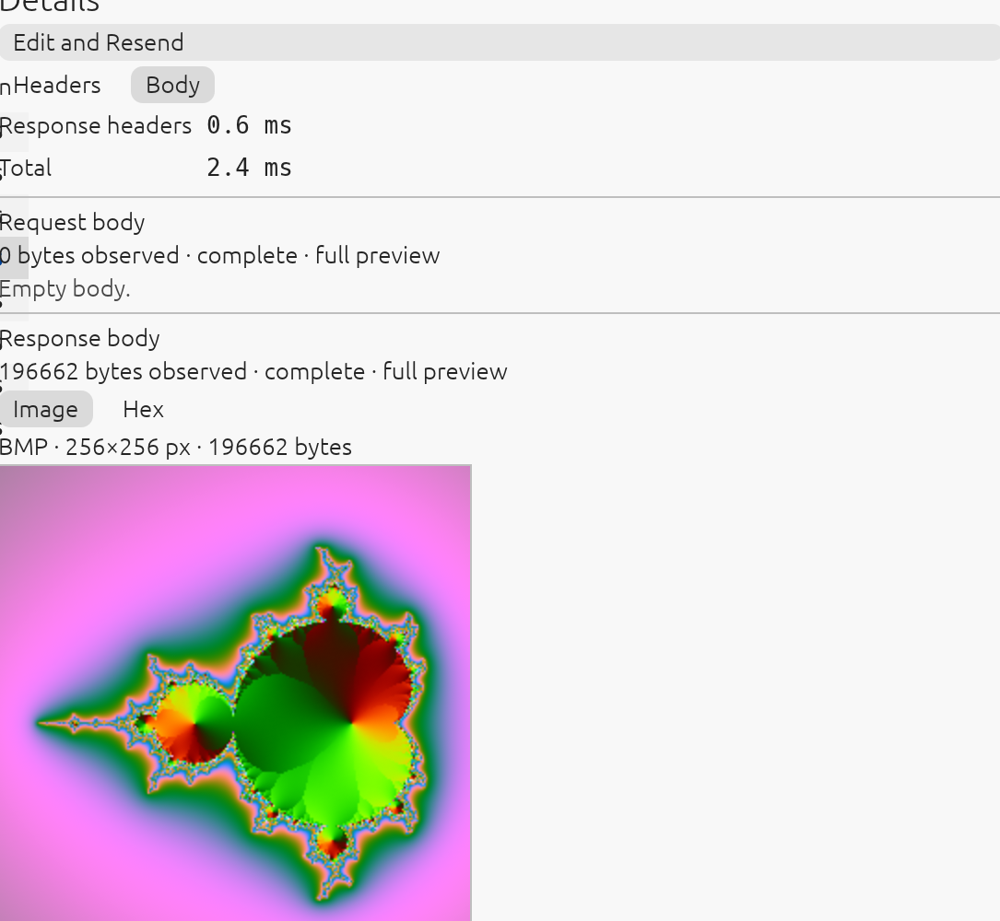

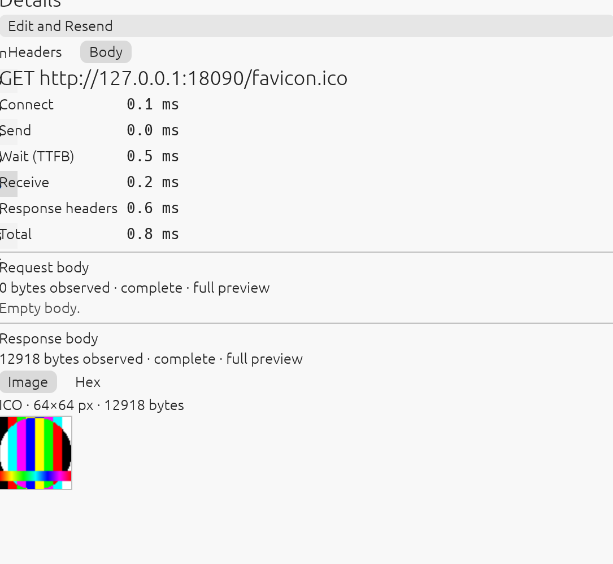

외부 CSS·스크립트·이미지를 참조하는 SVG는 외부 리소스 없이 그리고, 그리지 않은 요소를 안내한다. 이 화면을 만드는 동안 참조 대상 포트로 들어온 연결은 없었다. **Source**는 소스를 텍스트로만 보여 준다.

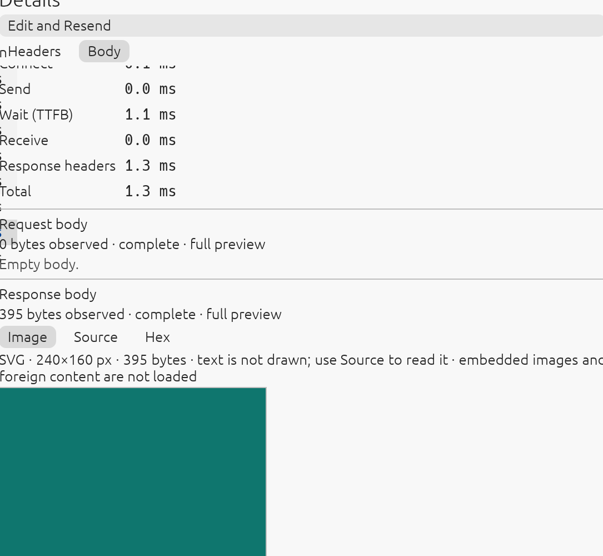

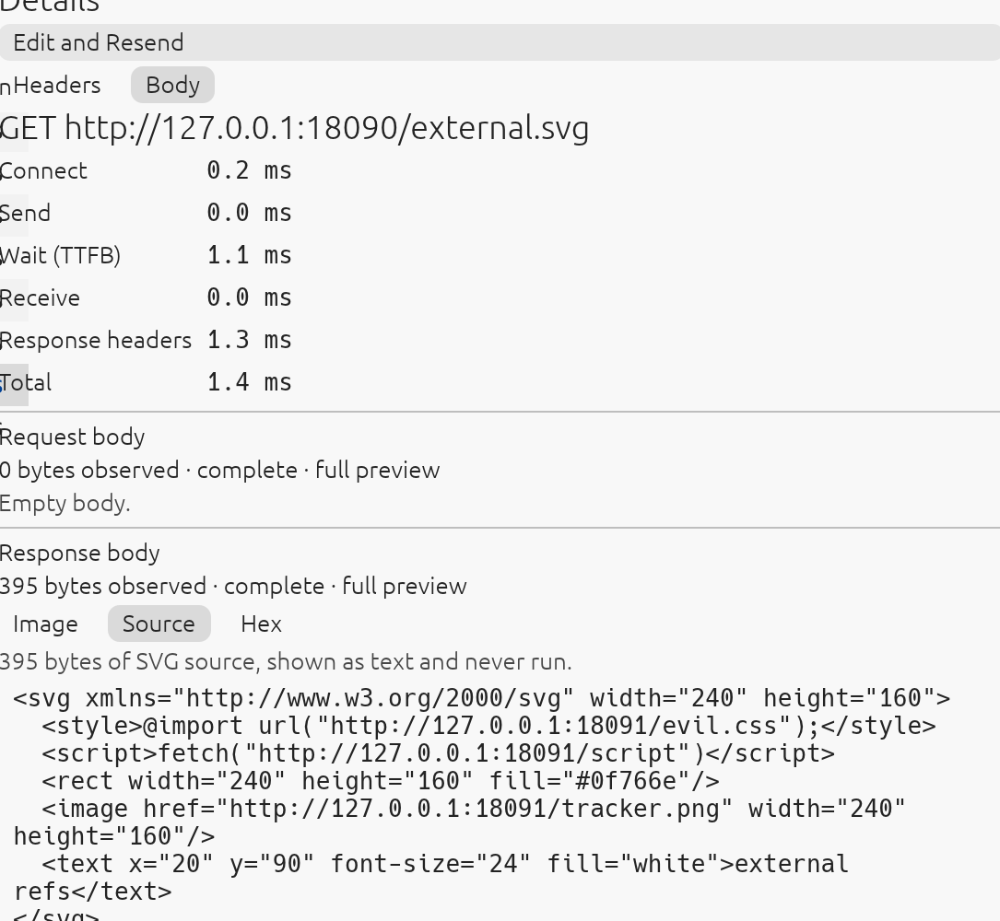

앞 300바이트만 보낸 WebP 응답은 디코딩 오류와 **Show bytes as hex** 버튼을 표시한다.

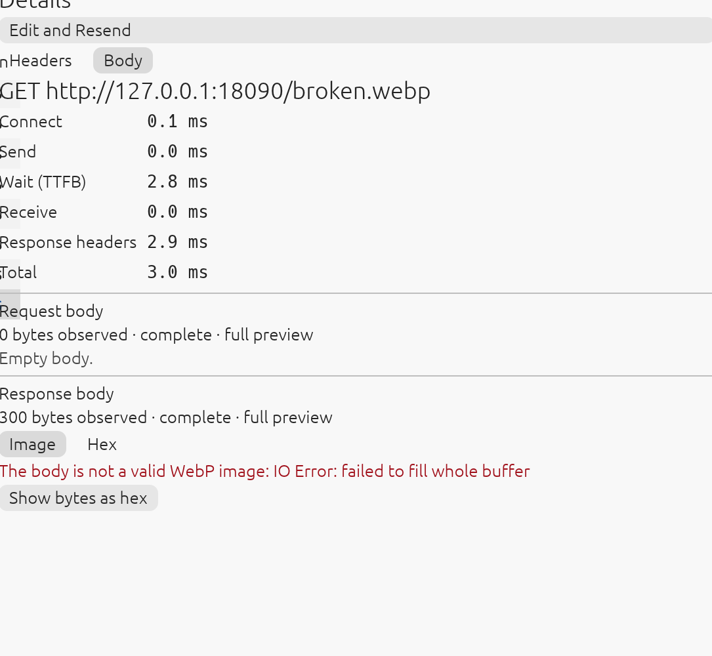

다음은 gzip으로 전송한 테스트 PNG 응답을 이미지로 표시한 실제 화면이다.

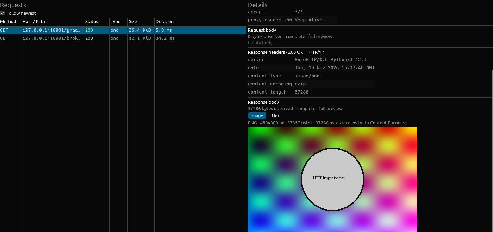

다음은 본문 앞 3분의 1만 보낸 테스트 PNG 응답의 디코딩 오류와 16진수 보기다.

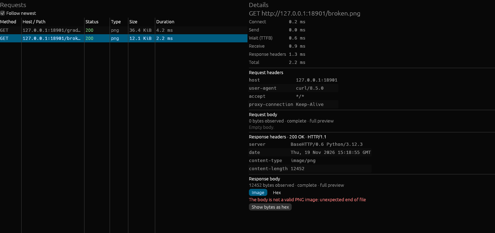

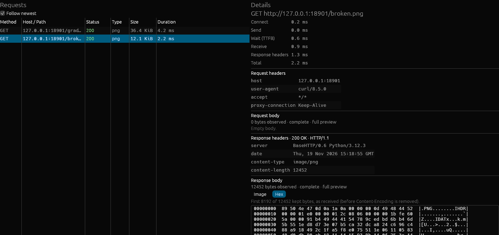
