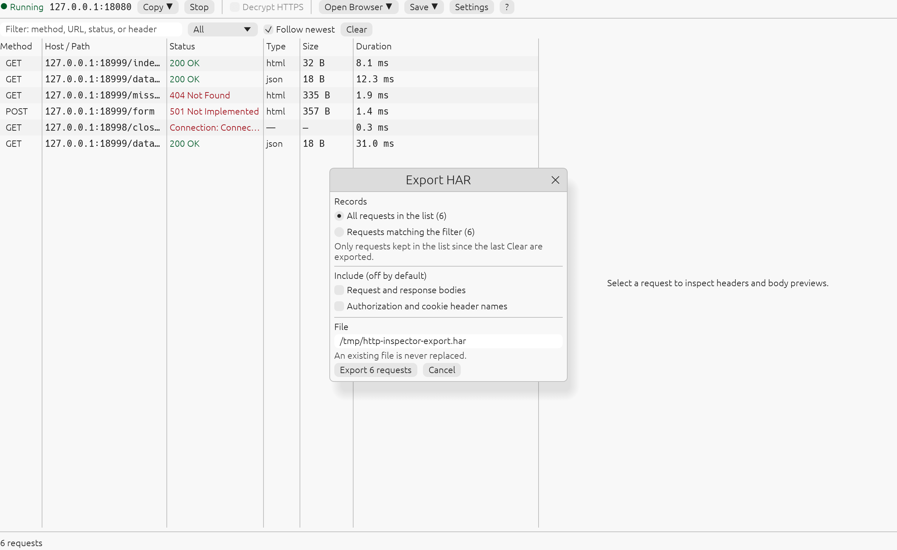
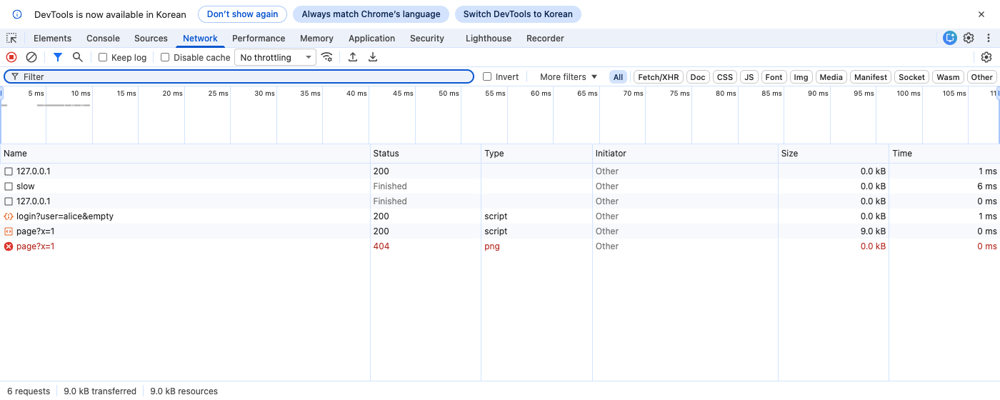

# HAR로 내보내기

[사용자 가이드 목록](README.md) · [README](../../README.md)

요청 목록의 기록을 [HAR 1.2](http://www.softwareishard.com/blog/har-12-spec/) 파일로 저장한다. 저장한 파일은 Chrome DevTools **Network** 패널의 **Import HAR file**(위쪽 화살표 아이콘)로 불러올 수 있다.

1. 툴바의 **Save** 메뉴에서 **Export HAR…**를 누른다.
2. **Records**에서 범위를 고른다.
   - **All requests in the list**: 마지막 **Clear** 이후 목록에 남아 있는 모든 요청(최대 2,000건)
   - **Requests matching the filter**: 현재 검색어와 종류 필터에 맞는 요청
3. 필요한 경우에만 **Include**의 항목을 켠다. 창을 열 때마다 두 항목 모두 꺼진 상태로 시작한다.
4. **File**에 새 파일 경로를 확인하고 **Export N requests**를 누른다. 기본 경로는 **Save** 메뉴의 저장 폴더 안의 새 `.har` 파일이다.
5. 하단 상태 바의 **Saved:** 경로에서 파일을 확인한다.

기존 파일은 덮어쓰지 않는다. 같은 이름의 파일이 있거나 폴더가 없으면 상태 바에 오류를 표시하며, 경로를 고쳐 다시 내보내면 된다. 파일은 같은 폴더의 임시 파일에 먼저 쓴 뒤 옮기므로 실패해도 불완전한 파일이 남지 않으며, 소유자만 읽고 쓸 수 있는 권한으로 만든다.

다음 이미지는 테스트용 HTTP 요청 6건을 보낸 뒤 연 **Export HAR** 창의 실제 화면이다.

## 기본으로 제외하는 내용

| 항목 | 기본 | 켰을 때 |
| --- | --- | --- |
| `Authorization`, `Proxy-Authorization`, `Cookie`, `Set-Cookie` 헤더 | 헤더 자체를 넣지 않는다 | **Authorization and cookie header names**: 헤더 이름과 `[REDACTED]` 값만 넣는다 |
| 요청·응답 본문 | 넣지 않는다. 응답 `content.size`와 `bodySize`에는 관찰한 크기를 쓴다 | **Request and response bodies**: 메모리 미리보기를 `postData.text`, `content.text`에 넣는다 |
| `cookies` 배열 | 항상 빈 배열 | 항상 빈 배열 |

민감 헤더의 원본 값은 앱이 처음부터 보관하지 않으므로 어떤 설정으로도 HAR에 들어가지 않는다. URL의 쿼리 문자열, 다른 헤더, 본문에는 토큰이나 개인정보가 있을 수 있으니 공유하기 전에 확인한다.

## 본문 표현

본문은 전체 로그가 아니라 화면용 메모리 미리보기(방향별 8KiB, 이미지 응답은 최대 8MiB)를 사용한다. 미리보기가 본문 전체가 아니면 `content.comment` 또는 `postData.comment`에 이유를 쓴다.

| 상황 | HAR 표현 |
| --- | --- |
| 전체 본문, UTF-8 | `text`에 그대로 넣는다 |
| 전체 본문, UTF-8이 아님 | 응답은 `text`에 base64를 넣고 `encoding: "base64"`. 요청 `postData`는 텍스트만 담을 수 있어 `text`를 비우고 comment에 이유를 쓴다 |
| `Content-Encoding`(gzip, deflate, br, zstd)이 있는 전체 본문 | 압축을 풀어 `text`에 넣는다. `content.size`는 푼 크기, `bodySize`는 전송된 크기, `compression`은 그 차이다 |
| 미리보기 한도를 넘음 | 앞부분만 `text`에 넣고 comment가 `Truncated: only the first N of M observed bytes were kept in memory.`로 시작한다. `content.size`는 관찰한 전체 크기다 |
| 내보낼 때 아직 수신 중이거나 중간에 끊김 | 그때까지의 바이트를 넣고 comment에 `Partial: …`로 상태를 쓴다 |
| 압축된 본문의 일부만 있음 | 일부만으로는 신뢰할 수 있게 풀 수 없어 `text`를 넣지 않고 comment에 이유를 쓴다. `content.size`는 압축된 크기다 |
| 전달을 늦추지 않으려고 미리보기를 건너뜀 | `text`를 넣지 않고 comment에 이유를 쓴다 |

## 요청 결과별 표현

| 결과 | HAR 표현 |
| --- | --- |
| 응답 | 상태 코드, 응답 헤더, 본문(선택)을 그대로 쓴다 |
| 대기 중(응답 전) | `response.status`는 `0`, 항목 `comment`에 `Still waiting for a response when exported.` |
| 실패(연결·TLS·시간 초과 등) | `response.status`는 `0`, `response._error`와 항목 `comment`에 실패 단계와 메시지를 쓴다 |
| 클라이언트 취소, 프록시 중지로 미완료 | `response.status`는 `0`, `response._error`와 항목 `comment`에 이유를 쓴다 |
| 복호화하지 않은 `CONNECT` 터널 | `method`는 `CONNECT`, `url`은 `https://호스트:포트`, `response.status`는 프록시가 답한 `200`. 요청·응답 `bodySize`는 클라이언트→서버, 서버→클라이언트 바이트 수이고 터널이 열려 있던 시간은 `timings.receive`다. 항목 `comment`에 터널 상태를 쓰고, 실패하거나 미완료로 끝난 터널은 `response._error`도 쓴다 |
| HTTPS 복호화용 `CONNECT` | 위와 같은 `CONNECT` 항목이며, 복호화한 요청은 각각 별도 항목이다 |
| **Edit and Resend**로 보낸 요청 | 항목 `comment`에 원본 기록 번호를 쓴다 |

Chrome DevTools는 상태가 `0`인 항목을 `(failed)`가 아니라 `Finished`로 표시한다. 실패 이유는 HAR 파일의 `_error`와 `comment`에서 확인한다.

## 시간과 크기

- `startedDateTime`은 요청이 도착한 시각(UTC, 밀리초)이다.
- `timings`는 관찰한 단계만 채운다. `connect`는 업스트림 연결 시간(복호화한 HTTPS는 TLS 핸드셰이크 포함)이고, `dns`와 `ssl`은 따로 측정하지 않아 `-1`이다. 응답의 `send`, `wait`, `receive`는 앱의 Timing 표시와 같은 구간이며, 어느 단계에도 속하지 않는 시간은 `blocked`에 넣는다. 응답이 아닌 결과는 결과가 정해질 때까지의 시간을 `wait`에 넣는다.
- `time`은 `-1`이 아닌 `timings` 값의 합이다. 내보낼 때 진행 중인 요청은 내보낸 시점까지의 시간이다.
- 요청의 HTTP 버전은 기록하지 않으므로 `request.httpVersion`은 프록시가 처리하는 `HTTP/1.1`로 쓴다. 헤더 크기도 기록하지 않아 `headersSize`는 `-1`이고, Chrome이 읽는 `response._transferSize`는 본문 바이트만 센다.
- 쿼리 문자열은 퍼센트 인코딩을 풀지 않고 `queryString`에 그대로 나눠 넣는다.

## Chrome DevTools 호환 확인

다음 이미지는 이 앱이 기본 설정으로 내보낸 HAR(응답, 404 이미지, 대기 중 요청, 연결 실패, `CONNECT` 터널)을 Chrome 157 DevTools **Network** 패널의 HAR 가져오기 처리로 불러온 화면이다.

