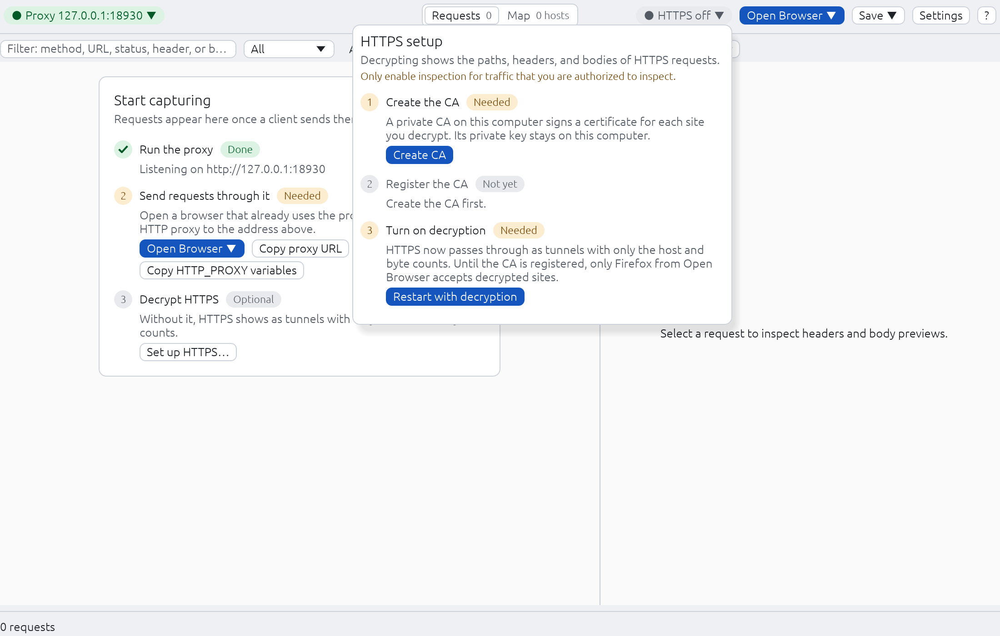
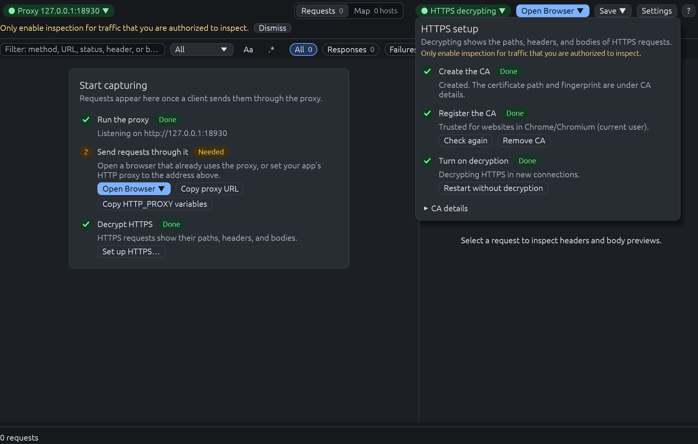
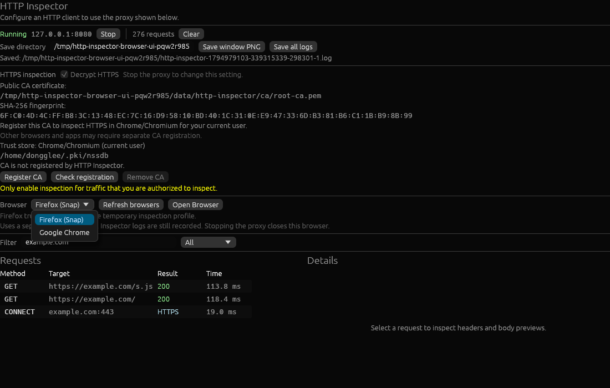

# HTTPS 복호화와 검사 브라우저

[사용자 가이드 목록](README.md) · [README](../../README.md)

HTTPS 복호화는 기본으로 꺼져 있다. 이 상태에서 앱은 `CONNECT` 터널 안의 URL, 헤더와 본문을 읽지 않는다. 사용자가 복호화를 켜면 앱은 HTTP/1.1 HTTPS 요청을 기존 상세 패널에 표시한다.

## HTTPS 복호화 켜기

HTTPS 복호화는 사용 권한이 있는 트래픽에만 사용한다.

상단 바 오른쪽의 HTTPS 상태 표시를 누르면 **HTTPS setup** 패널이 열린다. 패널은 세 단계를 순서대로 보여 주고, 각 단계에 상태(`Done`·`Needed`·`Not yet`·`Working…`), 아직 끝나지 않은 이유, 누를 버튼을 함께 표시한다. 시작 체크리스트의 **Set up HTTPS…**로도 같은 패널을 연다.

1. **Create the CA:** **Create CA**를 누르면 이 컴퓨터에 앱 전용 CA를 만든다. 개인키는 이 컴퓨터를 떠나지 않는다. 앱 데이터 폴더를 정할 수 없으면 `Not yet`으로 표시하고 `HOME`과 저장소 설정을 확인하라고 안내한다.
2. **Register the CA:** **Register CA**를 누르면 Chrome·Chromium이 쓰는 현재 사용자 저장소에 공개 CA를 등록한다. CA를 만들기 전에는 `Not yet`과 "Create the CA first."를 표시한다. 등록 후에는 **Check again**으로 다시 확인하고 **Remove CA**로 제거할 수 있다. Open Browser로 연 Firefox는 검사 전용 프로필에 CA를 따로 등록하므로 이 단계 없이도 복호화한 사이트를 연다.
3. **Turn on decryption:** 프록시가 멈춰 있으면 **Turn on**을, 실행 중이면 **Restart with decryption**을 누른다. 복호화 설정은 프록시를 시작할 때 적용되므로, 실행 중이면 같은 포트로 프록시를 다시 시작한다. 이때 Open Browser로 연 검사 브라우저는 닫히고, 재시작 전에 열린 연결은 터널로 남는다. 끌 때는 **Turn off** 또는 **Restart without decryption**을 누른다.

CA 인증서 경로(`root-ca.pem`), SHA-256 지문과 등록 대상 경로는 패널 아래의 **CA details**를 펼쳐 확인하고 복사한다. 확인·등록·제거에 실패하면 오류를 패널에 표시하고, 복호화가 켜져 있으면 상단 바 아래에도 표시한다. 처음 복호화를 켜면 권한이 있는 트래픽에만 사용하라는 경고를 상단 바 아래에 한 번 표시한다. 같은 경고는 패널 위쪽에 항상 보인다.



세 단계를 모두 마친 화면이다. 상단 바의 표시가 `HTTPS decrypting`으로 바뀐다.



상단 바의 HTTPS 표시는 색과 글자로 상태를 알린다.

| 표시 | 의미 |
| --- | --- |
| `● HTTPS off` (회색) | 복호화가 꺼져 있다. HTTPS는 `CONNECT` 터널로 전달한다. |
| `● HTTPS decrypting` (초록) | 복호화가 켜져 있고 CA가 Chrome·Chromium 저장소에서 신뢰된다. |
| `● HTTPS · CA not registered` (노랑) | 복호화는 켜져 있지만 CA를 등록하지 않았다. Open Browser의 Firefox만 복호화한 사이트를 연다. |
| `● HTTPS · CA not trusted` (노랑) | 등록되었지만 HTTPS 신뢰 설정이 없다. 다시 등록한다. |
| `● HTTPS · CA error` (빨강) | CA 생성·확인·등록에 실패했다. 패널에 오류를 표시한다. |
| `● HTTPS · checking CA…` (회색) | CA를 만들거나 확인하는 중이다. |
| `● HTTPS · no CA storage` (빨강) | CA를 보관할 앱 데이터 폴더가 없다. |

복호화가 꺼져 있으면 CA를 새로 만들지 않는다. 이미 CA가 있으면 패널을 열 때 등록 상태를 한 번 확인한다. 복호화를 켜면 예전처럼 CA가 없을 때 바로 만든다.

## 검사 브라우저 열기

1. HTTPS의 URL, 헤더와 본문을 확인하려면 [HTTPS 설정 패널](#https-복호화-켜기)에서 복호화를 켠다.
2. 상단 바의 **Open Browser** 메뉴에서 설치된 Firefox, Chrome 또는 Chromium을 누른다. 앱은 기본 브라우저를 자동으로 선택하지 않는다. 각 항목에 마우스를 올리면 CA 등록 방식을 안내한다.
3. 앱이 프록시를 설정한 검사 전용 프로필로 비공개 창을 연다. HTTPS 복호화를 켰으면 공개 CA도 자동으로 등록한다. Firefox에는 NSS `certutil`이 필요하다. Linux의 Chrome·Chromium도 NSS를 사용한다. macOS의 Chrome·Chromium은 로그인 키체인을 사용한다.
4. 열린 브라우저에서 확인할 사이트에 접속한다. HTTP Inspector의 요청 목록에서 트래픽을 확인한다.
5. 검사를 마치면 브라우저 창을 닫거나 **Close browser**를 누른다. 프록시 메뉴의 **Stop proxy**를 누르거나 앱을 종료해도 앱에서 연 검사 브라우저를 종료한다.

**Open Browser** 메뉴의 **Refresh browsers**는 `PATH`에서 Firefox, Firefox ESR, Google Chrome의 Stable·Beta·Dev, Chromium 실행 파일을 다시 찾는다. macOS에서는 `/Applications`와 `~/Applications`의 브라우저 앱도 찾는다. 같은 실행 파일의 별칭은 하나만 표시한다. Firefox Snap도 지원한다. Flatpak 브라우저와 Chromium Snap은 지원하지 않는다.

매번 새 검사 프로필을 만들며 브라우저 프로세스가 종료되면 삭제한다. 기존 개인 프로필의 쿠키와 로그인 상태는 가져오지 않는다. Firefox Snap의 임시 프로필은 `$HOME/snap/firefox/common` 아래에 만든다. 앱이 강제 종료되면 임시 프로필이 남을 수 있다. 비공개 창을 사용해도 HTTP Inspector의 요청 기록과 전체 로그는 남는다.

Firefox의 CA는 검사 전용 프로필에만 등록한다. Chrome·Chromium의 CA는 Linux에서 현재 사용자의 공용 NSS 저장소에, macOS에서 로그인 키체인에 등록하므로 개인 브라우저에도 신뢰 설정이 적용된다. Chrome·Chromium 등록은 검사 창을 닫아도 유지된다. 필요 없으면 HTTPS 설정 패널의 **Remove CA**로 제거한다.

다음은 실제 Firefox Snap에서 HTTPS를 복호화한 뒤 브라우저 선택 목록을 연 화면이다. 이 캡처는 브라우저 선택이 상단 바 메뉴로 옮겨지기 전의 화면이다.



검사 브라우저는 로컬 사이트도 프록시로 전달하고 HTTP/3을 비활성화한다. 인증서 검증은 유지한다. 복호화를 끄면 HTTPS는 `CONNECT` 터널로 전달하며 CA를 새로 등록하지 않는다.

## 기존 Chrome·Chromium에 CA 등록

기존 Chrome·Chromium을 직접 프록시에 연결하려면 HTTPS 설정 패널의 **Register CA**로 CA를 등록한다. 2단계가 `Done`("Trusted for websites …")으로 바뀌는지 확인한다.

### Linux

Linux에서 **Register CA**는 NSS의 `certutil` 명령으로 현재 사용자의 Chrome·Chromium 인증서 저장소에 공개 CA만 등록한다. 관리자 권한은 필요하지 않다. Ubuntu·Debian에서는 `sudo apt install libnss3-tools`, Fedora에서는 `sudo dnf install nss-tools`로 도구를 설치한다. 도구가 없거나 등록에 실패하면 화면에 오류를 표시한다. 수동으로 등록하려면 Chrome의 `chrome://settings/certificates`에서 공개 CA를 가져온다.

Linux의 등록 대상은 [Chromium의 NSS 저장소 선택 규칙](https://chromium.googlesource.com/chromium/src/+/HEAD/crypto/nss_util.cc)을 따른다. `$HOME/.pki/nssdb` 디렉터리가 있으면 그 경로를 사용한다. 없으면 `$XDG_DATA_HOME/pki/nssdb`를 사용하고, `XDG_DATA_HOME`이 없으면 `$HOME/.local/share/pki/nssdb`를 사용한다. HTTPS 설정 패널의 **CA details**에 실제 대상 경로를 표시한다. 별도 저장소를 사용하는 Snap·Flatpak 브라우저와 Firefox, 시스템 전체 저장소에는 등록하지 않는다.

HTTPS 설정 패널의 **Check again**은 이 앱이 관리하는 항목의 인증서와 HTTPS 신뢰 설정을 확인한다. **Remove CA**는 현재 CA와 일치하는 앱 관리 항목만 제거한다. 다른 설치의 CA와 수동으로 등록한 다른 이름의 항목은 제거하지 않는다. 등록 상태를 바꾼 후에는 브라우저를 다시 시작한다.

기본 CA 경로는 다음과 같다.

```text
$XDG_DATA_HOME/http-inspector/ca/root-ca.pem
```

`XDG_DATA_HOME`이 없으면 다음 경로를 사용한다.

```text
$HOME/.local/share/http-inspector/ca/root-ca.pem
```

### macOS

HTTPS를 복호화하려면 HTTPS 설정 패널에서 **Register CA**를 누르고 복호화를 켠다. 앱은 `security add-trusted-cert`로 공개 CA를 로그인 키체인에 SSL 신뢰 대상으로 등록한다. macOS 인증 창이 나타나면 승인한다. 취소하면 화면에 오류가 표시되며 다시 시도할 수 있다. **Check again**은 저장된 인증서 바이트와 SSL 신뢰 상태를 확인한다. **Remove CA**는 현재 CA의 SHA-256 지문과 일치하는 인증서 및 사용자 신뢰 설정을 제거한다. 변경 후 브라우저를 다시 실행한다. Safari도 로그인 키체인의 신뢰 설정을 사용하지만 검사 창 실행 목록에는 포함되지 않는다.

macOS에서는 CA를 `~/Library/Application Support/http-inspector/ca/`에 저장한다. `XDG_DATA_HOME`은 사용하지 않는다. CA 디렉터리는 `0700`, 개인키 파일은 `0600` 권한으로 생성한다.

**Open Browser**는 앱 번들 안 실행 파일을 새 검사 프로필로 직접 실행한다. 기존 브라우저 창은 그대로 유지한다. Firefox 검사 창에서 HTTPS를 복호화하려면 Homebrew NSS(`brew install nss`)가 필요하다. Chrome 검사 창에는 NSS가 필요하지 않다.

서명, 공증과 `.dmg` 배포는 지원하지 않는다. 시스템 키체인과 시스템 프록시 설정은 변경하지 않는다.

## 직접 실행한 Chrome에서 HTTP/3 막기

Chrome의 HTTP/3 우회를 막으려면 테스트 프로필을 다음과 같이 실행한다.

```bash
google-chrome \
	--user-data-dir=/tmp/http-inspector-chrome \
	--proxy-server=http://127.0.0.1:8080 \
	--disable-quic
```

## 개인키와 CA 제거

Chrome에는 `root-ca.pem`만 등록한다. `ca-identity.pem`에는 개인키가 있으므로 열거나 복사하거나 신뢰 저장소에 등록하지 않는다. 앱을 삭제해도 등록한 CA는 남으므로, 삭제 전에 **Remove CA**로 제거한다. 수동으로 등록한 항목은 Chrome 설정에서 직접 제거한다.
