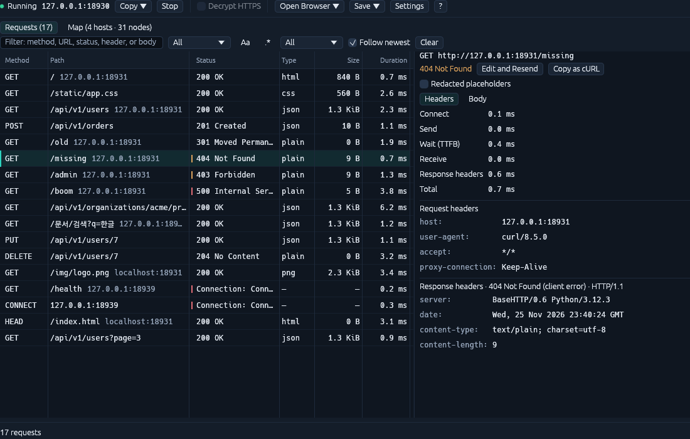
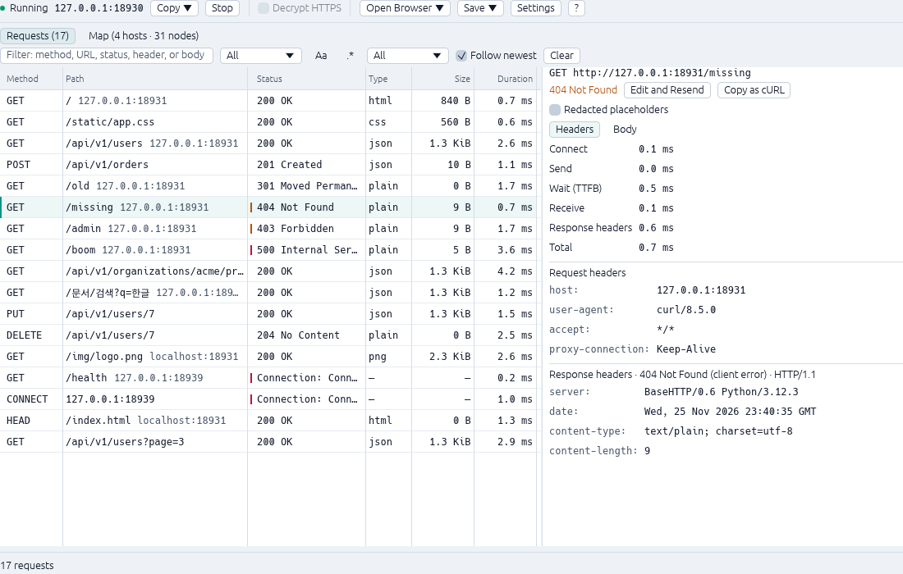
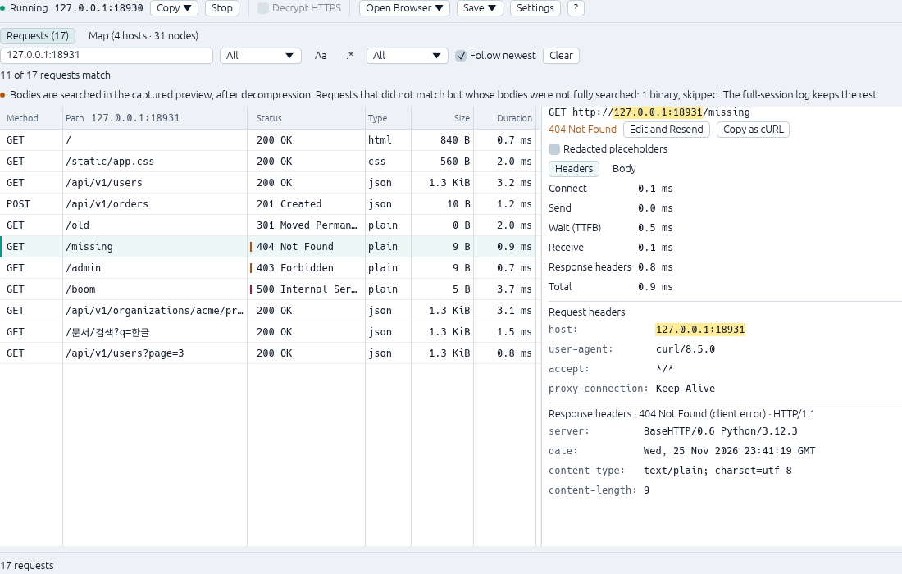

# 화면과 조작

[사용자 가이드 목록](README.md) · [README](../../README.md)

이 문서는 화면 구성, 요청 목록 단축키, 테마, 화면 읽기 프로그램 지원과 글꼴 표시를 설명한다.

## 화면 구성

화면은 위에서 아래로 다음 순서로 놓인다. 요청 목록과 상세가 남은 높이를 모두 쓴다.

- **툴바:** 프록시 상태·주소·`Copy`·`Stop`, **Decrypt HTTPS**와 CA 상태, **Open Browser**, **Save**, **Settings**(테마와 본문 저장 한도), **?**(캡처 범위 안내). 창이 좁으면 다음 줄로 넘어간다.
- **알림:** 포트 충돌, 브라우저·CA 오류처럼 확인해야 할 오류와 경고는 툴바 바로 아래에 표시한다.
- **보기 전환:** **Requests**에서 요청 목록을 보고 **Map**에서 [URL 맵과 관계 그래프](url-map.md)를 확인한다.
- **필터 줄:** 검색어, 검색 범위(All·URL·Headers·Request body·Response body), **Aa**(대소문자 구분), **.\***(정규식), 종류(All·Responses·Failures·Tunnels), **Follow newest**, **Clear**.
- **요청 목록과 상세:** 가운데 경계를 끌어 너비를 조절한다. 목록의 열은 목록 영역 안에서 잘린다. 요청이 없으면 목록 자리에 프록시 주소(`No requests yet · proxy http://127.0.0.1:8080`)나 중지 상태를 한 줄로 표시한다.
- **상태 바:** 요청 수, 누락·삭제된 기록 수, 전체 로그 오류와 한도 경고, 저장 결과.

창 높이가 부족하면 요청 목록과 상세는 약 10행 높이를 유지하고 창 전체가 세로로 스크롤된다. 마우스가 목록이나 상세 위에 있으면 그 영역이 먼저 스크롤되고, 끝에 닿은 뒤에는 창 전체가 스크롤된다.

다음은 1100×700 창에서 로컬 테스트 서버로 요청 17건을 보낸 실제 화면이다. 404·403·500 응답, 한글 경로, 닫힌 포트로 보낸 요청과 실패한 `CONNECT` 터널이 함께 있고 `/missing` 요청을 선택했다.

## 요청 목록 읽기

목록의 각 행은 메서드, 경로, 상태, 형식, 크기, 걸린 시간을 보여 준다. 값은 모두 상자 없는 글자이고 고정폭 글꼴로 표시한다. 행은 가는 선으로 나뉘고, 열 제목 줄은 목록을 스크롤해도 위에 남는다.

- **메서드:** `GET`, `POST` 같은 메서드 이름을 기본 글자색으로 표시한다.
- **Path:** 경로와 쿼리를 먼저 보여 주고 호스트는 흐린 글자로 뒤에 붙인다. 목록의 요청이 모두 같은 호스트로 갔다면 행마다 호스트를 반복하지 않고 **Path** 열 제목 옆에 한 번만 표시한다. `CONNECT` 터널처럼 경로가 없는 요청은 호스트를 표시한다. 칸보다 긴 경로는 가운데를 줄여 시작 부분과 마지막 경로 조각을 남긴다(예: `/api/v1/…/notifications.json`). 마지막 조각까지 넣을 수 없으면 끝을 줄인다. 공간이 부족하면 호스트를 먼저 숨긴다. 마우스를 올리면 전체 URL을 볼 수 있다.
- **상태:** 상태 글자(`200 OK`, `404 Not Found` 등)를 기본 글자색으로 보여 준다. 확인이 필요한 요청만 상태 글자 앞에 짧은 세로 표시가 붙는다. 4xx 응답과 취소·중단은 주황, 5xx 응답과 연결·터널 실패는 빨강이다. 정상 응답, 리다이렉트, 대기 중인 요청과 정상 터널에는 표시가 없다.
- **크기와 시간:** 오른쪽에 맞춰 자릿수를 세로로 비교할 수 있다.
- **선택한 행:** 옅은 청록 배경과 행 왼쪽의 가는 청록 막대로 표시한다. 키보드로 행에 포커스를 옮기면 메서드 둘레에 파란 테두리가 보인다.

같은 화면을 밝은 테마로 보면 다음과 같다. 검색창에 `18931`처럼 포트를 입력해 한 호스트의 요청만 남기면 호스트가 열 제목 옆으로 옮겨진다.

상세 패널의 쿼리 매개변수와 헤더는 이름을 흐린 글자로, 값을 기본 글자로 표시해 값이 먼저 눈에 들어오게 한다. 상세 패널의 상태 글자는 4xx·5xx와 실패일 때만 주황이나 빨강이고 정상 응답은 기본 글자색이다.

툴바의 프록시 상태(`Running`, `Stopped`), CA 상태, 툴바 아래 알림과 상태 바의 경고·오류는 글자 앞의 작은 점 색으로 상태를 구분하고 글자는 기본 글자색으로 쓴다.

800×420처럼 좁고 낮은 창에서도 목록과 상세는 최소 높이를 유지한다. 목록 영역에 다 들어가지 않는 열은 가로로 스크롤해 본다.

## 요청 목록 단축키

| 키 | 동작 |
| --- | --- |
| `↑`, `↓` | 이전 요청 또는 다음 요청을 선택합니다. |
| `Home`, `End` | 첫 요청 또는 마지막 요청을 선택합니다. |
| `PageUp`, `PageDown` | 목록에서 한 화면 위 또는 아래의 요청을 선택합니다. |
| `F6`, `Ctrl+PageDown` | 선택한 요청의 다음 상세 탭(**Headers** ↔ **Body**)으로 전환합니다. |
| `Ctrl+PageUp` | 선택한 요청의 이전 상세 탭으로 전환합니다. |
| `Tab`, `Shift+Tab` | 요청 행, 상세 탭과 다른 컨트롤 사이에서 포커스를 옮깁니다. |
| `Enter`, `Space` | 포커스가 있는 요청 행 또는 상세 탭을 선택합니다. |

목록 단축키는 현재 정렬과 필터를 따릅니다. 검색창, 포트 입력란 또는 **Save** 메뉴의 저장 경로 입력란에 포커스가 있으면 단축키를 처리하지 않습니다. `Esc`로 입력란의 포커스를 해제하면 다시 단축키를 사용할 수 있습니다. 키보드로 다른 요청을 선택하면 **Follow newest**가 꺼지고 선택한 행이 보이도록 목록이 스크롤됩니다.

## 화면 테마

툴바의 **Settings** 메뉴에서 **System / Light / Dark** 테마를 고른다. 기본값은 **System**이며, 감지 가능한 환경에서는 실행 중 시스템 외관 변경도 반영한다. 감지에 실패하면 Dark를 사용하고 화면에 안내한다. Tab으로 선택 항목에 이동한 뒤 Space로 바꿀 수 있다.

선택은 즉시 적용되며 포트 설정과 같은 디렉터리의 `theme` 파일에 저장된다.

- Linux: `$XDG_CONFIG_HOME/http-inspector/theme`. `XDG_CONFIG_HOME`이 없으면 `~/.config/http-inspector/theme`를 사용한다.
- macOS: `~/Library/Application Support/http-inspector/theme`.

설정 파일이 없거나 값이 잘못되면 System으로 시작한다.

## 화면 읽기 프로그램

AccessKit을 활성화해 요청 행과 기본 egui 컨트롤의 이름, 역할, 선택 상태를 접근성 트리에 제공합니다. Linux에서는 AT-SPI를 사용합니다. 요청 행은 메서드, 전체 URL, 상태와 상태 분류를 함께 읽도록 이름을 제공합니다(예: `GET http://… · 404 Not Found (client error)`). 상세 패널의 **Headers**와 **Body**는 `Request details` 탭 목록 안의 탭 역할과 선택 상태로 제공합니다.

상태는 색에만 의존하지 않습니다. 메서드와 상태는 글자 그대로 표시하고, 상태 글자 앞의 세로 표시는 상태 글자와 같은 내용을 강조할 뿐입니다. HTTP 응답은 숫자와 이유 문구(예: `200 OK`, `404 Not Found`)를 표시하고, 상태 칸에 마우스를 올리거나 상세 패널의 응답 헤더 제목에서 `success`, `redirect`, `client error`, `server error` 같은 분류를 글자로 확인할 수 있습니다. 실패, 취소, 터널 상태도 글자로 표시합니다.

키보드 탐색은 위의 단축키 표를 따릅니다.

Linux에서 Orca를 실행한 뒤 테스트 요청을 보내고 요청 선택, 상태 읽기, **Headers**와 **Body** 전환을 점검하세요. 목록은 화면에 보이는 행만 접근성 트리에 제공하므로 화면 밖 요청은 목록 단축키로 이동하세요.

## 글꼴

한글(현대 한글 11,172자)과 ASCII는 앱 바이너리에 내장한 Noto Sans KR 서브셋으로 표시하므로 OS나 폰트 설치 여부와 관계없이 보인다. 내장 글꼴에 없는 한자와 가나는 Linux에서 설치된 Nanum 또는 Noto CJK로, macOS에서 Apple SD Gothic Neo로 보완한다. Ubuntu에서 한자·가나가 네모로 보이면 `sudo apt install fonts-noto-cjk`로 폰트를 설치하고 앱을 다시 실행한다. 시스템 폰트 파일이 손상됐거나 TTF/OTF/TTC 형식이 아니면 등록하지 않고 경고 로그를 남긴 뒤 내장 폰트만 사용한다. `RUST_LOG=http_proxy::ui::style::fonts=debug cargo run`으로 실행하면 어떤 폰트를 등록했는지 확인할 수 있다.

## macOS 화면

다음 화면은 Apple Silicon Mac에서 실행한 앱이 로컬 테스트 서버의 HTTP 응답을 기록한 모습이다. 앱의 **Save window PNG** 경로로 렌더링을 저장했다.

