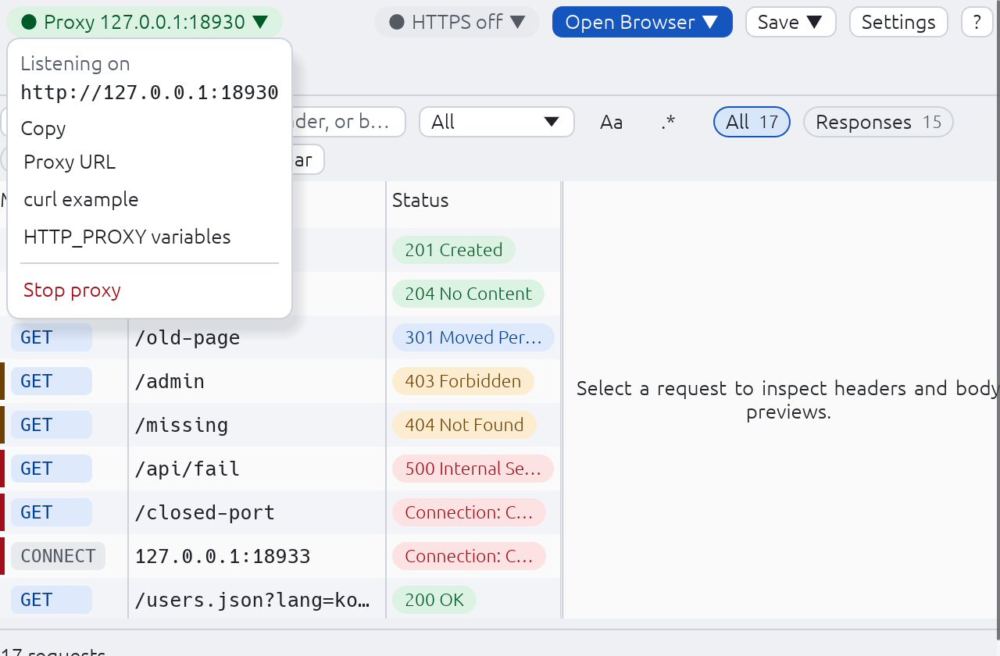
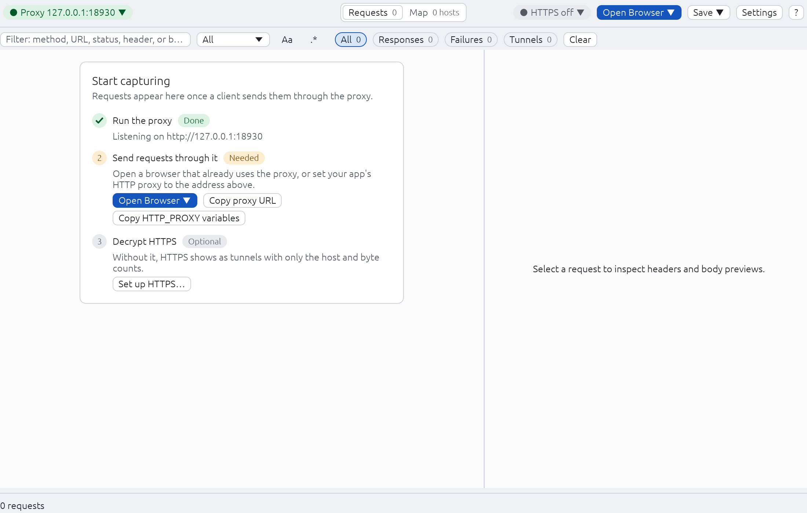
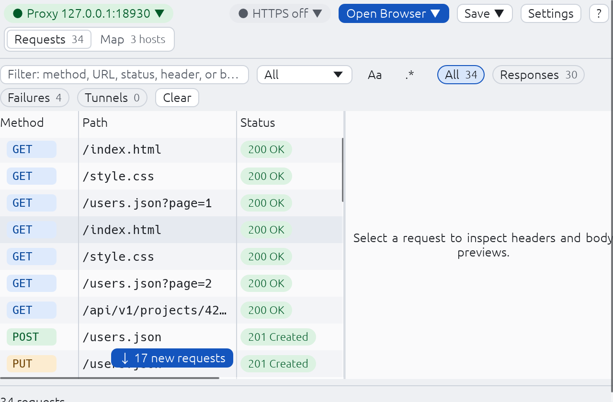
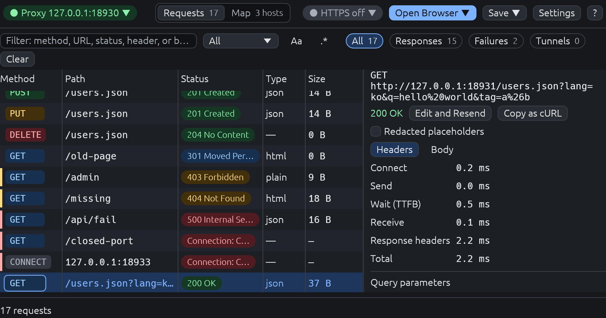
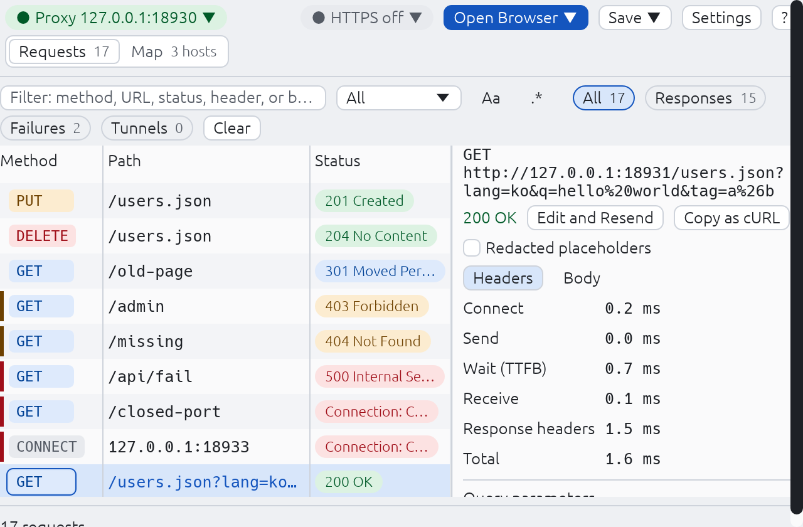
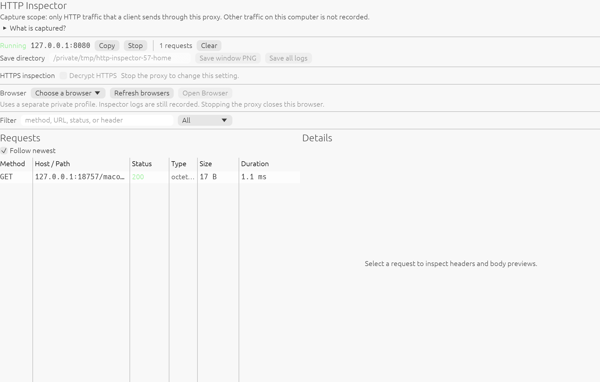

# 화면과 조작

[사용자 가이드 목록](README.md) · [README](../../README.md)

이 문서는 화면 구성, 요청 목록 단축키, 테마, 화면 읽기 프로그램 지원과 글꼴 표시를 설명한다.

## 화면 구성

화면은 위에서 아래로 다음 순서로 놓인다. 요청 목록과 상세가 남은 높이를 모두 쓴다.

- **상단 바:** 세 구역으로 나뉜다.
  - **왼쪽 — 프록시 상태:** 실행 중이면 초록 `● Proxy 127.0.0.1:18930 ▼` 표시를 누른다. 펼친 메뉴에서 프록시 주소를 확인하고 프록시 URL, `curl` 예시, `HTTP_PROXY` 변수를 복사하거나 **Stop proxy**로 멈춘다. 멈춰 있으면 빨간 `● Proxy stopped` 옆에 **Port** 입력란과 **Start** 버튼이 나온다.
  - **가운데 — 보기 전환:** **Requests**(요청 수)와 **Map**(호스트 수)을 오가는 전환 버튼이다. **Map**에서 [URL 맵과 관계 그래프](url-map.md)를 확인한다.
  - **오른쪽 — HTTPS와 주요 동작:** HTTPS 상태 표시(`HTTPS off`, `HTTPS decrypting` 등)를 누르면 [HTTPS 설정 단계](https.md#https-복호화-켜기)가 열린다. 파란 **Open Browser**가 주요 동작이고, **Save**, **Settings**(테마와 본문 저장 한도), **?**(캡처 범위 안내)가 뒤따른다.
  - 창이 좁으면 구역을 통째로 다음 줄로 옮긴다. 먼저 보기 전환이 둘째 줄로 내려가고, 그래도 좁으면 오른쪽 구역이 내려간다. 버튼이 잘리거나 겹치지 않는다.
- **알림:** 포트 충돌, 브라우저·CA 오류처럼 확인해야 할 오류와 경고는 상단 바 바로 아래에 표시한다.
- **필터 줄:** 검색어, 검색 범위(All·URL·Headers·Request body·Response body), **Aa**(대소문자 구분), **.\***(정규식), 결과 종류 칩(**All**·**Responses**·**Failures**·**Tunnels**), **Clear**. 각 칩에는 현재 검색어와 Map 필터를 적용했을 때 그 종류로 보일 요청 수가 붙는다. 열 제목으로 정렬했으면 **Arrival order**로 도착 순서와 최신 요청 따라가기를 되돌린다.
- **요청 목록과 상세:** 가운데 경계를 끌어 너비를 조절한다. 목록의 열은 목록 영역 안에서 잘린다. 아직 요청이 없으면 [시작 체크리스트](#시작-체크리스트)를, 요청은 있지만 필터에 맞는 것이 없으면 그 사실을 표시한다.
- **상태 바:** 요청 수, 누락·삭제된 기록 수, 전체 로그 오류와 한도 경고, 저장 결과.

다음은 640×420 창에서 프록시 표시를 펼친 화면이다. 주소를 확인하고 복사하거나 **Stop proxy**로 멈춘다.

창 높이가 부족하면 요청 목록과 상세는 약 10행 높이를 유지하고 창 전체가 세로로 스크롤된다. 마우스가 목록이나 상세 위에 있으면 그 영역이 먼저 스크롤되고, 끝에 닿은 뒤에는 창 전체가 스크롤된다.

다음은 1100×700 창에서 로컬 테스트 서버로 요청 17건을 보내고 마지막 요청을 선택한 실제 화면이다. 404·500 응답, 닫힌 포트로 보낸 요청과 실패한 `CONNECT` 터널이 함께 있다.

## 시작 체크리스트

아직 캡처한 요청이 없으면 목록 자리에 세 단계를 보여 준다. 끝난 단계는 초록 체크와 `Done`, 할 단계는 번호와 `Needed`로 표시한다.

1. **Run the proxy:** 프록시가 실행 중이면 주소를 보여 준다. 멈춰 있으면 **Start**를 누른다.
2. **Send requests through it:** **Open Browser**로 프록시가 설정된 검사 브라우저를 열거나, **Copy proxy URL**·**Copy HTTP_PROXY variables**로 주소를 복사해 앱에 설정한다. 프록시가 멈춰 있으면 `Not yet`으로 표시하고 먼저 시작하라고 안내한다.
3. **Decrypt HTTPS (선택):** **Set up HTTPS…**를 누르면 상단 바의 HTTPS 설정 단계가 열린다.

첫 요청이 들어오면 체크리스트 대신 요청 목록을 표시한다. **Clear**로 목록을 비우면 다시 나타난다.

## 최신 요청 따라가기

도착 순서로 볼 때 목록은 새 요청이 들어오면 맨 아래로 따라간다. 마우스 휠로 위로 스크롤하거나 스크롤 막대를 끌어 올리거나, 요청을 클릭하거나 키보드로 고르면 따라가기를 멈춘다. 멈춘 동안 새 요청이 들어오면 목록 아래에 `↓ N new requests` 버튼이 떠서 몇 건이 새로 왔는지 알려 준다. 버튼을 누르거나 맨 아래까지 직접 스크롤하면 최신 요청으로 이동하고 다시 따라간다. 마지막으로 본 요청이 목록에서 사라졌다면(보관 한도로 밀려났거나 필터에서 빠진 경우) 개수 대신 `↓ Jump to newest`를 표시한다.

## 요청 목록 읽기

목록의 각 행은 메서드, 경로, 상태, 형식, 크기, 걸린 시간을 보여 준다.

- **메서드 배지:** 메서드 이름을 색이 있는 배지로 표시한다. `GET`은 파랑, `POST`는 초록, `PUT`·`PATCH`는 주황, `DELETE`는 빨강, 그 밖의 메서드는 회색이다.
- **Path:** 경로와 쿼리를 먼저 보여 주고 호스트는 흐린 글자로 뒤에 붙인다. 목록의 요청이 모두 같은 호스트로 갔다면 행마다 호스트를 반복하지 않고 **Path** 열 제목 옆에 한 번만 표시한다. `CONNECT` 터널처럼 경로가 없는 요청은 호스트를 표시한다. 칸보다 긴 경로는 가운데를 줄여 시작 부분과 마지막 경로 조각을 남긴다(예: `/api/v1/…/notifications.json`). 마지막 조각까지 넣을 수 없으면 끝을 줄인다. 공간이 부족하면 호스트를 먼저 숨긴다. 마우스를 올리면 전체 URL을 볼 수 있다.
- **상태:** 상태 글자(`200 OK`, `404 Not Found` 등)를 둥근 표시 안에 그대로 보여 준다. 2xx는 초록, 1xx·3xx는 파랑, 4xx와 취소·중단은 노랑, 5xx와 연결·터널 실패는 빨강, 대기 중인 요청과 정상 터널은 회색이다.
- **왼쪽 띠:** 4xx 응답은 노란 띠, 5xx 응답과 실패한 요청·터널은 빨간 띠를 행 왼쪽에 표시해 긴 목록에서도 찾기 쉽게 한다.

같은 화면을 밝은 테마로 보면 다음과 같다. 검색창에 `18931`처럼 포트를 입력해 한 호스트의 요청만 남기면 호스트가 열 제목 옆으로 옮겨진다.

상세 패널의 쿼리 매개변수와 헤더는 이름을 흐린 글자로, 값을 기본 글자로 표시해 값이 먼저 눈에 들어오게 한다.

프록시가 실행 중인 800×420 창에서는 상단 바 세 구역이 한 줄에 들어가고, 목록과 상세는 최소 높이를 유지한다.

가장 좁은 640×420 창에서는 보기 전환이 둘째 줄로 내려가고, 필터 줄의 칩도 다음 줄로 넘어간다.

## 요청 목록 단축키

| 키 | 동작 |
| --- | --- |
| `↑`, `↓` | 이전 요청 또는 다음 요청을 선택합니다. |
| `Home`, `End` | 첫 요청 또는 마지막 요청을 선택합니다. |
| `PageUp`, `PageDown` | 목록에서 한 화면 위 또는 아래의 요청을 선택합니다. |
| `F6`, `Ctrl+PageDown` | 선택한 요청의 다음 상세 탭(**Headers** ↔ **Body**)으로 전환합니다. |
| `Ctrl+PageUp` | 선택한 요청의 이전 상세 탭으로 전환합니다. |
| `Tab`, `Shift+Tab` | 요청 행, 상세 탭과 다른 컨트롤 사이에서 포커스를 옮깁니다. |
| `Enter`, `Space` | 포커스가 있는 요청 행 또는 상세 탭을 선택합니다. |

목록 단축키는 현재 정렬과 필터를 따릅니다. 검색창, 포트 입력란 또는 **Save** 메뉴의 저장 경로 입력란에 포커스가 있으면 단축키를 처리하지 않습니다. `Esc`로 입력란의 포커스를 해제하면 다시 단축키를 사용할 수 있습니다. 키보드로 다른 요청을 선택하면 최신 요청 따라가기를 멈추고 선택한 행이 보이도록 목록이 스크롤됩니다. 상단 바의 메뉴나 HTTPS 설정 단계가 열려 있는 동안에도 목록 단축키를 처리하지 않으며, `Esc`로 닫을 수 있습니다.

## 화면 테마

상단 바의 **Settings** 메뉴에서 **System / Light / Dark** 테마를 고른다. 기본값은 **System**이며, 감지 가능한 환경에서는 실행 중 시스템 외관 변경도 반영한다. 감지에 실패하면 Dark를 사용하고 화면에 안내한다. Tab으로 선택 항목에 이동한 뒤 Space로 바꿀 수 있다.

선택은 즉시 적용되며 포트 설정과 같은 디렉터리의 `theme` 파일에 저장된다.

- Linux: `$XDG_CONFIG_HOME/http-inspector/theme`. `XDG_CONFIG_HOME`이 없으면 `~/.config/http-inspector/theme`를 사용한다.
- macOS: `~/Library/Application Support/http-inspector/theme`.

설정 파일이 없거나 값이 잘못되면 System으로 시작한다.

## 화면 읽기 프로그램

AccessKit을 활성화해 요청 행과 기본 egui 컨트롤의 이름, 역할, 선택 상태를 접근성 트리에 제공합니다. 상단 바의 **Requests**·**Map** 전환은 탭 역할과 선택 상태로(예: `Requests (17)`), 결과 종류 칩은 라디오 버튼 역할과 선택 상태로(예: `Failures (2)`) 제공합니다. 프록시 상태 표시는 `Proxy running at 127.0.0.1:18930`, HTTPS 상태 표시는 `HTTPS off. HTTPS setup`처럼 상태와 동작을 함께 읽습니다. 새 컨트롤은 모두 `Tab`으로 이동하고 `Enter`나 `Space`로 누를 수 있습니다. Linux에서는 AT-SPI를 사용합니다. 요청 행은 메서드, 전체 URL, 상태와 상태 분류를 함께 읽도록 이름을 제공합니다(예: `GET http://… · 404 Not Found (client error)`). 상세 패널의 **Headers**와 **Body**는 `Request details` 탭 목록 안의 탭 역할과 선택 상태로 제공합니다.

상태는 색에만 의존하지 않습니다. 상단 바의 프록시·HTTPS 표시와 HTTPS 설정 단계는 색과 함께 `Proxy stopped`, `Needed`, `Done` 같은 글자를 표시합니다. 메서드 배지는 메서드 이름을, 상태 표시는 상태 글자를 그대로 담고, 행 왼쪽 띠는 상태 글자와 같은 내용을 강조할 뿐입니다. HTTP 응답은 숫자와 이유 문구(예: `200 OK`, `404 Not Found`)를 표시하고, 상태 칸에 마우스를 올리거나 상세 패널의 응답 헤더 제목에서 `success`, `redirect`, `client error`, `server error` 같은 분류를 글자로 확인할 수 있습니다. 실패, 취소, 터널 상태도 글자로 표시합니다.

키보드 탐색은 위의 단축키 표를 따릅니다.

Linux에서 Orca를 실행한 뒤 테스트 요청을 보내고 요청 선택, 상태 읽기, **Headers**와 **Body** 전환을 점검하세요. 목록은 화면에 보이는 행만 접근성 트리에 제공하므로 화면 밖 요청은 목록 단축키로 이동하세요.

## 글꼴

한글(현대 한글 11,172자)과 ASCII는 앱 바이너리에 내장한 Noto Sans KR 서브셋으로 표시하므로 OS나 폰트 설치 여부와 관계없이 보인다. 내장 글꼴에 없는 한자와 가나는 Linux에서 설치된 Nanum 또는 Noto CJK로, macOS에서 Apple SD Gothic Neo로 보완한다. Ubuntu에서 한자·가나가 네모로 보이면 `sudo apt install fonts-noto-cjk`로 폰트를 설치하고 앱을 다시 실행한다. 시스템 폰트 파일이 손상됐거나 TTF/OTF/TTC 형식이 아니면 등록하지 않고 경고 로그를 남긴 뒤 내장 폰트만 사용한다. `RUST_LOG=http_proxy::ui::style::fonts=debug cargo run`으로 실행하면 어떤 폰트를 등록했는지 확인할 수 있다.

## macOS 화면

다음 화면은 Apple Silicon Mac에서 실행한 앱이 로컬 테스트 서버의 HTTP 응답을 기록한 모습이다. 앱의 **Save window PNG** 경로로 렌더링을 저장했다.

