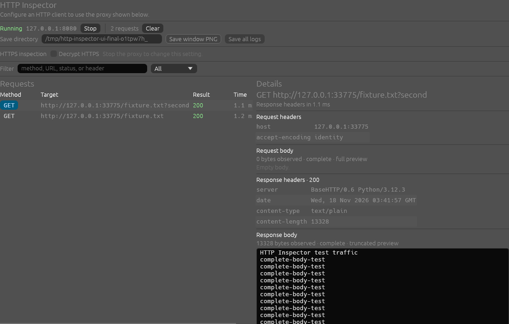
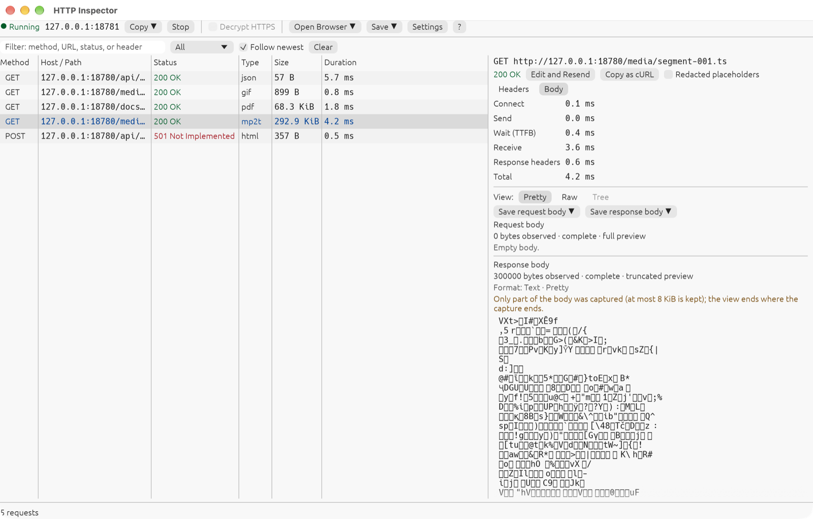
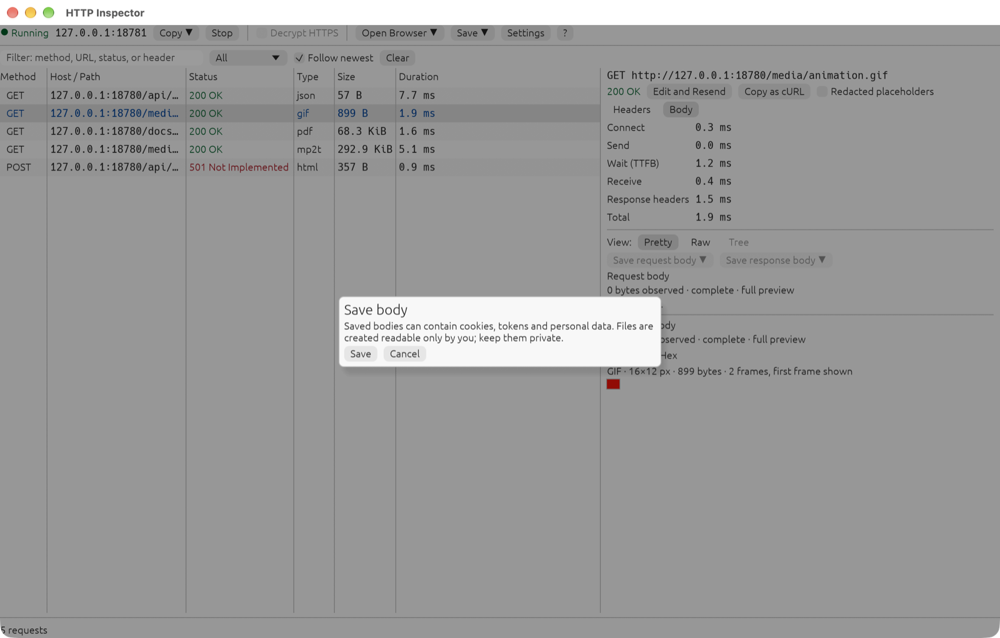
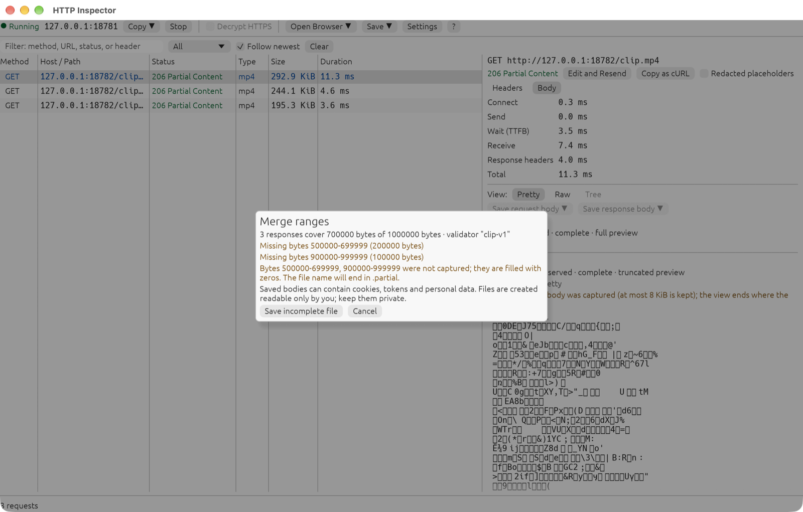
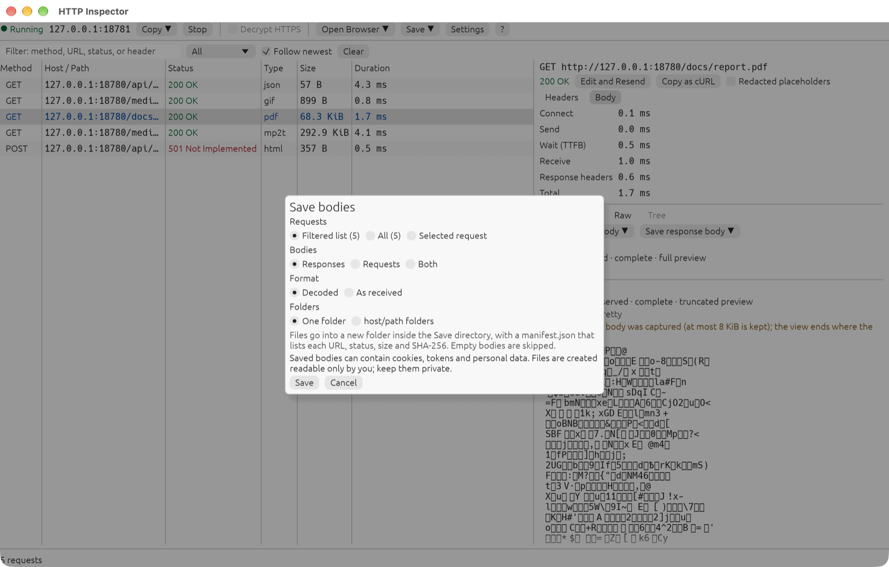

# 창, 로그와 본문 저장

[사용자 가이드 목록](README.md) · [README](../../README.md)

1. 상단 바의 **Save** 메뉴를 열고 **Save directory**에 저장할 기존 폴더의 경로를 입력한다. 기본값은 앱을 실행한 폴더다.
2. 창 이미지를 저장하려면 같은 메뉴에서 **Save window PNG**를 누른다. 현재 스크롤 위치를 포함한 앱 내부 전체가 PNG로 저장된다. 운영체제의 제목 표시줄과 테두리는 포함하지 않는다.
3. 전체 로그를 저장하려면 같은 메뉴에서 **Save all logs**를 누른다. 수집 시작부터 버튼을 누른 시점까지의 기록을 `.log` 텍스트 파일로 저장한다.
4. 하단 상태 바에 표시된 **Saved:** 경로에서 파일을 확인한다. 저장할 때마다 새 파일을 만들며 기존 파일을 덮어쓰지 않는다.

다음 이미지는 테스트용 HTTP 트래픽을 보낸 뒤 **Save window PNG**로 저장한 실제 화면이다.

## 전체 로그에 기록되는 내용

전체 로그에는 필터, 선택한 요청, 화면의 2,000건 보관 한도와 관계없이 모든 요청의 대상과 헤더, 응답 결과, 관찰한 요청·응답 본문, 트레일러를 기록한다. **Clear**는 요청 목록과 URL 맵을 비운다. 전체 로그와 본문 저장소는 앱 세션이 끝날 때까지 유지한다. 프록시 메뉴의 **Stop proxy** 후 **Start**를 눌러도 같은 앱 세션의 전체 로그를 유지한다. 앱을 종료하면 임시 로그를 삭제하므로 필요한 로그는 종료 전에 저장한다.

로그는 발생 순서대로 기록하며 대괄호 안의 요청 번호로 내용을 구분한다. 본문 바이트는 `\n`, `\r`, `\t`, `\\`, `\xNN` 이스케이프를 사용한다. 같은 요청과 방향의 `body bytes:` 줄을 순서대로 합치고 이스케이프를 풀면 본문 바이트를 복원할 수 있다. UTF-8이 아닌 본문도 바이트를 잃지 않는다. 저장 시 수신 중인 본문은 그 시점까지 관찰한 내용이 들어가며, `body: complete` 또는 `body: interrupted`가 없는 방향은 아직 완료되지 않았을 수 있다.

## 한도와 대기열

전체 로그는 세션당 본문 바이트를 512MiB까지 기록한다. 한도에 도달하면 해당 본문 뒤에 `body: later bytes omitted ...` 줄을 남기고 이후 본문 바이트를 기록하지 않는다. 대상, 헤더와 결과는 계속 기록하며 상태 바에 노란색 안내를 표시한다. 프록시는 본문 전체를 계속 전달한다.

전체 로그는 앱이 실행되는 동안 별도의 임시 파일에 기록한다. 요청이 몰려 기록 대기열(1,024건)이 차면 전체 로그는 기록을 버리지 않고 대기열에 자리가 날 때까지 해당 요청의 전달을 잠시 늦춘다. 화면 기록은 보관 한도를 넘으면 `records dropped`로 알리고 버리지만, 전체 로그는 세션 본문 한도 안에서 모든 기록을 보관한다. 대기열이 찬 순간 **Save all logs**를 누르면 `Session logging is busy; retry saving the log shortly`를 표시하며, 잠시 뒤 다시 저장하면 된다.

디스크 쓰기에 실패하거나 기록 스레드와 연결이 끊기면 로그가 불완전하다는 오류를 표시하고 이후 로그 내보내기를 거부한다. 프록시의 트래픽 전달은 계속한다. 저장 위치 오류는 경로를 수정한 뒤 다시 저장할 수 있다.

## 민감정보

`Authorization`, `Proxy-Authorization`, `Cookie`, `Set-Cookie` 헤더의 원본 값은 저장 전에 `[REDACTED]`로 바꾸므로 메모리, 임시 로그, 저장한 로그 어디에도 남지 않는다.

복호화하지 않은 HTTPS는 CONNECT 연결 기록만 저장한다. 프록시가 본문을 읽기 전에 실패한 요청의 본문은 저장할 수 없다. 전체 로그에는 URL과 본문의 민감한 내용이 포함될 수 있으며, 위에 나열한 네 가지 헤더 외의 내용은 가리지 않는다. 임시 로그와 내보낸 파일은 소유자만 읽고 쓸 수 있는 권한으로 만든다.

## 본문 파일 저장

선택한 요청의 본문을 파일로 저장한다. 압축을 풀거나 받은 바이트를 그대로 쓸 수 있다. 파일에는 본문 바이트가 들어가므로 이미지, PDF, ZIP, 동영상 조각을 해당 형식으로 열 수 있다.

1. **Save** 메뉴의 **Save directory**에 저장할 기존 폴더를 입력한다.
2. 요청을 고르고 **Body** 탭의 **Save request body ▼** 또는 **Save response body ▼**를 연다. 메뉴 첫 줄에 저장소에 보관한 크기와 완료 여부가 표시된다.
3. **Decoded**는 `gzip`, `deflate`, `br`, `zstd` `Content-Encoding`을 풀어 실제 파일을 저장한다(기본 동작). **As received**는 받은 바이트를 그대로 저장하고 `.gz`, `.br`, `.zst`, `.zz` 확장자를 붙인다. 요청 목록에서 행을 우클릭해 **Save response body**·**Save request body**를 누르면 **Decoded**로 저장한다.
4. 세션에서 처음 저장할 때와 본문이 불완전할 때 확인 창이 나타난다. 저장 결과는 하단 상태 바에 `Saved body:` 경로로 표시된다.

다음 이미지는 로컬 테스트 서버로 보낸 테스트 트래픽에서 MPEG-TS 응답을 고른 실제 화면이다. **Body** 탭 위쪽에 두 저장 메뉴가 있다.

처음 저장할 때 나타나는 확인 창이다.

## 부분 응답(206) 저장과 합치기

동영상 플레이어처럼 `Range` 요청으로 같은 URL을 여러 조각으로 받으면 응답이 `206 Partial Content`로 기록된다.

- **개별 저장:** `206` 응답 본문을 저장하면 `Content-Range`의 위치가 이름에 들어간다(예: `clip.bytes-0-299999.mp4`). **Save response body ▼** 메뉴에도 `206 range: bytes 0-299999 of 1000000`처럼 위치가 표시된다. 받은 본문 길이가 `Content-Range` 길이와 다르면 `.partial`로 저장하고 이유를 알린다.
- **Merge ranges…:** 같은 메뉴의 **Merge ranges…**는 URL, `ETag`(없으면 `Last-Modified`), 전체 길이, `Content-Encoding`이 모두 같은 `206` 응답만 골라 위치 순서로 하나의 파일로 합친다. 검증 값이 다른 응답은 다른 파일로 보고 합치지 않는다. 두 검증 값이 모두 없는 응답끼리는 합치되, 다른 버전이 섞일 수 있다고 창에 경고한다. 겹치는 부분은 먼저 시작한 응답의 바이트를 한 번만 쓴다. 저장소에 일부만 보관된 응답은 보관된 앞부분만 쓴다. 응답을 모으고 계획하는 작업은 백그라운드에서 하며, 그동안 `Checking the range responses…`와 **Cancel** 버튼을 표시한다.
- **빈 구간:** 비어 있는 위치가 있으면 창에 `Missing bytes 500000-699999`처럼 목록과 최종 파일 크기를 보여 주고, **Save incomplete file**을 눌렀을 때만 저장한다. 조각 **사이**의 빈 구간은 0으로 읽히게 해 뒤쪽 조각이 원래 위치에 오게 한다. 지원하는 파일 시스템에서는 0을 실제로 쓰지 않는 희소(sparse) 파일로 만든다. 마지막 조각 **뒤**의 빈 구간은 파일에 넣지 않으므로 파일은 마지막 조각의 끝에서 끝난다. 이름 끝에는 `.partial`을 붙인다. 서버가 전체 길이를 `*`로 보낸 경우에도 끝이 빠졌을 수 있으므로 `.partial`로 저장한다. 아직 수신 중인 응답이 있으면 그 사실을 함께 안내한다.
- **디스크 보호:** 쓰기 직전에 확인해, 빈 구간을 포함한 파일 크기 때문에 저장 폴더의 여유 공간이 1GiB 아래로 내려가면 저장을 거부한다. 예를 들어 10바이트 응답이 `bytes 999999999990-999999999999/1000000000000`을 주장해도 약 1TB 파일을 쓰지 않는다.
- `Content-Range`의 숫자는 ASCII 숫자만 받아들인다. `+5` 같은 부호나 `u64`로 길이를 표현할 수 없는 범위는 무시한다.

다음은 로컬 테스트 서버에서 1,000,000바이트 파일을 세 범위로 받은 뒤 **Merge ranges…**를 연 실제 화면이다.

## 여러 본문 한꺼번에 저장

1. **Save** 메뉴에서 **Save bodies…**를 누른다.
2. 대상 요청(**Filtered list**, **All**, **Selected request**), 본문(**Responses**, **Requests**, **Both**), 형식(**Decoded**, **As received**), 폴더 구조(**One folder**, **host/path folders**)를 고르고 **Save**를 누른다.
3. 저장 폴더 안에 `http-inspector-bodies-<시각>` 폴더를 새로 만들어 저장한다. 하단 상태 바에 진행률과 **Cancel** 버튼이 나타나며, 저장 중에도 프록시와 화면은 계속 동작한다. **Cancel**을 누르면 쓰고 있던 본문까지만 저장하고 멈춘다.

- **host/path folders**는 요청 URL을 따라 `127.0.0.1_8080/media/` 같은 폴더를 만든다. 각 폴더 이름은 파일 이름과 같은 규칙으로 정리하므로 저장 폴더 밖으로 나가지 않는다. 최대 16단계까지 만든다.
- 파일 이름 결정, `.partial`, 번호 붙이기 규칙은 한 개를 저장할 때와 같다. 같은 이름이 많아도 이미 쓴 번호를 기억해 다음 번호부터 시도한다. 완료된 빈 본문(예: `GET` 요청 본문)은 건너뛴다.
- **host/path folders**에서 폴더로 써야 할 이름에 이미 파일이 있으면(예: `/a`를 저장한 뒤 `/a/b`) 폴더 이름에 `a (1)`처럼 번호를 붙인다.
- 폴더에는 `manifest.json`이 함께 생긴다. 각 항목에 요청 번호, 방향, 메서드, URL, 상태 코드, `Content-Type`, 형식, 상대 파일 경로, 크기, SHA-256, 완료 여부와 불완전 이유를 적는다. 저장하지 못한 본문(예: 저장소가 열리기 전에 캡처한 요청)은 `error`로 남는다. 취소한 경우에도 그때까지의 항목과 `"cancelled": true`를 기록한다. 본문 파일 이름이 `manifest.json`이면 `manifest (1).json`으로 저장한다.
- 폴더는 `0700`, 파일은 `0600`으로 만든다.

### 파일 이름

응답 본문은 `Content-Disposition`의 `filename*`, `filename`, URL 경로의 마지막 부분, `response-<id>` 순서로 이름을 정한다. 요청 본문은 `Content-Disposition`이 없으면 `request-<id>`를 쓴다. 확장자가 없거나 `Content-Type`과 맞지 않으면 MIME 표로 보정한다(예: `video/mp2t`는 `.ts`, `application/pdf`는 `.pdf`). `text/plain`, `application/json`처럼 일반적인 형식은 확장자가 없을 때만 붙인다.

이름에서 디렉터리 부분(`/`, `\`), 제어 문자, 다른 운영체제가 거부하는 문자, 앞뒤의 `.`과 공백을 제거하고 180바이트로 줄인다. 따라서 `../../etc/passwd` 같은 값도 저장 폴더 안의 `passwd`가 된다. 같은 이름의 파일이 있으면 덮어쓰지 않고 `name (1).ext`로 저장한다. 앱은 저장한 파일을 열거나 실행하지 않는다.

### 불완전한 본문

전송이 중단되었거나, 아직 수신 중이거나, 아래 한도 때문에 일부 바이트를 보관하지 못한 본문은 확인 후 저장하며 이름 끝에 `.partial`을 붙인다. 보관한 바이트는 항상 본문의 정확한 앞부분이다. 압축된 불완전 본문을 **Decoded**로 저장하면 풀 수 있는 부분까지만 저장한다.

### 본문 저장소와 한도

프록시는 전달하는 본문의 복사본을 제한된 대기열(64MiB)에 넣기만 하고 디스크 쓰기를 기다리지 않는다. 별도 스레드가 대기열의 바이트를 세션별 추가 전용 파일에 쓴다. 대기열이 차거나 한도에 도달하면 해당 본문을 불완전으로 표시하고 이후 바이트는 보관하지 않으며, 프록시 전달은 계속한다. 로컬 루프백처럼 디스크보다 빠른 전송에서는 큰 본문이 대기열 초과로 불완전해질 수 있다.

- **위치:** Linux는 `$XDG_CACHE_HOME/http-inspector/bodies/` 또는 `~/.cache/http-inspector/bodies/`, macOS는 `~/Library/Caches/http-inspector/bodies/` 아래의 세션 폴더. `/tmp`는 RAM 기반인 경우가 많아 쓰지 않는다. 폴더는 `0700`, 파일은 `0600`으로 만든다.
- **세션 한도:** 기본 2GiB. **Settings** 메뉴의 **Body store limit**에서 바꾸며 다음 실행에도 유지된다. 한도에 도달하면 상태 바에 안내한다.
- **디스크 여유 공간:** 여유 공간이 1GiB보다 적으면 공간이 생길 때까지 보관하지 않는다.
- **보관 기간:** 화면 기록이 2,000건 한도로 밀려나도 세션이 끝날 때까지 유지한다. 앱을 종료하면 세션 폴더를 지우고, 비정상 종료로 남은 폴더는 다음 실행 때 지운다. 실행 중인 다른 인스턴스의 폴더는 잠금 파일로 구분해 지우지 않는다.

저장한 본문에는 쿠키, 토큰, 개인정보가 들어 있을 수 있다. 헤더 가림(`[REDACTED]`)은 본문에 적용되지 않으므로 파일을 공유할 때 주의한다.
