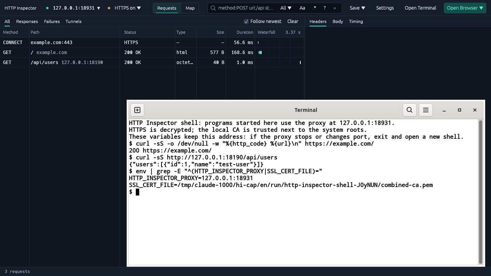
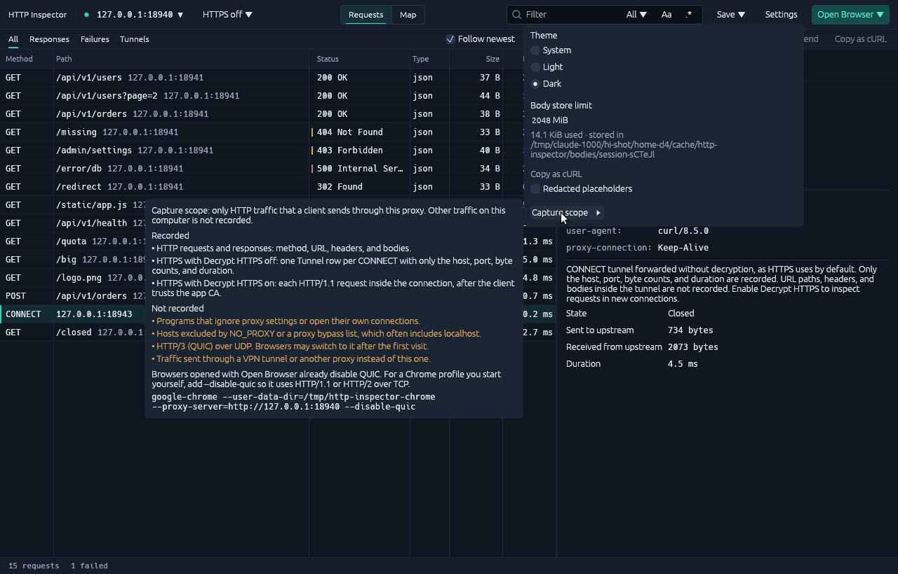

# 프록시 포트와 캡처 범위

[사용자 가이드 목록](README.md) · [README](../../README.md)

## 프록시 포트

프록시는 항상 `127.0.0.1`에서만 연결을 받는다. 포트는 다음 순서로 정한다.

1. `--port <번호>` 또는 `--port=<번호>` 명령줄 인자
2. `HTTP_INSPECTOR_PORT` 환경 변수
3. 툴바에서 마지막으로 입력해 시작에 성공한 포트(`$XDG_CONFIG_HOME/http-inspector/settings`, 없으면 `~/.config/http-inspector/settings`. macOS는 `~/Library/Application Support/http-inspector/settings`)
4. 기본값 `8080`

```bash
cargo run --release -- --port 18080
HTTP_INSPECTOR_PORT=0 cargo run --release
```

`0`은 운영체제가 비어 있는 포트를 고르게 한다. 실제 포트는 툴바 주소에 표시된다. 다른 프로그램이 포트를 쓰고 있으면 앱은 툴바 아래에 `Port 8080 is already in use; enter another port, or 0 for a free one.`처럼 한 줄로 안내한다. 프록시가 멈춘 동안 툴바의 `Port` 칸에 다른 번호를 입력하고 오른쪽의 **Start**를 눌러 다시 시작한다. 명령줄 인자와 환경 변수는 그 실행에만 적용되며 저장하지 않는다.

HTTP 요청을 확인하려면 `curl`에 프록시 주소를 지정한다.

```bash
curl --proxy http://127.0.0.1:8080 http://example.com/
```

환경 변수로 명령줄 프로그램에 프록시를 지정할 수도 있다.

```bash
http_proxy=http://127.0.0.1:8080 https_proxy=http://127.0.0.1:8080 curl http://example.com/
```

프로그램이 `NO_PROXY`를 설정하면 로컬 주소나 지정된 호스트가 프록시를 우회할 수 있다.

## 검사 터미널

툴바의 **Open Terminal**은 프록시와 CA 설정을 주입한 검사 전용 셸을 외부 터미널 창에 연다. `curl`, `wget`, Python(`requests`·`httpx`·`urllib`), Go, Rust `reqwest`, Ruby, `git`, `pip`, `npm`, `gh`, `aws` CLI처럼 표준 프록시·CA 환경 변수를 따르는 프로그램은 옵션 없이 캡처된다. 그 셸과 자식 프로세스만 영향을 받으며, 루트 권한, 시스템 CA 저장소, 방화벽 규칙, `~/.bashrc`·`~/.zshrc`는 바꾸지 않는다.

- **터미널 선택:** `$TERMINAL`, `x-terminal-emulator`, `gnome-terminal`, `konsole`, `xfce4-terminal`, `kitty`, `alacritty`, `wezterm`, `foot`, `xterm` 순서로 처음 찾은 것을 쓴다. macOS에서는 Terminal.app을 쓴다. 찾지 못하면 툴바 아래에 한 줄로 알린다.
- **변수:** `HTTP_PROXY`·`HTTPS_PROXY`·`ALL_PROXY`와 소문자 변수를 프록시 주소로 정하고, `NO_PROXY`·`no_proxy`를 지워 `localhost`의 테스트 서버도 캡처한다. 프록시 자신의 주소로 가는 요청은 프록시가 루프로 막는다. `HTTP_INSPECTOR_PROXY`에는 프록시 주소가 들어 있다.
- **HTTPS 복호화가 켜졌을 때:** 시스템 루트 CA 묶음 뒤에 로컬 공개 인증서 `root-ca.pem`을 덧붙인 `combined-ca.pem`을 만들어 `SSL_CERT_FILE`, `CURL_CA_BUNDLE`, `REQUESTS_CA_BUNDLE`, `GIT_SSL_CAINFO`, `AWS_CA_BUNDLE`, `DENO_CERT`에 지정하고, `NODE_EXTRA_CA_CERTS`에는 `root-ca.pem`을 지정한다. 시스템 루트를 유지하므로 프록시를 거치지 않는 HTTPS도 인증서 검사를 통과한다. 시스템 묶음을 찾지 못하면 로컬 CA만 담고, 셸 시작 안내에 그 사실을 한 줄로 보인다.
- **정리:** 묶음은 `$XDG_RUNTIME_DIR`(없으면 시스템 임시 디렉터리) 아래 현재 사용자 전용 `0700` 디렉터리에 `0600` 파일로 만들고, `exit`로 셸을 끝내거나 터미널 창을 닫으면 지운다. CA 개인키 파일(`ca-identity.pem`)은 열지 않고 CA를 새로 만들지도 않는다. 공개 인증서 `root-ca.pem`이 없으면 셸을 열지 않고 오류를 창에 보인 채 Enter를 기다린다. `$SHELL`을 실행하지 못했을 때도 같다.
- **주소가 바뀌면:** 이미 연 셸의 변수는 바뀌지 않는다. 셸은 시작할 때 이 사실을 안내한다. 프록시를 멈추거나 다른 포트로 다시 시작했다면 셸을 나와 **Open Terminal**로 새로 연다. 터미널 창은 앱을 끝내도 남는다.

프록시 변수를 무시하는 프로그램의 요청은 캡처되지 않는다. Go의 `net/http`는 `localhost`·`127.0.0.1` 요청에 프록시를 쓰지 않는다. 명령줄에서는 `http-proxy shell`로 같은 셸을, `http-proxy exec -- <명령>`으로 명령 하나를 실행한다. [명령줄 인터페이스](../cli.md#http-proxy-shell)

다음은 HTTPS 복호화를 켜고 **Open Terminal**로 연 셸에서 옵션 없는 `curl` 두 번을 실행한 실제 화면이다. `https://example.com/`은 복호화되어 `GET /` 행으로, 로컬 테스트 서버 요청은 `GET /api/users` 행으로 기록됐다.



## 캡처 범위

앱은 클라이언트가 이 프록시로 보낸 HTTP 통신만 기록한다. 컴퓨터의 모든 트래픽을 수집하지 않는다. 툴바 **Settings** 메뉴의 **Capture scope** 하위 메뉴에서 기록하는 것과 기록하지 않는 것의 요약을 볼 수 있다.

- HTTP는 메서드, URL, 헤더와 본문을 기록한다.
- **Decrypt HTTPS**를 끄면 HTTPS는 `Tunnel` 행으로 기록한다. 이 행에는 호스트, 포트, 전송 바이트 수와 연결 시간만 있다. URL 경로, 헤더와 본문은 암호화된 채 전달한다.
- **Decrypt HTTPS**를 켜고 클라이언트가 앱 CA를 신뢰하면 연결 안의 HTTP/1.1 요청을 하나씩 기록한다.

다음 트래픽은 기록되지 않는다.

- 프록시 설정을 무시하거나 직접 연결하는 프로그램의 통신
- `NO_PROXY`나 프록시 우회 목록에 포함된 호스트. 이 목록에는 흔히 `localhost`가 들어 있다.
- UDP를 사용하는 HTTP/3(QUIC). 브라우저는 첫 방문 뒤 HTTP/3으로 전환할 수 있다.
- 이 프록시를 거치지 않고 VPN이나 다른 프록시로 직접 보낸 통신

**Open Browser**로 연 검사 브라우저는 QUIC을 끈다. 프록시 변수를 따르지 않는 프로그램은 **Open Terminal**로 연 셸에서도 캡처되지 않는다. 직접 실행하는 Chrome에는 [HTTPS 복호화와 검사 브라우저](https.md#직접-실행한-chrome에서-http3-막기)의 예처럼 `--disable-quic`을 추가한다.

다음은 테스트용 HTTP 요청과 `CONNECT` 터널을 보낸 뒤 `Tunnel` 행을 선택하고 **Settings** 메뉴의 **Capture scope**를 펼친 실제 화면이다.


