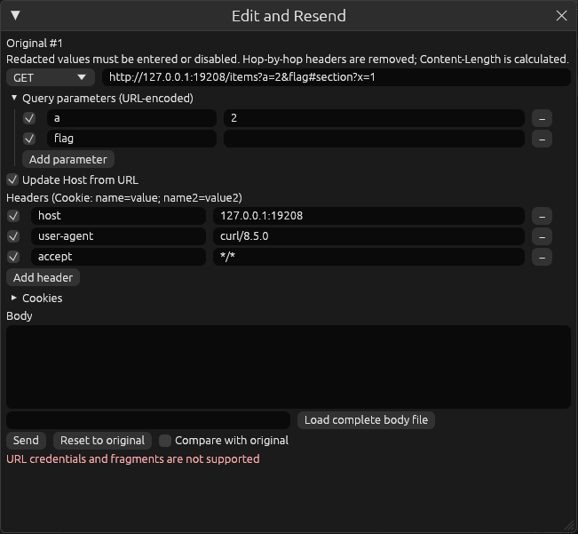
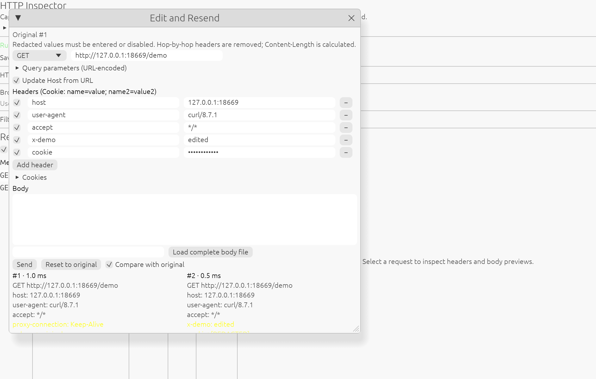

# 요청을 수정해 다시 보내기

[사용자 가이드 목록](README.md) · [README](../../README.md)

요청 목록의 우클릭 메뉴나 상세 패널에서 **Edit and Resend**를 누른다.
메서드, URL, 헤더와 본문을 수정하고 **Send**를 누르면 새 요청이 기록된다.
목록의 **Replay of #N**과 상세 패널의 링크로 원본을 찾을 수 있다.
**Compare with original**을 켜면 가장 최근 재전송과 원본의 요청, 응답 상태,
헤더, 본문 미리보기와 시간을 나란히 볼 수 있다. 다른 줄은 노란색으로 표시한다.
편집기는 전송 후에도 유지되며 **Cancel**로 진행 중인 전송을 중단할 수 있다.

쿼리 표에는 URL 인코딩한 키와 값을 입력한다. 쿠키 표는 Cookie 헤더와
동기화되며 쿠키 값은 가려서 표시한다. 쿼리·쿠키·form 표의 행을 끄면 전송에서
빠지지만 표에 남아 다시 켤 수 있다. 표를 열기만 해서는 값이 바뀌지 않으며,
수정하지 않은 행은 원문(예: 값이 없는 `flag`) 그대로 유지한다. **Update Host from URL**은 URL에 맞춰 Host를 바꾼다.
Content-Length는 본문 바이트 수로 계산하며 hop-by-hop 헤더는 전달하지 않는다.
GET, HEAD, OPTIONS 외의 메서드는 서버 상태를 바꿀 수 있다는 확인을 받아 전송한다.

쿼리 표는 URL에서 첫 `#` 앞의 쿼리만 읽는다. 그림에서 `a`를 수정해도 URL의
`#section?x=1`은 그대로 남는다. 재전송하려면 URL 입력칸에서 프래그먼트를 지운다.

가려진 민감 헤더는 빈 입력칸으로 열린다. 값을 직접 입력하거나 행을 끈다.
입력한 민감 헤더도 화면 기록과 전체 로그에는 [REDACTED]로 남는다.
원래 민감 값을 따로 보관하는 옵션은 제공하지 않는다. 편집기를 닫으면 초안을
해제하고 진행 중인 재전송을 취소한다. 메모리의 물리적 덮어쓰기를 보장하지는 않는다.

잘렸거나 끝나지 않은 본문은 **Load complete body file**로 전체 본문을 불러와야
전송할 수 있다. 바이너리 본문도 파일로 교체한다. 헤더가 생략된 기록은 재전송할 수 없다.
불러올 수 있는 파일은 16MiB까지다. 256KiB를 넘는 본문은 편집기에 넣지 않고 크기와 파일 경로만
표시하며 불러온 그대로 전송한다.
캡처 시 UTF-8이 아닌 바이트가 있어 원래 값을 재현할 수 없는 헤더는 경고와 함께
전송을 막는다. 값을 다시 입력하거나 행을 끈다.
CONNECT 터널은 대상에서 제외한다. HTTPS 재전송에는 **Decrypt HTTPS**를 켜야 한다.
본문 비교는 캡처한 미리보기 범위이며 압축 본문의 비교는 원시 바이트를 표시한다.

다음은 로컬 테스트 서버로 보낸 요청의 헤더와 쿠키를 수정해 재전송한 실제 화면이다.
비교 영역은 아래로 스크롤해 응답까지 확인할 수 있다.

