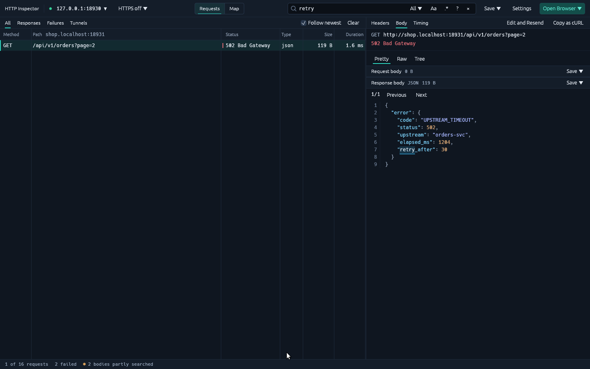

# 요청 검색

[사용자 가이드 목록](README.md) · [README](../../README.md)

툴바의 필터 입력에 단어나 필드 조건을 입력한다. Ctrl+F로 필터 입력에 포커스를 옮긴다. macOS에서는 Cmd+F를 쓴다. 필터 결과는 `1 of 8 requests`처럼 남은 건수와 전체 건수로 표시한다. **×**로 입력을 지운다.

다음은 로컬 테스트 서버로 보낸 요청 8건을 `quota`로 검색한 실제 화면이다. gzip으로 압축된 JSON 응답 본문과 JSON 요청 본문에 단어가 있는 2건만 남았고, 상태 바에 8KiB 뒤쪽을 검색하지 못한 본문 1건과 건너뛴 PNG 1건을 안내한다. 상세 패널은 응답 본문의 일치 위치를 강조하고 `Match 1 of 2`로 이동할 수 있다.

## 필드 조건

`method:POST url:/api/users status:4xx -path:/static/ token`은 모든 조건을 만족하는 요청을 남긴다. `method:GET,POST`의 쉼표는 같은 키에서 허용할 값을 나눈다. `"connection refused"`는 공백을 포함한 구절 하나를 찾는다. 큰따옴표 안에 쉼표를 쓰면 쉼표도 검색한다. 큰따옴표와 역슬래시 자체를 검색하려면 큰따옴표 안에서 각각 `\"`와 `\\`로 입력한다.

- 필드 조건의 키와 값은 대소문자를 구분하지 않는다. 키 목록은 [README의 요청 필터 표](../../README.md#요청-필터) 또는 입력 옆 **?** 메뉴에서 확인한다.
- `http://localhost:8080/api`, `localhost:8080`, `127.0.0.1:8080`처럼 URL이나 포트를 붙인 주소는 자유 검색어로 읽는다. `"tag:value"`처럼 큰따옴표를 쓰면 콜론이 포함된 일반 문구를 검색한다.
- 모르는 키나 잘못된 값에는 밑줄과 오류를 표시한다. 다른 조건은 적용한다. `body:`, `req-body:`, `res-body:`는 예약된 키다. 본문을 검색하려면 범위를 고른 뒤 자유 검색어를 입력한다.
- 상태, 크기, 시간은 `>`, `>=`, `<`, `<=`, `=`로 비교한다. 크기는 정수와 `b`, `kb`, `mb`를 쓴다. `kb`는 1,024바이트다. 시간은 정수와 `ms`, `s`를 쓴다. 단위를 생략하면 각각 바이트와 밀리초다. 시간은 완료된 요청에서 비교한다.
- `host:*.example.com`은 `api.example.com`처럼 하위 도메인을 찾는다. 포트를 지정하지 않으면 모든 포트가 일치한다.
- 헤더 조건에서 이름은 정확히 일치해야 한다. `header:accept=json`은 값에 `json`이 들어 있는 `Accept` 헤더를 찾는다. `header:accept=`는 값이 비어 있는 `Accept` 헤더를 찾는다.
- `is:failed`는 실패, 취소, 미완료를 포함한다. `is:tunnel`은 중계 터널을, `is:https`는 CONNECT와 HTTPS 요청을 찾는다.

`method:`, `host:`, `domain:`, `status:`를 입력하면 값 후보가 열린다. ↑·↓로 이동하고 Enter 또는 Tab으로 넣는다. 요청 목록의 메서드, 호스트, 상태를 우클릭하면 **Filter by value** 또는 **Exclude value**를 선택할 수 있다. 상세의 요청·응답 헤더에서도 같은 메뉴를 쓴다.

## 검색 범위와 옵션

필터 입력 오른쪽 메뉴에서 자유 검색어의 범위를 고른다. 기본값은 **All**이다.

| 범위 | 찾는 곳 |
| --- | --- |
| **All** | 메서드, URL, 요청·응답 헤더 이름과 값, 상태 코드, 실패 단계와 메시지, 결과 키워드(`pending`, `tunnel` 등), 요청 본문, 응답 본문 |
| **URL** | 요청 URL(`CONNECT`는 대상 주소) |
| **Headers** | 요청·응답 헤더 이름과 값 |
| **Request body** | 요청 본문 |
| **Response body** | 응답 본문 |

- **Aa**를 켜면 자유 검색어의 대소문자를 구분한다. 끄면(기본) ASCII 대소문자를 무시한다. `É`처럼 대소문자가 있는 비ASCII 글자가 검색어에 있으면 유니코드 대소문자도 무시한다. 한글은 대소문자가 없으므로 그대로 찾는다.
- **.\***를 켜면 입력 전체를 정규식으로 읽는다. 필드 조건과 우클릭 필터는 정규식 모드를 끈 상태에서 쓴다. 정규식은 입력 길이에 비례하는 시간에 끝나며(역추적 없음), 너무 큰 정규식이나 문법 오류는 필터 입력 오른쪽 끝에 오류로 표시하고 목록을 거르지 않는다.
- 요청 목록 위 결과 종류 탭(All·Responses·Failures·Tunnels)는 검색과 함께 적용된다.

## 본문 검색 범위

본문은 화면 미리보기와 같은 데이터, 즉 방향별 앞 8KiB를 검색한다. 세션 전체 로그는 읽지 않는다.

- `gzip`, `deflate`, `br`, `zstd` 본문은 [본문 보기](body-view.md#압축-해제)와 같은 한도(출력 8KiB, 중간 확장 64KiB, 중첩 4단계)로 압축을 푼 내용에서 찾는다.
- 8KiB보다 긴 본문, 아직 받는 중이거나 중간에 끊긴 본문은 앞부분만 검색된다. 검색어를 찾지 못한 요청 중 이런 본문이 있으면 상태 바에 `3 only in their first 8 KiB`처럼 건수를 표시한다. `-token`처럼 제외한 단어도 같은 미리보기에서 확인한다. 뒤쪽 내용이 필요하면 [전체 로그와 본문 저장소의 한도](logs.md)를 확인한다.
- 이미지·오디오·비디오·폰트와 `application/octet-stream`, `pdf`, `zip`, `gzip`, `wasm`, `protobuf`, `grpc`, `msgpack`, `cbor` 등 바이너리 `Content-Type` 본문은 검색하지 않는다. `image/svg+xml`은 텍스트로 검색한다. 형식을 알 수 없는 본문은 압축을 푼 앞 1KiB에 NUL 바이트가 있으면 바이너리로 본다. 건너뛴 본문과 압축을 풀 수 없던 본문의 건수도 같은 경고에 표시한다.

## 진행 상태와 응답성

필드 조건은 입력과 함께 적용된다. 자유 검색어는 입력을 멈추고 150ms 뒤 별도 스레드에서 검색한다. 본문 압축 해제도 같은 스레드에서 실행한다. 검색 중에는 `Searching… 800 / 2000`처럼 진행 상태를 표시한다.

- 새 요청이 들어오면 그 요청만 추가로 검사한다. 응답 본문이 아직 오는 중인 요청은 받기가 끝나면 다시 검사한다.
- 자유 검색어를 더 구체적으로 바꾸면 이전에 일치한 요청만 다시 검사할 수 있다. 검색 범위나 옵션을 바꾸면 전체를 다시 검사한다.
- 압축을 푼 본문은 받기가 끝난 요청에 한해 검색 스레드에 보관해 다음 검색에서 다시 풀지 않는다. 보관량은 화면 기록 2,000건 × 방향별 8KiB 이하다.

## 일치 위치 강조

검색 중에 요청을 선택하면 상세 패널에서 일치한 부분의 배경을 칠한다.

- **Headers** 탭: URL, 헤더 이름과 값(범위가 All·URL·Headers일 때)
- **Body** 탭: Pretty·Raw 보기의 본문(범위가 All 또는 해당 본문일 때). 본문 위에 `Match 2 of 5`와 **◀ Previous**·**Next ▶** 버튼이 나타나고, 현재 위치는 더 진한 색으로 표시하며 그 위치로 스크롤한다. Pretty는 정리한 텍스트에서 다시 찾으므로 정리로 공백이 바뀐 곳은 건수가 목록 검색과 다를 수 있다. 줄 번호가 있는 보기(CSS·JavaScript)는 줄을 넘는 일치를 표시하지 않는다. Tree 보기는 강조하지 않는다.

## 보안과 전달

- 검색은 목록에 보이는 요청만 바꾼다. 프록시 전달 바이트와 전체 로그 기록은 바꾸지 않는다.
- `Authorization`, `Proxy-Authorization`, `Cookie`, `Set-Cookie` 값은 기록 전에 `[REDACTED]`로 바뀌므로 원래 값으로는 찾을 수 없다.
