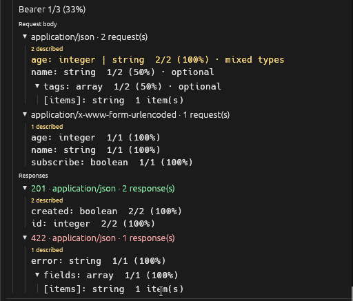
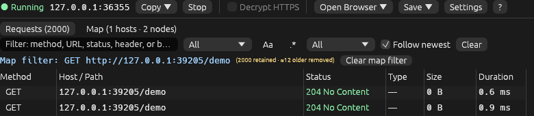

# URL 맵과 관계 그래프

[사용자 가이드](README.md)로 돌아가기

**Map** 화면은 캡처한 HTTP·HTTPS 트래픽을 호스트와 경로 계층으로 묶고, 요청 간 호출·리다이렉트 관계를 실시간으로 보여 준다. 왼쪽 패널 머리줄의 **Tree**·**Graph** 탭으로 보기를 바꾸고, 오른쪽의 **Export ▼**와 **Clear**로 맵을 내보내거나 비운다.

## 트리 보기 (Tree)

- **정규화와 계층:** `scheme://host:port`를 루트로 두고 경로 세그먼트를 자식으로 쌓는다. 호스트 대소문자와 기본 포트(`:80`, `:443`)는 합치고, 퍼센트 인코딩은 화면에 표시할 때만 푼다.
- **행:** 각 행은 24pt 높이이고 깊이마다 16pt 들여쓰며 상위 단계의 세로 가이드선을 그린다. 오른쪽 끝에는 3rd-party·터널 표시, 메서드, 오류 수(`2 err`, 4xx·5xx·실패를 합친 수), 요청 수(`8 req`)를 열을 맞춰 보여 준다. 행에 마우스를 올리면 상태 구간별 건수를 툴팁으로 보여 준다.
- **동적 ID 접기 (`Fold IDs`):** 같은 부모 아래 정수, UUID, 16진수(8자 이상), 혼합 불투명 ID가 2개 이상 나타나면 `/{id}` 노드로 묶어 보여 준다. 필터 줄의 **Fold IDs** 토글을 끄면 원본 세그먼트로 되돌아간다.
- **터널:** 복호화하지 않은 HTTPS(`CONNECT` 터널)는 호스트 노드만 만들고 행에 `Tunnel`, 상세 패널에 `No path info`로 표시한다.
- **필터·정렬·탐색:** 머리줄 아래 필터 줄에서 호스트 검색(**Filter hosts**), 상태(`2xx`/`3xx`/`4xx`/`5xx`/실패), Content-Type, 1st/3rd-party 메뉴와 **Sort** 메뉴(이름·요청 수·오류 수·크기), 정렬 방향 버튼, **Expand all**·**Collapse all**을 쓴다. `↑`/`↓`/`←`/`→` 키로 트리를 탐색하며, 펼침 상태는 새 요청이 들어와도 유지된다.
- **요청 목록 연동:** 노드를 선택하면 오른쪽 상세 패널 머리줄에 노드 URL과 **Show in Requests**가 보이고, 아래에 **Summary**, **Endpoints**, **Query names**, **Requests** 묶음이 열린다. 묶음 제목을 누르면 접고 펼친다. **Show in Requests**를 누르면 해당 경로 접두사로 필터된 Requests 화면으로 이동하며, 화면 보관 한도(2,000건)에서 밀려난 건수가 있으면 함께 안내한다. **Requests** 묶음의 행을 누르면 그 요청을 Requests 화면에서 연다.

## 엔드포인트 구조 (Endpoints)

경로 노드를 선택하면 오른쪽 상세 패널의 **Endpoints** 묶음에 그 경로로 끝나는 요청의 구조를 메서드별로 보여 준다. 정확히 그 경로로 온 요청에서 추론한 구조이며, 값은 표시하지 않고 이름, 타입·형식, 등장 비율만 보여 준다.

- **메서드별 묶음:** 같은 경로의 `GET`과 `POST`는 따로 집계한다. 하위 경로 요청은 포함하지 않는다.
- **경로·쿼리 매개변수:** 접힌 `{id}` 세그먼트에서 관찰한 ID 형식(정수, UUID 등)과 쿼리 이름별 등장 비율(`2/3 (66%)`), 관찰한 타입을 보여 준다.
- **헤더·인증:** 표준 헤더와 인증 헤더를 뺀 사용자 정의 요청 헤더 이름, 그리고 `Bearer`·`Basic`·`Cookie`·`API Key` 같은 인증 방식 이름만 보여 준다.
- **요청·응답 본문:** 요청 본문은 Content-Type별로, 응답 본문은 상태 코드와 Content-Type별로 묶는다. JSON과 폼은 필드를 펼쳐 볼 수 있으며, 일부 샘플에만 있는 필드는 `optional`, `null`이 관찰된 필드는 `nullable`, 여러 타입이 섞인 필드는 `mixed types`로 표시한다. 멀티파트는 파트 이름, 파일 여부, Content-Type만 보여 준다.
- **근거:** 집계한 요청 수와 본문 샘플 수, 잘림·크기 초과·압축 해제 실패로 제외한 본문 수를 표시한다. 제외한 본문이 있으면 경고 색으로 표시한다. 샘플이 적으면 한 번만 본 필드가 선택 사항인지 알 수 없으니 등장 비율을 함께 본다. 모든 샘플에 나타난 필드도 서버가 필수로 요구하는지는 캡처만으로 알 수 없으므로 비율로만 표시한다.
- **ID 접기:** `Fold IDs`로 `/users/101`과 `/users/202`를 `/users/{id}`로 접으면 두 경로의 엔드포인트 집계도 합쳐진다.
- **요청 목록 연동:** **Show GET in Requests**처럼 메서드별 버튼을 누르면 그 메서드와 정확한 경로에 속한 보관 중인 요청만 Requests 화면에 표시한다. 요청이 목록에서 밀려난 뒤에는 스키마 분석에 포함된 기록을 기준으로 제거 건수를 추정한다.

본문 분석은 응답이 끝난 뒤 별도 스레드에서 처리하므로 프록시 전달과 화면 갱신을 막지 않는다. 본문 미리보기에 모두 남지 않은 본문은 본문 저장소에서 읽는다. 온전히 읽을 수 있는 본문만 구조 집계에 사용하며, 압축을 푼 크기가 1MiB를 넘는 본문은 제외한다. 필드는 본문 묶음마다 256개, 중첩은 8단계까지 집계하고, ID처럼 보이는 JSON 키는 `{id}` 하나로 묶는다.

## 관계 그래프 (Graph)

- `Referer`(실선), `Origin`(CORS, 3-3 점선), `Location` 3xx 리다이렉트(짧은 점선) 헤더에서 도메인 간 호출 관계를 추출해 힘-방향 배치로 그린다.
- 평소 노드와 선은 흐린 테두리색으로 누르고, 마우스를 올린 도메인과 Tree에서 고른 노드의 도메인, 그 도메인에 닿는 선만 청록색 실선으로 강조한다.
- Public Suffix List(eTLD+1)로 1st-party(실선 테두리)와 3rd-party(점선 테두리)를 구분한다. 노드에 마우스를 올리면 사이트, 1st/3rd-party, 요청·오류 수, 크기, 선 수를 툴팁으로 보여 준다.
- 머리줄의 **Edges ▼** 메뉴에서 선 종류별 표시를 켜고 끄며, 같은 메뉴에 선과 노드 테두리 견본이 있다. **Top 40 domains ▼**로 표시할 도메인 수를, **Relayout**으로 배치를 다시 계산한다. 표시 중인 도메인·선 수는 상태 바에 보이고, 도메인 한도에 걸려 일부를 숨기면 경고 점과 함께 `top 40 of 52 domains`처럼 표시한다.
- 노드를 드래그해 배치할 수 있으며, 클릭하면 Tree 보기에서 해당 호스트로 이동한다.

## 내보내기 (Export)

패널 머리줄의 **Export ▼** 메뉴에서 트리 텍스트(`.txt`), 구조화 JSON(`.json`), Mermaid(`.mmd`), Graphviz DOT(`.dot`) 파일로 저장하거나 Mermaid/DOT 텍스트를 클립보드에 복사할 수 있다. 파일은 기존 **Save directory**에 덮어쓰지 않고 저장한다.

## 보안과 메모리 한도

- **쿼리 값 비보관:** URL 맵, 오른쪽 상세 패널, 내보낸 파일 어디에도 쿼리 매개변수 **값**은 저장하거나 표시하지 않는다. 매개변수 **이름**과 등장 횟수만 집계한다.
- **값 비보관(엔드포인트 구조):** 쿼리 값, 헤더 값, 쿠키 값, 인증 정보 원문, 본문 필드 값은 타입을 판정할 때만 읽고 저장하지 않는다. 엔드포인트 집계에는 이름, 타입·형식, 횟수만 남는다.
- **노드 상한:** 기본 50,000노드 상한에 도달하면 새 하위 경로를 가장 가까운 상위 노드로 합치고 상태 표시줄에 안내한다.
- **보관 범위:** 화면 요청 목록(2,000건)에서 오래된 기록이 밀려나도 **Clear**를 누르기 전까지 맵과 엔드포인트 구조의 누적 집계는 유지된다.
- **엔드포인트 상한:** 세션마다 엔드포인트(경로·메서드) 20,000개까지 집계한다. 엔드포인트마다 쿼리 이름·헤더 이름 64개와 본문 묶음 32개까지 집계하며, 넘친 이름과 묶음 수를 상세 패널에 표시한다. 분석 대기열(4,096건)이 가득 찼거나 아직 진행 중인 요청이 목록에서 밀려나면 해당 요청을 건너뛴다. 상세 패널에는 건너뛴 요청 수도 표시한다.
